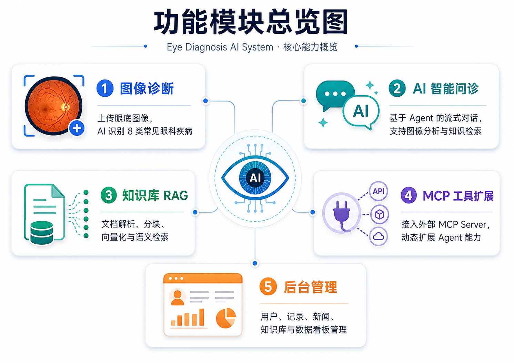
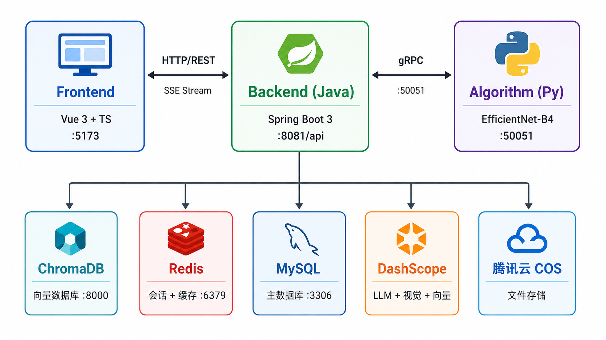
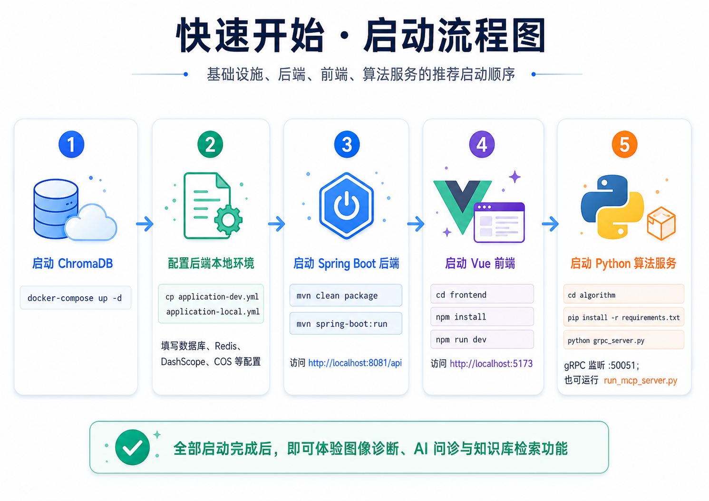
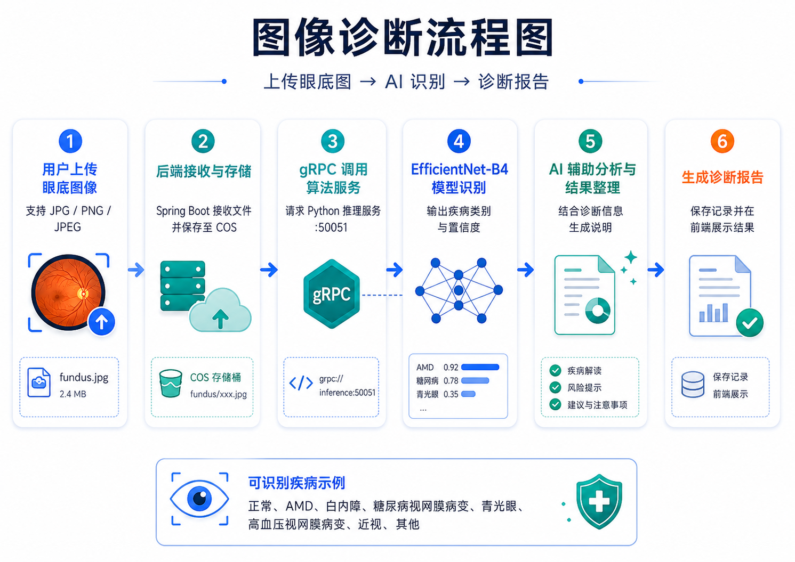
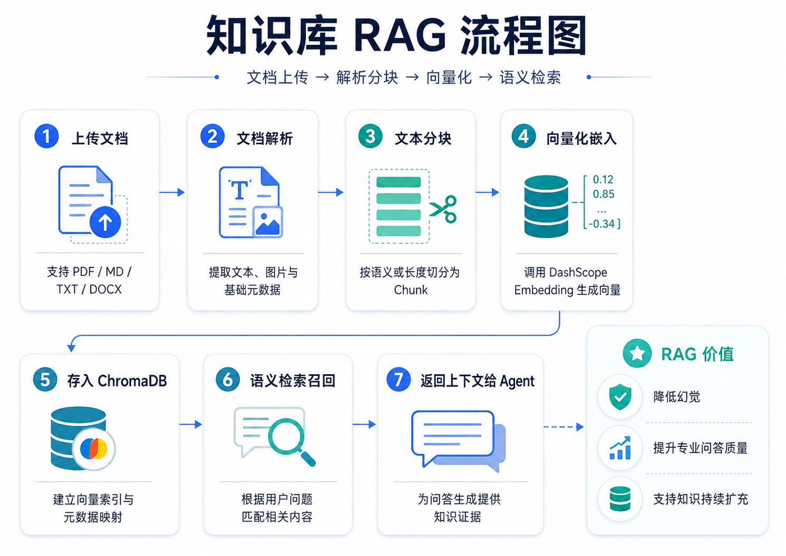
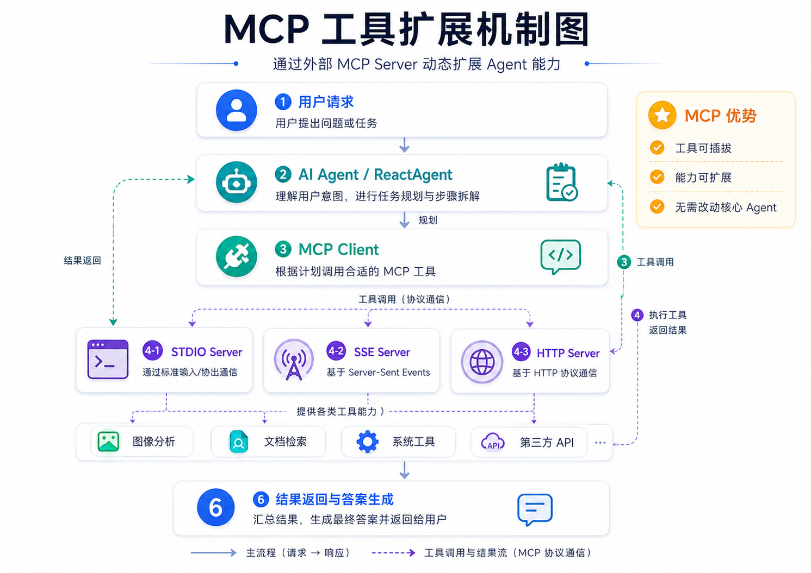
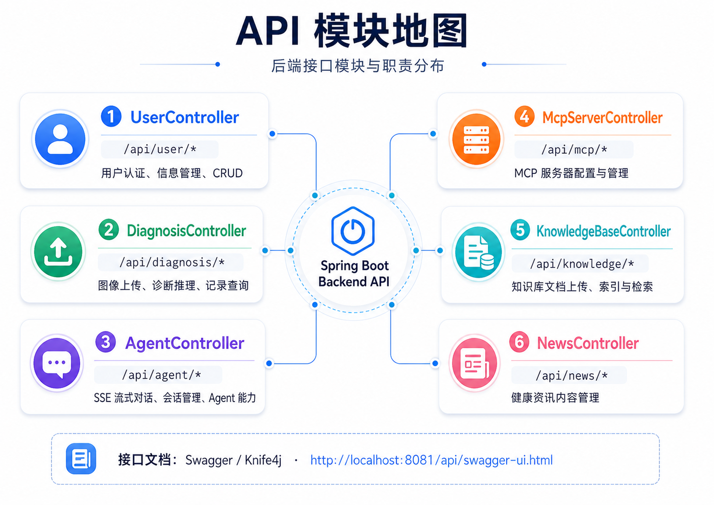
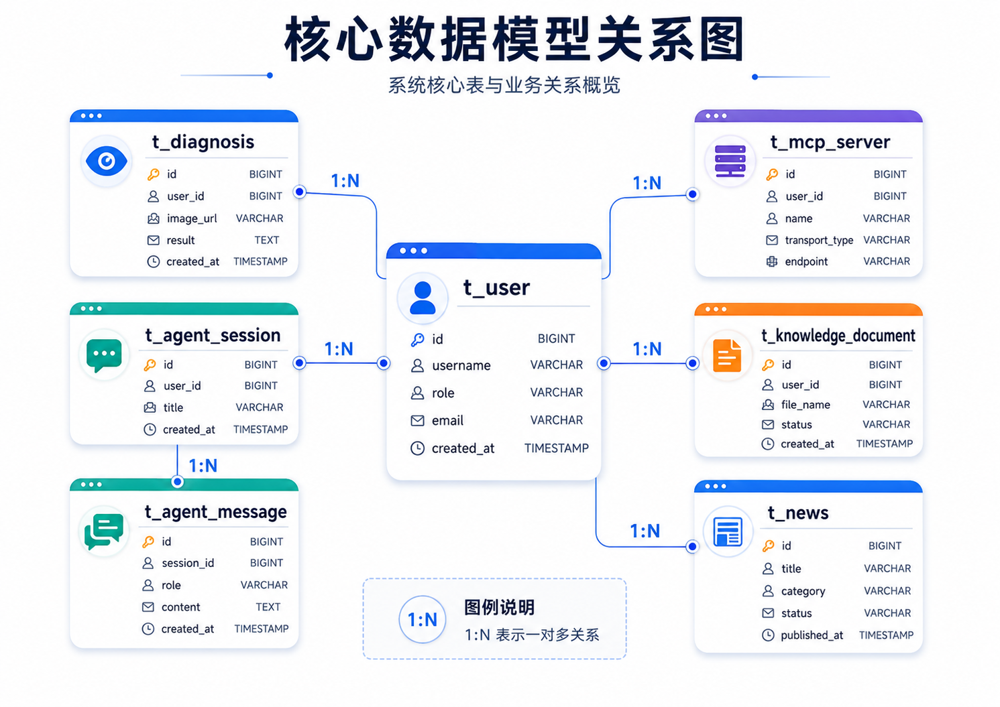

# Eye Diagnosis AI System · 眼科智能诊断系统

> 基于深度学习的眼科疾病智能诊断系统。通过分析眼底图像，利用 EfficientNet-B4 模型识别 **8 种常见眼科疾病**，并提供 **AI 智能问诊**、**知识库 RAG 检索** 与 **MCP 工具扩展** 能力。



## ✨ 功能特性

- 🩺 **图像诊断**：上传眼底图像（`JPG / PNG / JPEG`），AI 自动识别 8 种眼科疾病 —— 正常、AMD、白内障、糖尿病视网膜病变、青光眼、高血压视网膜病变、近视、其他
- 💬 **AI 智能问诊**：基于 Spring AI `ReactAgent` 的流式对话（SSE），支持工具调用（图像分析、文档检索）
- 📚 **知识库 RAG**：支持上传 `PDF / MD / TXT / DOCX` 文档，自动解析、分块、向量化、语义检索
- 🔌 **MCP 工具扩展**：支持用户配置外部 MCP 工具服务器（`STDIO / SSE / HTTP`），动态扩展 Agent 能力而无需改动核心
- 🛠 **后台管理**：用户、诊断记录、新闻、知识库与数据看板的一体化管理

## 🏗 系统架构



**核心交互链路**：

| 角色 | 技术栈 | 端口 |
|------|--------|------|
| Frontend | Vue 3 + TypeScript + Vite + Ant Design Vue 4 + Tailwind CSS v4 | `:5173` |
| Backend (Java) | Spring Boot 3.5.6 + Spring AI 1.1.2 + MyBatis Plus 3.5.12 | `:8081/api` |
| Algorithm (Py) | PyTorch + EfficientNet-B4 + gRPC + MCP | `:50051` |

**后端依赖服务**：

- 🟢 **ChromaDB** —— 向量数据库（`:8000`）
- 🔴 **Redis** —— Session + 缓存（`:6379`）
- 🔵 **MySQL** —— 主数据库（`:3306`）
- 🟠 **DashScope** —— 阿里云 LLM + 视觉 + 文本嵌入
- 🟣 **腾讯云 COS** —— 文件存储

## 🚀 快速开始



### 环境要求

- ☕ Java 21+
- 🟢 Node.js 18+
- 🐍 Python 3.10+
- 🐬 MySQL 8.0+
- 🧠 Redis 7+
- 🐳 Docker（用于 ChromaDB）

### 1️⃣ 启动基础设施

```bash
# 启动 ChromaDB 向量数据库
docker-compose up -d
```

### 2️⃣ 配置后端本地环境

```bash
# 复制开发配置为本地配置（不提交到 Git）
cp src/main/resources/application-dev.yml src/main/resources/application-local.yml
# 编辑 application-local.yml，填入数据库、Redis、DashScope、COS 等配置
```

### 3️⃣ 启动 Spring Boot 后端

```bash
mvn clean package
mvn spring-boot:run    # 访问 http://localhost:8081/api
```

### 4️⃣ 启动 Vue 前端

```bash
cd frontend
npm install
npm run dev            # 访问 http://localhost:5173
```

### 5️⃣ 启动 Python 算法服务

```bash
cd algorithm
pip install -r requirements.txt

# 先从唯一 Proto 源生成 Python 绑定
python generate_proto.py

# 方式一：gRPC 服务（供后端直接调用）
# 必填：MODEL_WEIGHTS_PATH、MODEL_WEIGHTS_SHA256、MODEL_REGISTRY_PATH
# 可选：MODEL_CALIBRATION_PATH、INFERENCE_POLICY_VERSION（默认 medical-safety-v2）
python grpc_server.py  # 监听 :50051

# 方式二：MCP 服务（供 Agent 通过 MCP 协议调用）
python run_mcp_server.py
```

> ✅ 全部启动完成后，即可体验图像诊断、AI 问诊与知识库检索功能

### 推理安全状态

- 推理缓存仅在图片哈希、模型版本、权重 SHA-256、预处理版本和安全策略版本全部一致时复用；并发写入采用原子 UPSERT。
- 当前 OOD 状态为 `NOT_EVALUATED`，不表示图片已被确认属于训练分布。
- 当前温度配置为 `1.0` 且状态为 `NOT_CALIBRATED`；界面显示的是模型置信分数，不是诊断可靠性或医学结论。
- 数据库升级使用 Flyway。现有已应用 V8 的数据库在升级前须遵循 [Flyway 迁移历史计划](docs/flyway-migration-history-plan.md)。

## 🩺 核心功能详解

### 1. 图像诊断流程



**6 步流水线**：`上传 → 存储 → gRPC 推理 → 模型识别 → 辅助分析 → 生成报告`

- 用户上传眼底图像至 Spring Boot
- 文件保存到 **腾讯云 COS**
- 后端通过 gRPC 调用 Python 推理服务
- EfficientNet-B4 输出 **疾病类别 + 置信度**
- AI 辅助整理诊断信息（疾病解读 / 风险提示 / 建议）
- 保存记录并在前端展示诊断结果

### 2. 知识库 RAG



**7 步流水线**：`文档上传 → 解析 → 分块 → 向量化 → 入库 → 语义检索 → 返回上下文`

- 支持 `PDF / MD / TXT / DOCX`
- 提取文本、图片与基础元数据后按语义/长度切分
- 调用 DashScope Embedding 生成向量，存入 ChromaDB
- 检索时根据用户问题匹配相关内容，作为上下文返回给 Agent

**RAG 价值**：降低幻觉、提升专业问答质量、支持知识持续扩充

### 3. MCP 工具扩展机制



**主流程 + 工具调用双通道**：

1. 用户请求 → AI Agent / ReactAgent 理解意图并规划
2. MCP Client 根据计划调用合适的 MCP 工具
3. 通过 **STDIO / SSE / HTTP** 三种协议之一与外部 MCP Server 通信
4. 工具执行后返回结果，Agent 汇总生成最终答案

**MCP 优势**：工具可插拔、能力可扩展、无需改动核心 Agent

## 📡 API 文档



后端启动后访问 Knife4j 文档：<http://localhost:8081/api/swagger-ui.html>

| # | Controller | 路径前缀 | 职责 |
|---|------------|----------|------|
| 1 | `UserController` | `/api/user/*` | 用户认证、信息管理、CRUD |
| 2 | `DiagnosisController` | `/api/diagnosis/*` | 图像上传、诊断推理、记录查询 |
| 3 | `AgentController` | `/api/agent/*` | SSE 流式对话、会话管理、Agent 能力 |
| 4 | `McpServerController` | `/api/mcp/*` | MCP 服务器配置与管理 |
| 5 | `KnowledgeBaseController` | `/api/knowledge/*` | 知识库文档上传、索引与检索 |
| 6 | `NewsController` | `/api/news/*` | 健康资讯内容管理 |

## 🗄 数据库设计



MySQL 数据库名 `diagnosis`，schema 以 `src/main/resources/db/migration/` 下的 Flyway 迁移脚本为唯一权威来源（新库基线表由 `src/main/resources/db/callback/` 提供），应用启动时自动执行；已应用的迁移脚本不得再修改。

**以 `t_user` 为中心的 7 张核心表**（均为 `1:N` 一对多关系）：

- `t_user` — 用户
- `t_diagnosis` — 诊断记录
- `t_agent_session` / `t_agent_message` — Agent 会话与消息
- `t_mcp_server` — MCP 服务器配置
- `t_knowledge_document` — 知识库文档
- `t_news` — 健康资讯

## 📁 项目结构

```
eye-diagnosis/
├── src/                    # Java 后端（Spring Boot）
│   └── main/java/com/csust/eyediagnosis/
│       ├── agent/          # AI Agent 系统（ReactAgent、MCP、RAG、工具）
│       ├── controller/     # REST 控制器（6 个）
│       ├── service/        # 业务逻辑层
│       ├── mapper/         # MyBatis Plus 数据访问层
│       ├── model/          # 实体、DTO、VO、枚举
│       ├── grpc/           # gRPC 客户端（调用 Python 算法服务）
│       ├── config/         # Spring 配置类
│       └── ...
├── frontend/               # Vue 3 前端
│   └── src/
│       ├── pages/          # 页面组件
│       ├── components/     # 通用组件
│       ├── stores/         # Pinia 状态管理
│       ├── api/            # API 调用层（OpenAPI 自动生成）
│       ├── composables/    # 组合式函数
│       └── ...
├── algorithm/              # Python 算法服务
│   ├── eye_disease_model.py    # EfficientNet-B4 模型定义
│   ├── grpc_server.py          # gRPC 推理服务
│   ├── mcp_server/             # MCP 工具服务
│   ├── train_model.py          # 模型训练脚本
│   └── diagnosis.proto         # Protobuf 定义
├── docs/                   # 设计文档与配图资源
├── docker-compose.yml      # ChromaDB 服务
└── pom.xml                 # Maven 构建配置
```

## 📜 许可证

本项目由长沙理工大学开发，仅供学习和研究使用。**本系统仅作为辅助诊断工具，不能替代专业医生的诊断。**
