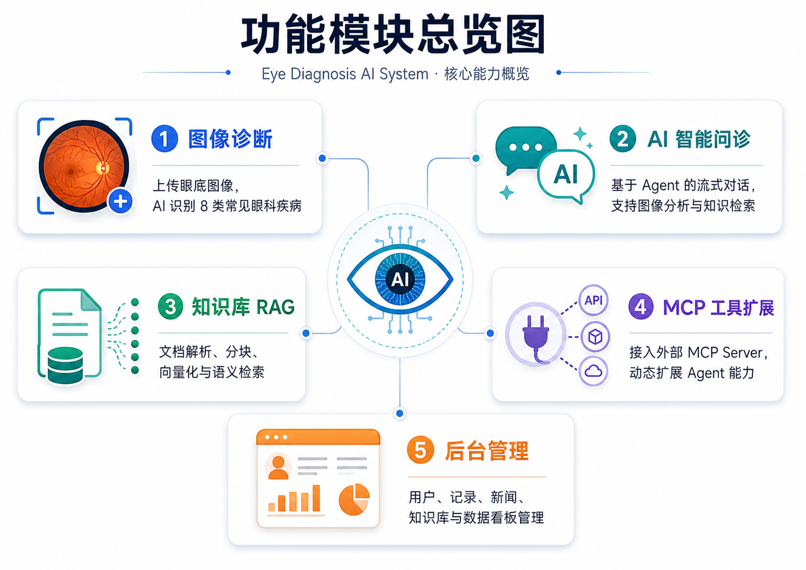
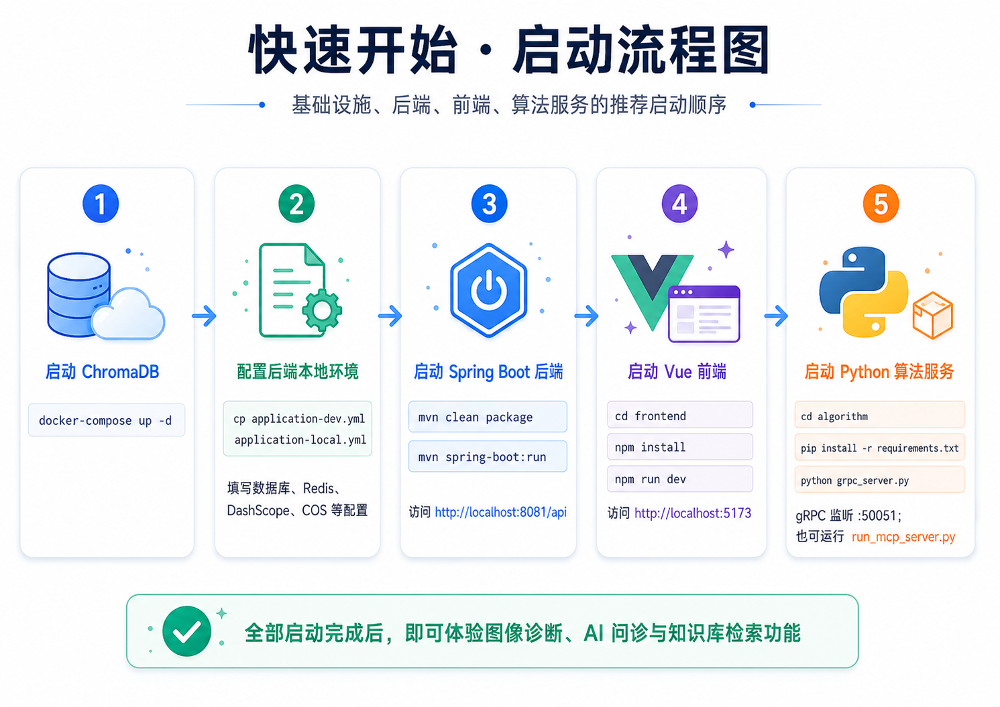
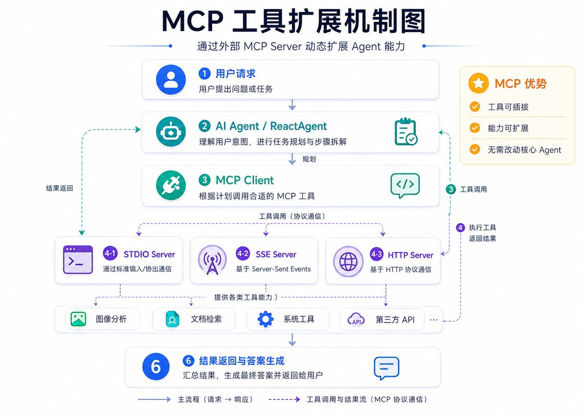
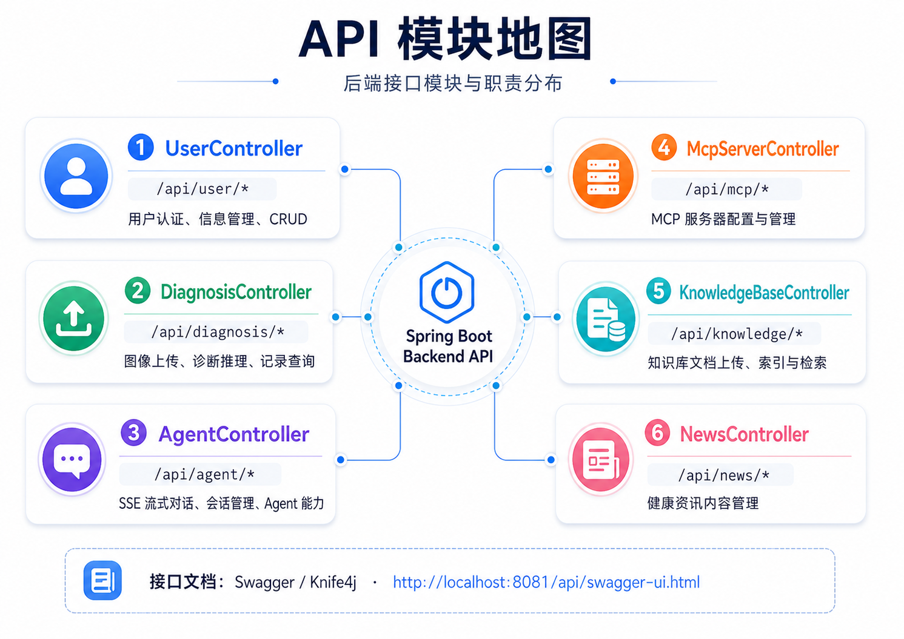

# Iris · 眼科智能诊断系统

> 基于深度学习的眼科疾病智能诊断系统。通过分析眼底图像，利用 EfficientNet-B4 模型识别 **8 种常见眼科疾病**，并提供 **多模态 Agent 问诊**、**知识库 RAG 检索**、**MCP 工具扩展** 与 **多 Agent 协作基础设施**（默认关闭）。

[](https://github.com/yuwen773/eyes-diagnosis/releases)
[](LICENSE)




## 📦 当前版本

**v1.1.0**（2026-11-20）· [GitHub Release](https://github.com/yuwen773/eyes-diagnosis/releases/tag/v1.1.0) ·
[发布说明](docs/release/v1.1.0-release-notes.md)

本版本是**开源代码与工程版本**，不是生产部署，也不是医疗器械或临床产品：

- 临床能力未经验证，所有临床相关生产开关保持关闭；
- 多 Agent 协作基础设施随版本发布，但前后端开关默认关闭；
- 对象存储当前使用腾讯云 COS 作为过渡方案，后续计划迁移到自建 S3 兼容存储。

## ✨ 功能特性

- 🩺 **图像诊断**：上传眼底图像（`JPG / PNG / JPEG`），AI 自动识别 8 种眼科疾病 —— 正常、AMD、白内障、糖尿病视网膜病变、青光眼、高血压视网膜病变、近视、其他
- 💬 **多模态 Agent 问诊**：基于 Spring AI Alibaba `ReactAgent` 的 SSE 流式对话，工具状态、工具结果与结构化资源可回放；含工具调用预算与失败语义护栏
- 📚 **知识库 RAG**：支持 `PDF / MD / TXT / DOCX`，解析、分块、向量化后存 ChromaDB；默认启用向量 + BM25 混合检索与 `gte-rerank-v2` 重排，按服务端索引版本准入
- 🔌 **MCP 工具扩展**：用户可配置远端 MCP 服务器（SSE / Streamable HTTP），动态扩展 Agent 能力而无需改动核心；用户配置禁止 STDIO 本地进程
- 🛠 **后台管理**：用户、诊断记录、新闻、知识库与数据看板的一体化管理
- 🧠 **多 Agent 协作（默认关闭）**：持久领域事件、图执行、授权快照、SSE 订阅与取消；需同时打开后端 `eye-diagnosis.collaboration.*` 与构建期 `VITE_COLLABORATION_ENABLED`

## 🏗 系统架构


> 本 README 描述的是 **Java 线**（`master` 分支）。仓库里另有一条独立的 **Python 后端线**（FastAPI + worker），在 `feature/python-backend` 分支，与本分支不再互相合并；两条线各自维护一份 `frontend/` 与算法代码。约定见 [docs/backend-split.md](docs/backend-split.md)。

**核心交互链路**：

| 角色 | 技术栈 | 端口 |
|------|--------|------|
| **前端（产品）** | React 19 + TypeScript + Vite + Tailwind v4 —— 代码在 `web/` | `:5173` |
| 前端（已弃用） | Vue 3 + TypeScript + Vite + Ant Design Vue 4 + Tailwind CSS v4 —— 代码在 `frontend/`（deprecated） | `:5173` |
| Backend (Java) | Spring Boot 3.5.6 + Spring AI 1.1.2 + Spring AI Alibaba 1.1.2.2 + MyBatis Plus 3.5.12 | `:8081/api` |
| Algorithm (Py) | PyTorch + EfficientNet-B4 + gRPC + MCP | `:50051` |

**后端依赖服务**：

- 🟢 **ChromaDB** —— 向量数据库（`:8000`）
- 🔴 **Redis** —— Session + 缓存（`:6379`）
- 🔵 **MySQL 8** —— 主数据库（`:3306`）
- 🟠 **DashScope** —— 阿里云 LLM + 视觉 + 文本嵌入 + 重排
- 🟣 **腾讯云 COS** —— 文件存储（过渡方案）

## 🚀 快速开始



### 环境要求

- ☕ Java 21+
- 🟢 Node.js 20+
- 🐍 Python 3.10+
- 🐬 MySQL 8.0+
- 🧠 Redis 7+
- 🐳 Docker（用于 ChromaDB）

### 1️⃣ 启动基础设施

```bash
# 启动 ChromaDB 向量数据库
docker compose up -d
```

### 2️⃣ 配置后端本地环境

```bash
# 复制开发配置为本地配置（不提交到 Git）
cp src/main/resources/application-dev.yml src/main/resources/application-local.yml
# 编辑 application-local.yml，填入数据库、Redis、DashScope、COS 等配置
```

### 3️⃣ 启动 Spring Boot 后端

```bash
mvn clean package
mvn spring-boot:run    # 需 JDK 21；访问 http://localhost:8081/api
```

### 4️⃣ 启动前端

**产品前端（React，推荐）**：

```bash
cd web
npm install
npm run dev            # 访问 http://localhost:5173，/api 代理到 :8081
```

`web/` 自 2026-11-10 起由 `git subtree` 纳入本仓库（原独立仓库 `eyes-diagnosis-web` 已归档）。
门禁：`npm run typecheck && npm run test && npm run build && npm run lint`
（CI 里是根 `verify.yml` 的 `web` job；`web/.github/` 下的工作流不会被执行）。

**Vue 线（已弃用 / deprecated，仅作回溯参考）**：

> `frontend/` 自 2026-11-10 起停止开发，不再是产品前端、也不作为设计参考。
> 新功能与修复一律进 `web/`；保留它只是为了能回看旧实现。

### 5️⃣ 启动 Python 算法服务

```bash
cd algorithm
pip install -r requirements.txt

# 先从唯一 Proto 源生成 Python 绑定
python generate_proto.py

# 方式一：gRPC 服务（供后端直接调用）
# 必填：MODEL_WEIGHTS_PATH、MODEL_WEIGHTS_SHA256、MODEL_REGISTRY_PATH
# 可选：MODEL_CALIBRATION_PATH、INFERENCE_POLICY_VERSION（默认 medical-safety-v2）
python grpc_server.py  # 监听 :50051

# 方式二：MCP 服务（供 Agent 通过 MCP 协议调用）
python run_mcp_server.py
```

> ✅ 全部启动完成后，即可体验图像诊断、AI 问诊与知识库检索功能

### 推理安全状态

- 推理缓存仅在图片哈希、模型版本、权重 SHA-256、预处理版本和安全策略版本全部一致时复用；并发写入采用原子 UPSERT。
- 当前 OOD 状态为 `NOT_EVALUATED`，不表示图片已被确认属于训练分布。
- 当前温度配置为 `1.0` 且状态为 `NOT_CALIBRATED`；界面显示的是模型置信分数，不是诊断可靠性或医学结论。
- 数据库升级使用 Flyway，当前最高迁移为 **V29**。已应用迁移的数据库升级前须遵循 [Flyway 迁移矩阵](docs/architecture/migration-matrix.md)；已应用的迁移脚本不得再修改。

## 🧪 验证与 CI 门禁

CI 定义在 `.github/workflows/verify.yml`，覆盖编译、后端单测、MySQL 集成门禁、Flyway、Python、watchdog、文档契约、前端单测 / Lint / 构建与 Playwright 浏览器契约。

本地复现：

| 检查 | 命令 | 说明 |
|---|---|---|
| 后端全量 | `scripts/verify.sh` | 自带一次性 MySQL 8 + Redis，跑完整 `mvn test` 后自动清理 |
| 前端门禁 | `cd web && npm run typecheck && npm run test && npm run build && npm run lint` | TypeScript / Vitest / Vite / ESLint |
| 文档契约 | `python3 scripts/check_design_doc.py` / `check_steering_docs.py` / `check_probability_scale.py` | 设计文档、迁移与控制器、概率刻度 |
| 门禁自测 | `python3 -m unittest discover -s scripts/tests -p "test_check_*.py"` | 报告门禁的单测 |
| 跳过检查 | `python3 scripts/check_surefire_skips.py target/surefire-reports backend-unit` | 契约见脚本内的 `CONTRACTS` |

Maven 的 `Assumptions` 跳过会让 `mvn test` 显示 **BUILD SUCCESS**，所以 `backend-unit` 单独跑跳过门禁；契约里记录每个 opt-in 套件的精确用例数，新增或删除用例都要同步改契约。

## 🩺 核心功能详解

### 1. 图像诊断流程


**6 步流水线**：`上传 → 存储 → gRPC 推理 → 模型识别 → 辅助分析 → 生成报告`

- 用户上传眼底图像至 Spring Boot
- 文件保存到对象存储（当前为腾讯云 COS，过渡方案）
- 后端通过 gRPC 调用 Python 推理服务
- EfficientNet-B4 输出 **疾病类别 + 置信度**
- AI 辅助整理诊断信息（疾病解读 / 风险提示 / 建议）
- 保存记录并在前端展示诊断结果

### 2. 知识库 RAG


**7 步流水线**：`文档上传 → 解析 → 分块 → 向量化 → 入库 → 检索 → 返回上下文`

- 支持 `PDF / MD / TXT / DOCX`
- 提取文本、图片与基础元数据后按语义/长度切分
- 调用 DashScope Embedding 生成向量，存入 ChromaDB
- 检索默认使用向量 + BM25 混合检索（RRF 融合）与 `gte-rerank-v2` 重排
- 每次文档处理生成服务端索引版本（V29 `indexVersion`），检索只接纳「已就绪 + 当前版本」的片段

**RAG 价值**：降低幻觉、提升专业问答质量、支持知识持续扩充

### 3. MCP 工具扩展机制



**主流程 + 工具调用双通道**：

1. 用户请求 → AI Agent / ReactAgent 理解意图并规划
2. MCP Client 根据计划调用合适的 MCP 工具
3. 通过 **SSE / Streamable HTTP** 与远端 MCP Server 通信（用户配置禁止 STDIO 本地进程）
4. 工具执行后返回结果，Agent 汇总生成最终答案

**MCP 优势**：工具可插拔、能力可扩展、无需改动核心 Agent

## 📡 API 文档



后端启动后访问 Knife4j 文档：<http://localhost:8081/api/swagger-ui.html>

| # | Controller | 路径前缀 | 职责 |
|---|------------|----------|------|
| 1 | `UserController` | `/api/user/*` | 用户认证、信息管理、CRUD |
| 2 | `AdminStatsController` | `/api/stats/*` | 管理端总览读数 |
| 3 | `DiagnosisController` | `/api/diagnosis/*` | 图像上传、诊断推理、记录查询 |
| 4 | `DiagnosisTaskController` | `/api/diagnosis-tasks/*` | 患者影像任务：提交、幂等重放、安全状态查询 |
| 5 | `PatientAuthorizationController` | `/api/diagnosis-tasks/*` | 患者保存授权与唯一回执 |
| 6 | `PatientExplanationController` / `PatientFollowUpController` | `/api/diagnosis-tasks/*` | 分层解释与安全随访 |
| 7 | `AgentController` | `/api/agent/*` | SSE 流式对话、会话管理 |
| 8 | `AgentImageUploadController` | `/api/agent/image/*` | Agent 影像上传与删除（需登录） |
| 9 | `CollaborationRunController` | `/api/agent/collaboration-runs/*` | 多 Agent 协作运行（默认关闭） |
| 10 | `McpServerController` | `/api/mcp-server/*` | MCP 服务器配置与管理 |
| 11 | `KnowledgeBaseController` | `/api/knowledge/*` | 知识库文档上传、索引与检索 |
| 12 | `ControlledReferenceController` | `/api/controlled-references/*` | 受控参考资料上传、治理与检索 |
| 13 | `DoctorReviewController` | `/api/doctor-reviews/*` | 医生复核冻结草稿（写入门禁保持关闭） |
| 14 | `NewsController` | `/api/news/*` | 健康资讯内容管理 |
| 15 | `PatientDraftTestController` / `PatientDraftSeedController` | `/api/patient-draft-test/*` | 草稿校验（仅管理员、需显式开启） |

任务入口与普通诊断相互独立，不创建正式诊断记录、不向患者展示预测；契约见 [docs/diagnosis-task.md](docs/diagnosis-task.md)。

## 🗄 数据库设计


MySQL 数据库名 `diagnosis`，schema 以 `src/main/resources/db/migration/` 下的 Flyway 迁移脚本为唯一权威来源（新库基线表由 `src/main/resources/db/callback/` 提供），应用启动时自动执行；已应用的迁移脚本不得再修改。

**核心表**（Flyway 迁移为唯一权威来源）：

- `t_user` — 用户
- `t_diagnosis` — 正式诊断记录
- `t_diagnosis_task` — 患者影像任务（V18；租约协调、幂等键、安全状态；不等于正式诊断记录）
- `t_agent_session` / `t_agent_message` — Agent 会话与消息
- `t_agent_tool_audit` — 工具调用审计（V28，默认关闭持久化）
- `t_mcp_server` — MCP 服务器配置
- `t_knowledge_document` — 知识库文档（V29 起含服务端索引版本）
- `t_news` — 健康资讯
- `t_controlled_reference` — 受控参考资料
- `t_patient_authorization` / `t_patient_draft_run` / `t_doctor_review` — 患者授权、草稿运行与医生复核

## 📁 项目结构

```
eye-diagnosis/
├── src/                    # Java 后端（Spring Boot）
│   └── main/java/com/csust/eyediagnosis/
│       ├── agent/          # ReactAgent、MCP、RAG、工具、队列与可观测性
│       ├── collaboration/  # 多 Agent 协作运行（默认关闭）
│       ├── controller/     # REST 控制器
│       ├── diagnosistask/  # 患者影像任务
│       ├── doctorreview/   # 医生复核（写入门禁保持关闭）
│       ├── service/        # 业务逻辑层
│       ├── mapper/         # MyBatis Plus 数据访问层
│       ├── model/          # 实体、DTO、VO、枚举
│       ├── grpc/           # gRPC 客户端（调用 Python 算法服务）
│       └── config/         # Spring 配置类
├── web/                    # React 产品前端（git subtree，原 eyes-diagnosis-web）
│   ├── src/
│   └── e2e/                # Playwright 浏览器契约
├── frontend/               # Vue 3 前端（已弃用 / deprecated）
├── algorithm/              # Python 算法服务
│   ├── eye_disease_model.py    # EfficientNet-B4 模型定义
│   ├── grpc_server.py          # gRPC 推理服务
│   ├── mcp_server/             # MCP 工具服务
│   ├── train_model.py          # 模型训练脚本
│   └── diagnosis.proto         # Protobuf 定义
├── docs/                   # 设计文档、发版说明与配图资源
├── docker-compose.yml      # ChromaDB 服务
└── pom.xml                 # Maven 构建配置
```

## ⚠️ 已知限制与使用须知

- **不是临床产品**：本项目是工程与研究用途的辅助诊断系统，未在真实临床数据上做疗效或安全性评估，不能替代专业医生的诊断。
- **临床开关保持关闭**：医生正式复核写入、多 Agent 协作、推理输出展示等生产开关默认关闭，详见 [v1.1.0 发布说明](docs/release/v1.1.0-release-notes.md)。
- **对象存储为过渡方案**：当前使用腾讯云 COS；对象级私有化、短时签名视图与历史 ACL 回填不在 v1.1.0 内，后续计划迁移到自建 S3 兼容存储。
- **外部集成证据有限**：DashScope → SSE 全链路、视觉工具成功路径与真实对象存储上传的端到端证据尚未形成可独立核验的归档。
- **UI 冻结**：首页 / 品牌层、管理端、知识库、新闻工作台自 2026-11-15 起冻结，一般视觉优化登记 Issue。

## 📜 许可证

本项目采用 [MIT License](LICENSE)，版权归长沙理工大学所有。

**本系统仅作为辅助诊断工具，不能替代专业医生的诊断。**
