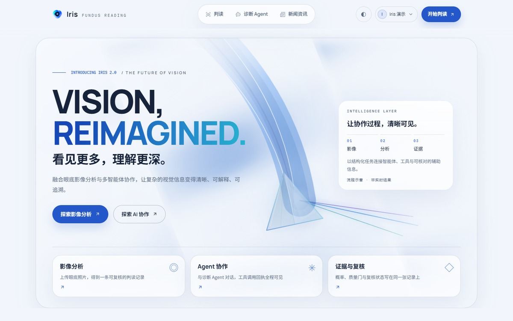
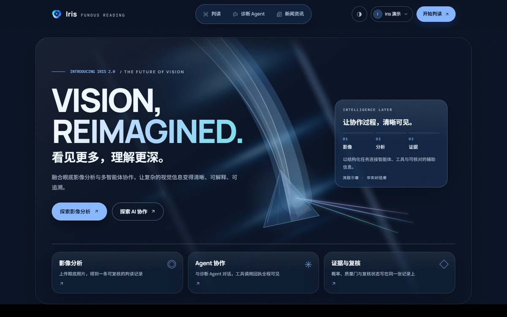
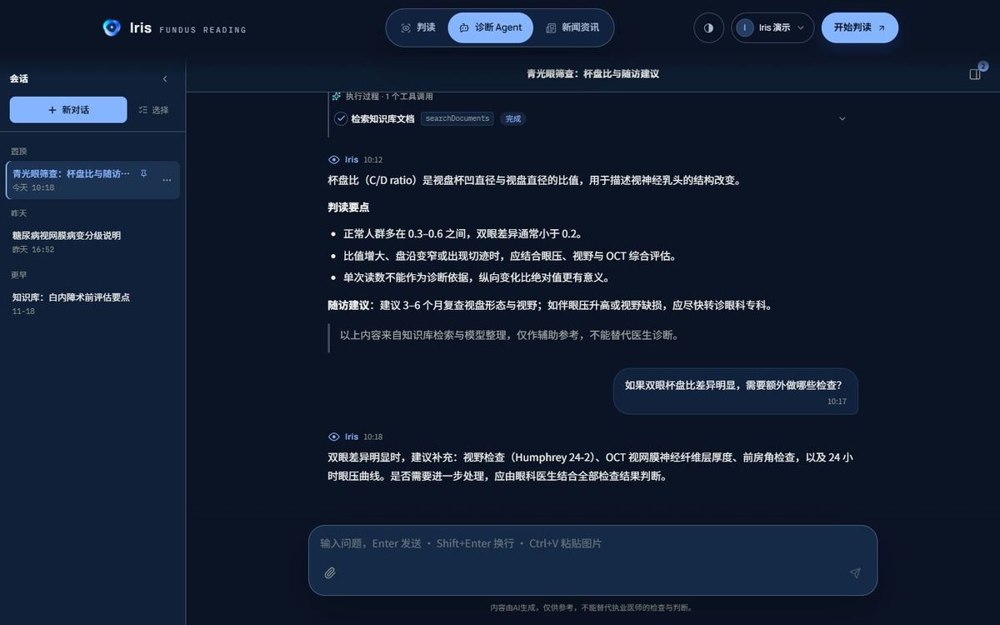
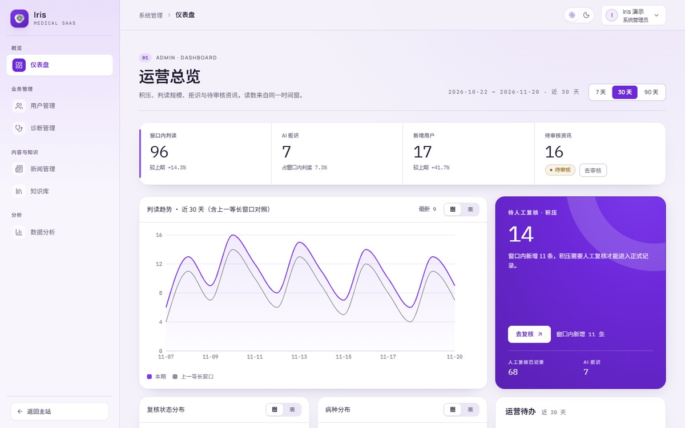
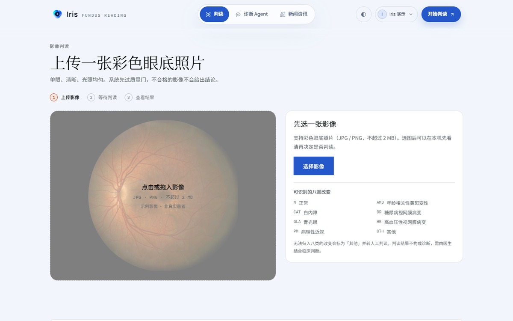
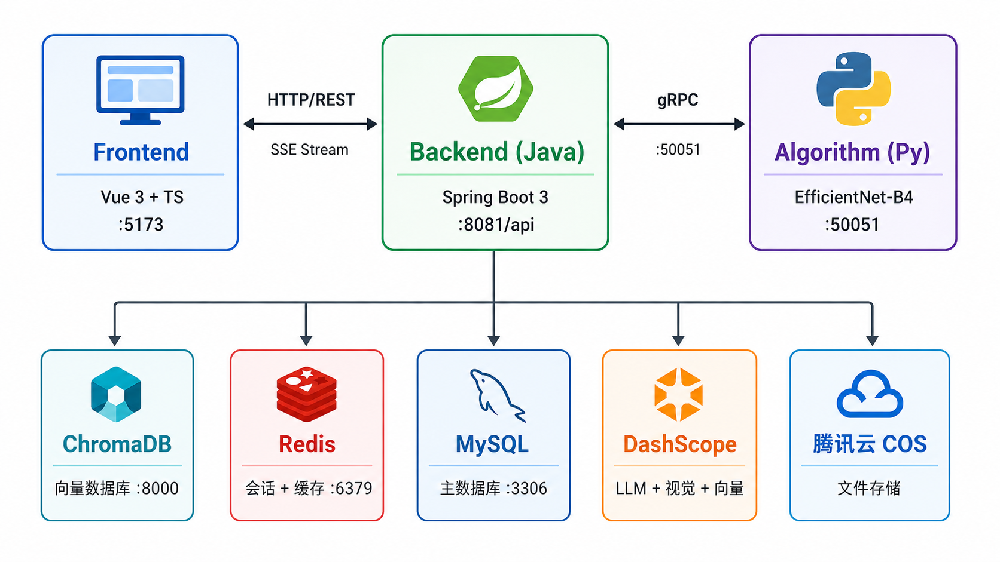
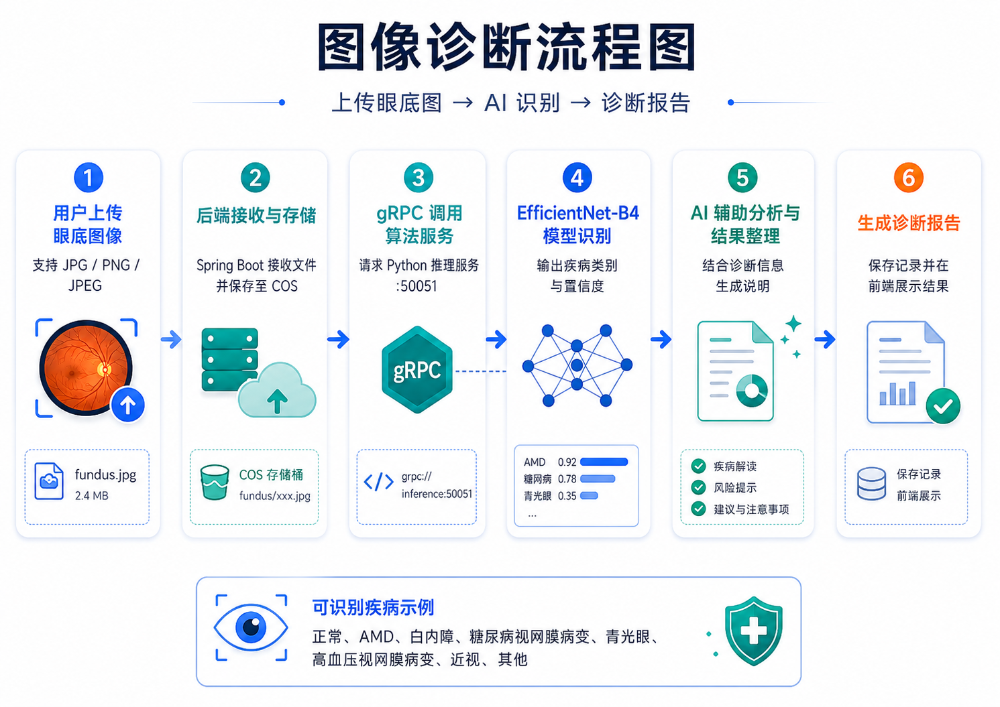
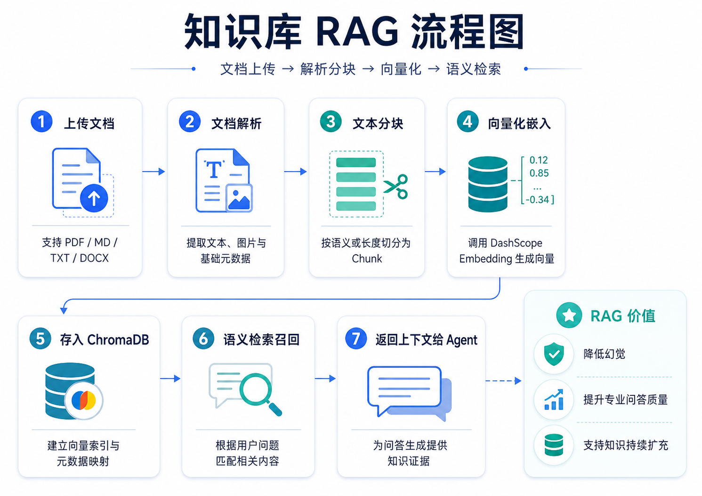
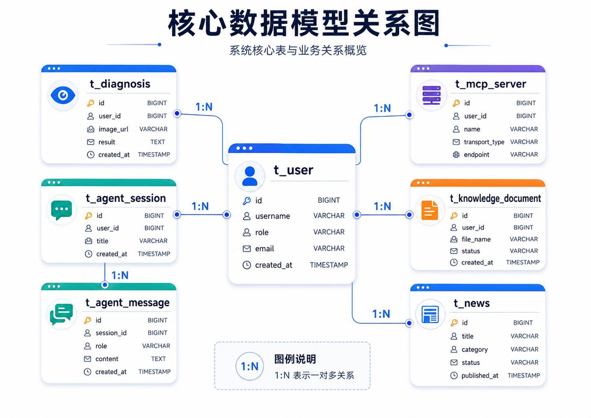

<p align="center">
  <picture>
    <source media="(prefers-color-scheme: dark)" srcset="web/public/brand/iris-optical-dark-192.png">
    
  </picture>
</p>

<h1 align="center">Iris</h1>

<p align="center"><strong>Ophthalmic AI Platform</strong></p>

<p align="center">面向眼科影像的多模态 AI 辅助分析平台</p>

<p align="center"><code>Multimodal Vision · AI Agents · Evidence-Aware RAG</code></p>

<p align="center">
  <a href="https://github.com/yuwen773/eyes-diagnosis/releases"></a>
  
  
  
  
  
  
</p>

## 产品界面

<p align="center">
  
</p>
<p align="center"><sub>Iris 2.1 首页 · 浅色主题</sub></p>

<p align="center">
  
  
</p>
<p align="center"><sub>深色主题 · 首页与诊断 Agent 工作区</sub></p>

<p align="center">
  
</p>
<p align="center"><sub>管理端运营总览 · 合成演示数据</sub></p>

<p align="center">
  
</p>
<p align="center"><sub>眼底影像判读工作区 · 示例影像为非真实患者</sub></p>

> 以上为当前 React 产品构建的真实界面；数据为合成演示数据，不含真实用户与患者信息。

## 为什么是 Iris

- **判读不是一个黑盒结论**：先过质量门，再给出八类分类（含「正常」与「其他」）；拒识、待复核、有效分类、失败是四种不同结局，不会混成一句「完成」。
- **Agent 的每一步都看得见**：工具调用、工具结果与知识库来源随对话落库，刷新后仍能回放当时的执行过程。
- **证据可追溯**：RAG 默认走向量 + BM25 混合检索与重排，只有「已就绪 + 当前索引版本」的片段才会成为来源。
- **默认安全**：临床相关写入、多 Agent 协作、推理输出等能力默认关闭；界面始终区分模型置信分数与医学结论。

## 核心能力

| 能力 | 说明 |
|---|---|
| 眼底影像分类 | 上传 JPG / PNG，EfficientNet-B4 输出八类结果（正常、AMD、白内障、糖尿病视网膜病变、青光眼、高血压视网膜病变、近视、其他）与置信分数 |
| 多模态视觉分析 | 通过 DashScope Qwen-VL-Plus 对影像做结构化视觉理解，接入 Agent 工具链 |
| 诊断 Agent | Spring AI Alibaba `ReactAgent` + SSE 流式对话；工具状态族（执行中 / 成功 / 失败 / 取消 / 待确认）统一驱动界面与落库 |
| 过程与历史恢复 | 工具结果正文、结构化资源与带时区偏移的时间戳持久化，刷新后恢复执行过程 |
| 知识库 RAG | PDF / MD / TXT / DOCX → 解析 → 分块 → DashScope 嵌入 → ChromaDB；默认启用混合检索（RRF）与 `gte-rerank-v2` 重排 |
| 索引版本准入 | 每次文档处理生成服务端索引版本（V29 `indexVersion`），旧代与失败代不会成为来源 |
| MCP 工具扩展 | 用户可配置远端 MCP 服务器（SSE / Streamable HTTP）；用户配置禁止 STDIO 本地进程 |
| 产品前端 | React 19 + TypeScript + Vite + Tailwind v4，四场景视觉体系与双主题 |
| 系统管理 | 用户、诊断记录、新闻、知识库与运营总览的一体化管理 |
| 多 Agent 协作基础设施 | 持久领域事件、图执行、授权快照、SSE 订阅与取消——**随 v1.1.0 发布，但前后端开关默认关闭** |

## 快速开始

**环境要求**：Java 21+ · Node.js 20+ · Python 3.10+ · MySQL 8.0+ · Redis 7+ · Docker（ChromaDB）

```bash
# 1. 基础设施
docker compose up -d                                   # ChromaDB :8000

# 2. 后端（先复制 application-dev.yml 为 application-local.yml 并填入配置，该文件不提交）
mvn clean package
mvn spring-boot:run                                    # http://localhost:8081/api

# 3. 产品前端
cd web && npm install && npm run dev                   # http://localhost:5173，/api 代理到 :8081

# 4. Python 算法服务
cd algorithm && pip install -r requirements.txt
python generate_proto.py                               # 从唯一 proto 源生成 Python 绑定
python grpc_server.py                                  # :50051，需 MODEL_WEIGHTS_PATH / MODEL_WEIGHTS_SHA256 / MODEL_REGISTRY_PATH
python run_mcp_server.py                               # 或通过 MCP 协议提供工具
```

### 验证与 CI 门禁

CI 定义在 `.github/workflows/verify.yml`，覆盖编译、后端单测、MySQL 集成门禁、Flyway、Python、watchdog、文档契约、前端单测 / Lint / 构建与 Playwright 浏览器契约。

| 检查 | 命令 |
|---|---|
| 后端全量（自带一次性 MySQL 8 + Redis） | `scripts/verify.sh` |
| 产品前端 | `cd web && npm run typecheck && npm run test && npm run build && npm run lint` |
| 文档契约 | `python3 scripts/check_design_doc.py` / `check_steering_docs.py` / `check_probability_scale.py` |
| 跳过门禁 | `python3 scripts/check_surefire_skips.py target/surefire-reports backend-unit` |

Maven 的 `Assumptions` 跳过会让 `mvn test` 仍显示 BUILD SUCCESS，所以 opt-in 套件由跳过门禁单独核对用例数；增删用例需同步脚本里的 `CONTRACTS`。

### 推理安全状态

- 推理缓存仅在图片哈希、模型版本、权重 SHA-256、预处理版本与安全策略版本全部一致时复用，并发写入采用原子 UPSERT。
- 当前 OOD 状态为 `NOT_EVALUATED`，温度配置为 `1.0` 且状态为 `NOT_CALIBRATED`——界面显示的是模型置信分数，不是诊断可靠性。

## 系统架构



| 角色 | 技术栈 | 端口 |
|---|---|---|
| 产品前端 | React 19 + TypeScript + Vite + Tailwind v4（`web/`） | `:5173` |
| 后端 | Spring Boot 3.5.6 + Spring AI 1.1.2 + Spring AI Alibaba 1.1.2.2 + MyBatis Plus | `:8081/api` |
| 算法服务 | PyTorch + EfficientNet-B4 + gRPC + MCP | `:50051` |
| 依赖服务 | MySQL 8 · Redis · ChromaDB · DashScope · 腾讯云 COS（过渡存储） | — |

- **诊断链路**：上传 → 存储 → gRPC 推理 → 八类分类 → 辅助分析 → 判读记录（6 步流水线）。
- **RAG 链路**：文档上传 → 解析 → 分块 → 向量化 → ChromaDB → 混合检索 + 重排 → 版本准入（7 步流水线）。
- **Agent 链路**：`/api/agent/chat/stream`（SSE），终态 `event: done`；工具状态与结果同时驱动界面与落库。
- **双后端线**：`master` 是 Java 线；`feature/python-backend` 是 Python 线，两者不再互相合并（见 [docs/backend-split.md](docs/backend-split.md)）。
- **Vue 前端已弃用**：`frontend/` 仅保留可运行以作回溯，新功能一律进 `web/`。

<details>
<summary>诊断、RAG 与 MCP 流程示意</summary>






</details>

### 技术栈

| 层 | 技术 |
|---|---|
| 后端 | Java 21 · Spring Boot 3.5.6 · Spring AI 1.1.2 · Spring AI Alibaba 1.1.2.2 · MyBatis Plus 3.5.12 |
| 数据 | MySQL 8（Flyway V1–V29）· Redis（Session + 缓存）· ChromaDB |
| AI | DashScope（LLM / Embedding / Qwen-VL-Plus / gte-rerank-v2）· MCP |
| 前端 | React 19 · TypeScript 6 · Vite 8 · Tailwind v4 · TanStack Query · Playwright |
| 算法 | PyTorch · EfficientNet-B4 · gRPC · protobuf |

### 数据模型



schema 以 `src/main/resources/db/migration/` 下的 Flyway 迁移为唯一权威来源（新库基线表由 `db/callback/` 提供），当前最高 **V29**；已应用的迁移脚本不得修改。核心表：`t_user`、`t_diagnosis`、`t_diagnosis_task`、`t_agent_session` / `t_agent_message`、`t_agent_tool_audit`、`t_mcp_server`、`t_knowledge_document`、`t_news`、`t_controlled_reference`、`t_patient_authorization` / `t_patient_draft_run` / `t_doctor_review`。

升级前请对照 [Flyway 迁移矩阵](docs/architecture/migration-matrix.md)。

### API 一览

后端启动后访问 Knife4j：<http://localhost:8081/api/swagger-ui.html>

<details>
<summary>控制器与路径前缀</summary>

| Controller | 路径前缀 | 职责 |
|---|---|---|
| `UserController` | `/api/user/*` | 用户认证、信息管理、CRUD |
| `AdminStatsController` | `/api/stats/*` | 管理端总览读数 |
| `DiagnosisController` | `/api/diagnosis/*` | 图像上传、诊断推理、记录查询 |
| `DiagnosisTaskController` / `PatientAuthorizationController` / `PatientExplanationController` / `PatientFollowUpController` | `/api/diagnosis-tasks/*` | 患者影像任务、保存授权、分层解释与随访 |
| `AgentController` | `/api/agent/*` | SSE 流式对话、会话与历史 |
| `AgentImageUploadController` | `/api/agent/image/*` | Agent 影像上传与删除（需登录） |
| `CollaborationRunController` | `/api/agent/collaboration-runs/*` | 多 Agent 协作运行：准入、授权快照、SSE、取消（默认关闭） |
| `McpServerController` | `/api/mcp-server/*` | MCP 服务器配置与管理 |
| `KnowledgeBaseController` | `/api/knowledge/*` | 知识库文档上传、索引与检索 |
| `ControlledReferenceController` | `/api/controlled-references/*` | 受控参考资料上传、治理与检索 |
| `DoctorReviewController` | `/api/doctor-reviews/*` | 医生复核冻结草稿（写入门禁保持关闭） |
| `NewsController` | `/api/news/*` | 健康资讯内容管理 |
| `PatientDraftTestController` / `PatientDraftSeedController` | `/api/patient-draft-test/*` | 草稿校验（仅管理员、需显式开启） |

任务入口与普通诊断相互独立，不创建正式诊断记录、不向患者展示预测；契约见 [docs/diagnosis-task.md](docs/diagnosis-task.md)。

</details>

### 项目结构

<details>
<summary>目录说明</summary>

```
eye-diagnosis/
├── src/main/java/        # Java 后端（Spring Boot）
│   ├── agent/            # ReactAgent、MCP、RAG、工具、队列与可观测性
│   ├── collaboration/    # 多 Agent 协作运行（默认关闭）
│   ├── controller/       # REST 控制器
│   ├── diagnosistask/    # 患者影像任务
│   ├── doctorreview/     # 医生复核（写入门禁保持关闭）
│   ├── service/ mapper/ model/ grpc/ config/
│   └── ...
├── web/                  # React 产品前端（git subtree）+ e2e/ Playwright 契约
├── frontend/             # Vue 3 前端（已弃用 / deprecated）
├── algorithm/            # Python 算法服务：模型、gRPC、MCP、训练脚本
├── docs/                 # 设计、发版与配图资源
├── docker-compose.yml    # ChromaDB
└── pom.xml
```

</details>

## 文档导航

| 文档 | 内容 |
|---|---|
| [docs/README.md](docs/README.md) | 文档总索引（按主题分组） |
| [v1.1.0 发布说明](docs/release/v1.1.0-release-notes.md) | 版本内容、升级注意、默认关闭开关、已知限制、产物 SHA-256 |
| [Flyway 迁移矩阵](docs/architecture/migration-matrix.md) | 各目标库的升级与回滚路径 |
| [docs/diagnosis-task.md](docs/diagnosis-task.md) | 患者影像任务入口的契约与边界 |
| [docs/backend-split.md](docs/backend-split.md) | Java 线 / Python 线的边界与共享目录搬运规则 |
| [DESIGN.md](DESIGN.md) | Iris 2.1 视觉规范（四场景、组件变体、双主题） |
| [CODING_STANDARDS.md](CODING_STANDARDS.md) | 代码风格与判断类约定 |
| [GLOSSARY.md](GLOSSARY.md) | 领域命名与模块边界 |

## Roadmap

- **对象存储**：把腾讯云 COS 迁移到自建 S3 兼容存储，并补齐对象级访问控制。
- **多 Agent 协作**：在受控环境完成准入、取消与审计的端到端验证后，再讨论生产启用。
- **知识库治理**：为存量文档提供批量重处理入口，让索引版本准入覆盖历史语料。
- **外部集成证据**：补齐 DashScope → SSE 全链路、视觉工具与真实对象存储的可核验证据。
- **工程瘦身**：依赖去重（如重复的 BouncyCastle）、按需裁剪文档解析模块与 API 文档 UI。

## 安全与使用限制

- **不是临床产品**：本项目为研究与工程用途，未在真实临床数据上做疗效或安全性评估，不能替代医生诊断。
- **临床开关保持关闭**：医生正式复核写入、推理输出展示等生产开关默认关闭，详见 [v1.1.0 发布说明](docs/release/v1.1.0-release-notes.md)。
- **多 Agent 协作默认关闭**：基础设施已包含在 v1.1.0，但需同时打开后端 `eye-diagnosis.collaboration.*` 与构建期 `VITE_COLLABORATION_ENABLED` 才可用。
- **COS 是过渡存储**：对象级私有化、短时签名视图与历史 ACL 回填不在 v1.1.0 内，后续迁移到自建 S3 兼容存储。
- **外部集成证据有限**：真实外部服务的端到端证据尚未形成可独立核验的归档。
- **UI 冻结**：首页 / 品牌层、管理端、知识库、新闻工作台自 2026-11-15 起冻结，一般视觉优化登记 Issue。

## License

本项目采用 [MIT License](LICENSE)，版权信息以 LICENSE 文件为准。

**本系统仅作为辅助诊断工具，不能替代专业医生的诊断。**
