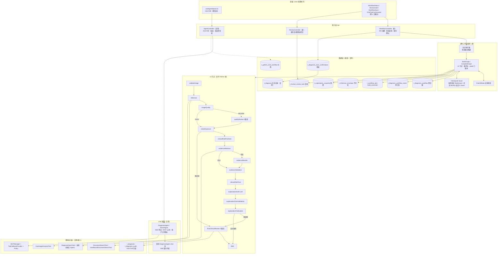

# Java 版多智能体总体架构设计（对齐 Python 线业务流程）

> **状态**：**v3 定向修订候选稿，暂缓冻结，待复审**。本轮仅修订设计文档，未实施 Java 代码或数据库迁移；既有 PR 和历史计划记录的是上一轮交付状态。
>
> **修订来源**：由 v2 候选稿（非冻结版）修订而来，第一轮评审结论『方向认可、持久化与安全契约需补充、暂不全量开发』，第二轮评审『有条件通过、修正后执行』。
>
> **评审保留的 3 个决定**：(1) `feature/python-backend` 为业务真源；(2) chat Agent 与诊断工作流解耦；(3) 人工复核、保存授权、溯源为独立安全边界。
>
> **基线**：`worktree-java-multi-agent-arch` 分支，基于 `f11a677`。工作树不含主检出的未提交改动，也不含 gitignored 的 `application-local.yml` / `application-dev.yml`。
>
> **业务真源**：`feature/python-backend` 分支（本仓库的 Python 后端线，与 master **不再互相合并**，见 `docs/backend-split.md`）。业务流程以该分支的 `algorithm/web/workflow/` 为准。
>
> **编排参照**：`D:\Work\code\medical-multi-agent-system`（外部教学项目）。**只借"共享状态 + 节点契约 + 条件路由"的骨架，不照抄其实现或业务角色**。
>
> **调研**：四个只读子代理分别覆盖参考项目 Java 架构、本项目 Java Agent 子系统、依赖可行性、Python 线业务流程；关键结论均在本文复核了源码。

---

## 0. 一句话架构

**把 Python 线已落地的「持久化临床诊断工作流」语义，用本项目 classpath 上已有的 Spring AI Alibaba Graph（`StateGraph` + `OverAllState` + Checkpoint）在 Java 线重建；业务流程（14 节点、多重门控、四类人工等待、不可变溯源、三权分离）完整对齐，Python 特有的 job-worker / LangGraph checkpoint / 迁移实现不照搬。**

```
业务真源   —— Python 线 workflow/（14 节点、9 态、四人工等待、V10–V22 数据模型）
编排引擎   —— 本项目已有 spring-ai-alibaba-graph-core:1.1.2.2（零新增依赖）
Java 线现状 —— 单 ReactAgent + SSE 单流，缺工作流、缺人工门控、缺溯源
前端       —— Java 线前端缺 workflow/review/confirmation 全套页面，需人工搬运
```

**产品定位**：本方案本质是「**基于状态图的多阶段医疗 AI 工作流架构**」——含 1 个对话 Agent + 1 个受控诊断状态图 + 多工具 + 多人工决策角色，**14 个图节点 ≠ 14 个 Agent**。若目标改为真正的 Multi-Agent 研究，需另加明确 Agent 职责、独立上下文、协作协议与评估机制，而不是增加图节点数量。**不要为了让项目更像 Multi-Agent 而增加 LLM 节点。**

### 0.1 必须纠正的三个认知

| 常见误解 | 事实 |
|---|---|
| 参考项目 Java 线用了 LangGraph4j | `java/pom.xml:45-49` 声明了 `langgraph4j-core:1.8.11`，但**全仓 Java 源码零 import**；实际是 `ClinicalPipeline.java:47-74` 的 `do-while` 手写循环 + 可变 Lombok POJO，无 checkpoint、无流式。`CLAUDE.md:78` 称其为 aspirational scaffolding |
| Python 线是"多个 LLM 智能体聊天" | **不是**。`definition.py:207-220` 的 **14 节点**中 13 个是确定性规则/门控/证据校验，唯一 LLM 是 `explanationDraft` 的有界抽取器，**无 LLM 做路由决策**；全仓仅两处受限 LLM 调用（chat 流式助手 `chat/model.py:32`、图内解释草稿 `explanation.py:80`）。`explanation.py:1` 明言 "Models cannot choose tools or publication"。"多"体现在**节点阶段 + 人类角色 + 独立进程**，不是多个自治 agent |
| 工作流完成 = 出诊断结果 | **不对**。`CONTEXT.md:27-33` 与 `AGENTS.md:25` 规定：聊天会话 ≠ 诊断工作流 ≠ 正式诊断记录；**医生复核 ≠ 用户保存授权**；`t_diagnosis` 正式记录**只在**患者 `approve` 保存确认后写入（`confirmation.py:185-205`） |

### 0.2 验收分层

**设计评审通过**与**工程实施验收通过**是两个不同的结论，不可混用：

| 层级 | 含义 | 本文件状态 |
|---|---|---|
| 设计评审通过 | 架构方案、接口契约、安全不变量、验证标准已明确 | 本文件所处（或追求）的层级 |
| 工程实施验收通过 | 实际代码在真实 MySQL、Graph 运行时、跨进程恢复、并发故障注入下满足契约 | **未达成** |

本文件是前者，不代表后者。特别注明：Spring AI Alibaba Graph `1.1.2.2` 的 Checkpoint/恢复/中断**最小可运行验证是 P1 Saver DDL 冻结之前的 P0 前置门禁**——本轮未写任何 Java 代码，文档修订通过不等于框架运行时恢复能力已验收。

### 0.3 分支基线事实表

以下为修订时的实测 `git rev-parse` 结果：

| 分支 / 位置 | 提交 | 说明 |
|---|---|---|
| 工作树 HEAD（`worktree-java-multi-agent-arch`） | `f11a677` | v2 基线，本文件修订起点 |
| 本地 `master` | `bd597c1` | Java 线主干 |
| `feature/python-backend` | `c7b1b88` | 业务真源（Python 线） |

评审所述远端 master `f11a677` 与本地 `master`（`bd597c1`）相差 1 个提交；实施前须以 `git rev-parse` 实测复核各分支位置，**不写死远端状态**。

---

## 1. 目标与非目标

### 1.1 目标

| # | 目标 |
|---|---|
| G1 | 业务流程与 Python 线**语义等价**：14 节点拓扑、状态分类、门控条件、结果分类、人工等待点一致 |
| G2 | 保留 Python 线的**业务不变量**：三权分离、不可变溯源、冻结快照发布、幂等与可重放防护、append-only 审计 |
| G3 | 用 Java 线已有的 `StateGraph` / `ReactAgent` / `OverAllState` / Checkpoint 实现，零新增依赖 |
| G4 | 补齐 Java 线现状缺口：历史不回灌模型、无 checkpoint、无人工门控、无审计事件流、`DiagnosisGrpcClient` 未接入 Agent |
| G5 | 明确 chat Agent 与诊断工作流的**解耦边界**（Python 线 `t_python_chat_workflow` 是引用而非复制任务） |
| G6 | 给出 Java 线前端与数据层的差距清单和搬运路径 |

### 1.2 非目标

- **不**引入 langgraph4j，**不**照搬参考项目的 Spring AI 1.0.0 依赖块或 PostgreSQL/JPA 数据层。
- **不**照搬 Python 特有的实现：LangGraph `interrupt` / `MysqlCheckpointSaver`、SQLAlchemy + `SKIP LOCKED` 租约 Job、MEDIUMBLOB 存图、FastAPI SSE 帧格式、`t_python_*` 表命名、PowerShell/Compose 部署。
- **不**把参考项目的临床五角色（Intake/Diagnosis/Treatment/Coding/Audit）搬进眼科业务。
- **不**改已应用的 Flyway 迁移（Java 线 V1–V9）。
- **不**打开 `outbox.enabled` / `upload.compensation.enabled` / `rag.corpus.seed-enabled` 三个默认关闭开关。
- **不**在本轮落地代码、不跑编译验证（工作树缺 gitignored 本地配置）。
- **不**直接改 `frontend/`：按 `docs/backend-split.md:30-49`，两条后端线各持一份，改动需人工搬运。

---

## 2. 三份调研的关键结论

### 2.1 参考项目：可借的只有骨架

`java/src/main/java/com/medical/graph/ClinicalPipeline.java:47-74` 是纯手工顺序调用 + 唯一一个 `do-while` 回环（`MAX_DIAGNOSIS_RETRIES=2`）；`ClinicalState.java:22-54` 是 Lombok `@Data @Builder` 可变 POJO，9 个字段、各 Agent 原地 `setXxx` 后 `return state`，同 JVM 引用传递，无校验、无 reducer、无不可变性。`docs/02-架构设计详解.md:385-390` 自认 Java 版「命令式／状态手动传递／检查点 无」。

五个 Agent 中 4 个用 `ChatClient.prompt().system().user().call().content()` 同步调 LLM、prompt 内嵌 JSON schema、剥围栏后解析；`AuditAgent.java:14-15` 不调 LLM，但 `:60-68` 的 7 项检查全是硬编码 `"passed"`，`:87` 只回填 PHI 字段名**不做脱敏**。回环时 `rawInput` 从未改变（`ClinicalPipeline.java:60`），"补充信息"只是同一输入的 LLM 重跑。对外 `POST /api/v1/clinical/analyze` 同步返回整个 state，无 SSE、无会话。

**可移植的通用骨架**：① 共享黑板 + 明确写入方与冲突规则；② 统一节点契约 `process(state) → state` + `currentAgent` 打点；③ 错误累积、节点不抛出、优雅降级；④ 布尔标志 + 有界计数器实现条件回环；⑤ 末端确定性非 LLM 审计节点；⑥「prompt 声明 schema → 剥离围栏 → 结构化解析」输出契约；⑦ 编排器/节点/状态/控制器四层分离。

**不搬**：五个临床角色与 Prompt、ICD-10/DRG/DDI/FHIR/HIPAA、`needs_more_info` 语义、置信度阈值。参考项目的「置信度门控 + 人工复核」**只是文档概念**，Java 无 interrupt/HITL/审批门。

### 2.2 本项目 Java 线：单 Agent，但底层已是可嵌入节点

`agent/DiagnosisAgent.java:36-37` 是 Spring 单例 `@Component`，内部**每请求 new** 一个 `ReactAgent`（`:93-104, :123`）：固定 `name`、类内静态 `SYSTEM_PROMPT`（`:39-73`）、单一 `ChatModel`、写死注入两个内置工具 + 全部 MCP 回调。但 `:3-7` 已 import `NodeOutput` / `RunnableConfig` / `InterruptionMetadata` / `StreamingOutput`——**它本身就是一个可嵌入 `StateGraph` 的 `ReactAgent` 节点**。

现状缺口：

- `DA:130` 只传本轮 `fullMessage`，**无历史/记忆 Advisor**；DB 历史仅供 UI。
- `threadId ≡ sessionId`（`AC:53-65`、`CH:62`、`DA:125-127`），单一命名空间；`t_agent_message` 无 node 维度列。
- **无 checkpoint**：`AgentSession.checkpointData byte[]`（`AgentSession.java:21`）和 `AgentSessionMapper.java:33-40` 有字段/更新语句但全仓无调用。
- Outbox（`OB:17-29`）的 `append` 全仓无调用；dispatcher 被 `application.yml:82-83` 明确关闭（注释警告开启会重放历史行）。
- `DiagnosisGrpcClient`（8 分类 + 质量/拒识/OOD 元数据）**未接入 Agent**。
- SSE 契约：后端 `MessageType.java:7-13` 六类；`AC:75-80` 每条 `MessageDTO` + 唯一 `event: done`；异常 `event: error`。前端真身在 `frontend/src/composables/useAgentStream.ts:128-200`。**已存在漂移**：后端 `tool-result` vs 前端 `tool-response`（`:184`）。

**可复用能力**：视觉分析 `EyeImageAnalyzerTool`、用户隔离 RAG `DocumentSearchTool` + `UserBoundDocumentSearchTool`、gRPC 分类、COS/上传状态机、鉴权与会话所有权、MCP 全套基建（`MCPManager` / `McpToolCallbackProvider` / `TextMcpModelInterceptor` / `McpConnectionPolicy`）、SSE 装配、`ChatHistoryService` + `SessionMessageQueue`、`t_diagnosis_audit` 与 V5/V7/V9 的拒识/校准/人工复核字段。

### 2.3 依赖可行性：不需要 langgraph4j

| 事实 | 证据 |
|---|---|
| 参考项目声明但零使用 langgraph4j | `java/pom.xml:45-49` + 全 Java 源码零 import + `CLAUDE.md:78` |
| 本机 m2 只有 `langgraph4j-core:1.6.0-rc2`，无 1.8.11 | `/d/maven-repository/org/bsc/langgraph4j/` |
| 本项目显式声明 `spring-ai-alibaba-agent-framework:1.1.2.2` | `pom.xml:165-169` |
| 它传递 `spring-ai-alibaba-graph-core:1.1.2.2` | `mvn dependency:tree` |
| graph-core 内含 `StateGraph` / `CompiledGraph` / `OverAllState` / `KeyStrategy` / `RunnableConfig` / `StreamingOutput` / `GraphRunner` + 7 种 CheckpointSaver | jar 类清单 |
| agent-framework 内含 `ReactAgent` / `SequentialAgent` / `ParallelAgent` / `LlmRoutingAgent` / `LoopAgent` / `AgentTool` + `AgentToSubCompiledGraphNodeAdapter` | jar 类清单 |
| Spring AI 1.0.0 → 1.1.2 Breaking：旧 starter `spring-ai-openai-spring-boot-starter` 在本项目 `spring-ai-starter-model-openai` BOM 下不可解析 | `java/pom.xml:54` vs `pom.xml:148` |

**结论**：图编排、条件边、并行、checkpoint、流式、子图嵌套全部已在依赖树里且版本对齐。参考项目 Agent 源码不能逐字复制，需按 1.1.2 重写。

### 2.4 Python 线业务真源：14 节点持久化工作流

框架是 **LangGraph `StateGraph` + 数据库驱动 job-worker + 独立 API 进程**的混合体（`definition.py:9,206`；`worker.py:1,72-101`；`AGENTS.md:15`）。图版本 `upload-final-clinical-review-v6`，`GRAPH_VERSION` / `ACTION_VERSION` / `GRAPH_HASH` 三元组（`definition.py:19-20,258-261`）。一个 Job 只推进图的一个分段，worker 用 `get_state().next` 生成下个 RESUME Job（`worker.py:186-187,230-234`）。

`Workflow.status`（`schemas/workflow.py:90-91`）9 态：`CREATED / QUEUED / RUNNING / WAITING_HUMAN_REVIEW / COMPLETED / COMPLETED_LIMITED / REJECTED / CANCELLED / FAILED`，配套 40+ `stopReasonCode`、`workflowVersion` 乐观锁、`inferenceEpoch`、`explanationPublicationStatus`、`predictionExposureStatus`（`V10:1-27`）。

关键设计：`MysqlCheckpointSaver` 段内暂存 + 栅栏式原子提交（`checkpoint.py:29,104-113`），**业务表是真相、checkpoint 只管续跑**——checkpoint 与业务行在**同一事务**内提交：worker 在 `with self.sessions.begin() as db:` 单事务里同时完成 `saver.flush(db)` 与业务行更新（`InferenceEnvelopeRow` 插入、`workflow` 更新、`Job` 完成、`ReviewTask`、下个 `RESUME Job`、`append_event`，`worker.py:188-235`），不存在「checkpoint 先落、业务后补」的窗口。`WorkflowEvent` 是 append-only 审计时间线；`InferenceEnvelopeRow` 是不可变推理快照；`ReviewTask` 绑定 `envelopeId` + graph 三版本防重放；旧任务只能**显式重建**不能自动续跑（`legacy.py:68-105`）。Java 侧的对应约束见 ADR-4 的「单事务边界」定义。

---

## 3. 业务语义不变量（最高优先级，不可妥协）

这一章是 Java 版必须完整对齐的**业务契约**，比技术选型更重要。来自 Python 分支 `CONTEXT.md` / `AGENTS.md` / `confirmation.py` / `definition.py`。

### 3.1 身份与上下文三分

| 概念 | 定义 | 不可混淆为 |
|---|---|---|
| 用户账号 | 稳定身份与角色，关联本人诊断记录与会话 | 登录态 / 聊天会话 |
| 登录态 | 访问凭证及有效状态 | 账号 / 会话 |
| 聊天会话 | 一段持续对话及历史上下文 | 登录会话 / 病例 / **诊断工作流** |
| 诊断工作流 | 一次受控眼底分析的完整业务过程，可由聊天或上传入口共同引用 | 一次聊天请求 / 一条正式诊断记录 |
| 正式诊断记录 | 用户**明确批准保存后**形成的持久业务记录 | 分析中间结果 / 待确认内容 |

**推论**：`t_python_chat_workflow`（V18）是「会话到工作流的授权引用」，注释明确 "not duplicate jobs"；Java 版必须让 chat 与 workflow **各自独立、通过引用关联**，不能把工作流状态塞进 `t_agent_session`。

### 3.2 三权分离

```
医生复核      —— 医生对分析质量或临床解释的独立判断，不构成用户保存授权
AI 溯源       —— 不可变的推理信封 / 解释快照 / 引用集合，发布后不重算
用户保存授权  —— 患者针对「实际展示的拟保存内容及版本」作出的明确保存决定
```

`confirmation.py:52-65` 的 `candidate()` 是硬门控：所有 `ReviewTask` 必须 `SUBMITTED` 且决策正确、`exposure_status == AVAILABLE`、`sha256(imageBytes) == envelope.input_digest`、`graph` 三版本兼容、解释已发布——全部满足才生成拟保存内容。用户对**冻结后的内容摘要**（`contentDigest`）授权，30 分钟过期（`confirmation.py:81-83,141`），批准后才写 `t_diagnosis` + 唯一回执 `SavedWorkflowDiagnosis`。

**保存授权事务边界**（契约参考 Python `decide_save()`，`confirmation.py:147-205`）：**状态 CAS 成功 + 正式 `t_diagnosis` 插入 + 唯一 `SavedWorkflowDiagnosis` 回执写入，三者在同一事务原子提交**——原实现注释即契约："Consent, receipt and formal row succeed or roll back together"。前置校验三者缺一不可：确认行 `status == PENDING`、未过期（`expiresAt > now`）、`expectedContentDigest` 与 `expectedWorkflowVersion` 均与冻结值一致；CAS 以 `UPDATE … WHERE status='PENDING' AND expires_at > now` 兜底并发（Python 注释：CAS 也能在没有 `SELECT FOR UPDATE` 的数据库上隔离并发请求）。重复 approve **只回放已提交回执**——按 `workflow_id` 命中既有 `SavedWorkflowDiagnosis` 即直接返回原结果，绝不重跑写入。

### 3.3 四类人工等待（可跨重启恢复）

| # | 类型 | 谁 | 状态迁移 | 决策 | 恢复方式 |
|---|---|---|---|---|---|
| ① | 质量复核 `IMAGE_QUALITY_GATE` | **医生**（禁自审 `review.py:35`） | OPEN → CLAIMED → SUBMITTED | `APPROVE_CONTINUE` / `REJECT_RESUBMIT` | submit 建 RESUME Job |
| ② | 最终临床复核 `FINAL_CLINICAL_REVIEW` | **医生** | 同上 | 有效预测：`CONFIRM_AI_ASSESSMENT` / `CORRECT_AI_ASSESSMENT` / `INCONCLUSIVE`；安全拒识：`CONFIRM_ABSTENTION` / `PROVIDE_INDEPENDENT_REVIEW` / `INCONCLUSIVE` | 只放行**冻结快照**发布，不重跑推理/检索/解释 |
| ③ | 保存确认 | **患者本人** | PENDING → APPROVED / REJECTED / EXPIRED / INVALIDATED | `SAVE_DIAGNOSIS` | 批准才写正式记录 |
| ④ | 补充说明 | **患者** | WAITING → ANSWERED | 自由文本 | 独立聊天图 `Command(resume=text)`（见下表） |

管理员另有知识库治理审核（`reviewStatus=APPROVED/WITHDRAWN`，V19）。

**三种恢复机制（不可混用，二次评审 P0-1 纠正）**：上表四行虽同属人工等待，但恢复机制并不相同——**两类医生复核、独立聊天补充、图外保存确认是三种不同机制，不能直接套用同一种恢复机制**：

| 类型 | 正确恢复方式 | 禁止 |
|---|---|---|
| ① 医生质量复核 `IMAGE_QUALITY_GATE` / ② 医生最终临床复核 `FINAL_CLINICAL_REVIEW` | **临床主图** `interrupt_after` 分段 + Checkpoint + `RESUME Job`（`review.py:228`、`worker.py:232`），绑定 `envelopeId` + 图三版本 + `checkpointId` | 不重新推理、不换 envelope |
| ④ 患者补充说明 | **独立聊天交互图** `interrupt()` + `Command(resume=text)`（`chat/supplement.py`，`chat-supplement-v1`，单节点 `waitForDescription`，thread `supplement:<requestId>`，自带 `waitVersion` CAS + `t_python_chat_supplement`） | **不恢复或重新执行临床诊断图、不重新推理、不重新发布解释**；补充答案仅供 `doctor_notes()` 提供给医生 |
| ③ 用户保存确认 `SAVE_DIAGNOSIS` | **图外**数据库事务 + CAS + 唯一回执（`confirmation.py:decide_save()`） | 不走图 checkpoint、不走 RESUME Job |

### 3.4 结果分类与门控

`explanation.py:113-124` 的 5 种 `disposition`：`WITHHOLD_UNSAFE` / `PROCEED_TO_EVIDENCE` / `LIMITED_EVIDENCE` / `FINAL_REVIEW_REQUIRED` / `AUTO_PUBLICATION_ELIGIBLE`。

`publication_decision()`（`:192-203`）状态机：`NONE → DRAFT → VALIDATED → PUBLISHED`，异常分支 `REJECTED`（声明校验失败）/ `WITHHELD`（来源变更或风险不允许）。前端 `WorkflowStatus.vue:47-50` 仅在 `COMPLETED && PUBLISHED && VALIDATED && patientVisible` 时才显示结果——**结果可见性是门控结果，不是流程终点**。

`validate_claims()`（`:150-188`）对 LLM 输出做 **10 类** issue 校验：`INVALID_OUTPUT_STRUCTURE` / `DUPLICATE_CLAIM_ID` / `UNKNOWN_CITATION` / `UNSUPPORTED_CLAIM_TYPE` / `UNSUPPORTED_SOURCE_CLAIM` / `UNSUPPORTED_NUMERIC_CLAIM` / `PROHIBITED_DIAGNOSIS_CERTAINTY` / `PROHIBITED_TREATMENT_ADVICE` / `PROMPT_INJECTION_ARTIFACT` / `SOURCE_NO_LONGER_APPROVED`。LLM 被 `ExplanationModel.generate()`（`:65-110`）约束为「从证据逐字摘一句」的抽取器：禁工具、禁患者身份、禁原始预测、禁写权限、`max_tokens: 512`、`response_format: json_object`、15s 硬超时、来源视为不可信数据。

### 3.5 不可变溯源与防重放

- `InferenceEnvelope`（V11）：`inputDigest` / `qualityOutcome` / `predictionSnapshot` / `confidenceSnapshot` / `oodSnapshot` / `calibrationSnapshot` / `modelVersion` / `modelWeightFingerprint` / `preprocessVersion` / `policyVersion`，**只插入不更新**。
- `ExplanationSnapshot`（V12）：`revision` 唯一、内容不可变、`citationSetDigest`。
- graph 三版本 + `GRAPH_HASH`；`ReviewTask` 绑定 `envelopeId` + 三版本；worker 领取时校验，不兼容直接 `FAILED/GRAPH_VERSION_INCOMPATIBLE`（`worker.py:162-165`）。
- `WorkflowEvent` append-only（`eventSequence` 唯一、`actorType` = USER/WORKER/DOCTOR/SYSTEM）。
- 幂等：`UNIQUE(ownerUserId, creationIdempotencyKey)`；键冲突且内容不同返回 409。

---

## 4. 架构决策（ADR 摘要）

### ADR-1 双层：chat Agent 与诊断工作流解耦

Python 线是**两条并行链路**：`routers/agent.py` 的流式 chat Agent（SSE + MCP 工具 + 用户工具确认）+ `algorithm/web/workflow/` 的异步持久化工作流，通过 `t_python_chat_workflow` 引用关联。Java 线照此分层：

- **保留**现有 `DiagnosisAgent` / `AgentController` / SSE 契约作为 chat 链路，不推翻；
- **新增**独立的诊断工作流子系统，不复用 `t_agent_session` / `t_agent_message` 承载工作流状态；
- chat 内发起诊断只创建**引用**，不复制任务。

> 这修正了本设计草案 v1 里"把单 Agent 直接升级成一条 5 节点 SSE 流水线"的错误方向。

### ADR-2 编排引擎：Spring AI Alibaba `StateGraph`

用已有 `graph-core:1.1.2.2` 的 `StateGraph` / `OverAllState` / `KeyStrategy` / `CompileConfig` 对齐 Python 线的 14 节点拓扑与条件边。节点统一实现 `AsyncNodeAction`（`Map<String,Object> state → 增量 Map`），函数式、返回部分更新、由 KeyStrategy 合并——比参考项目"原地 mutate 同一 POJO"更利于 checkpoint 序列化与并行。

**不照搬** Python 的 LangGraph `interrupt` / `MysqlCheckpointSaver`；Java 侧用 graph-core 的 `Checkpoint` + 自建 `BaseCheckpointSaver`（见 ADR-4）。

### ADR-3 共享状态：`OverAllState` + 显式 KeyStrategy

状态是 JSON 友好的 `Map<String,Object>`，节点返回部分更新。**REPLACE 允许多个顺序节点阶段性覆盖同一 key**；同一执行阶段若并行写同一 key，必须先设计确定性的合并规则，否则禁止并行并在编译或测试时拒绝。Python 当前主图按条件路径顺序推进。

下表写入方来自 Python `definition.py`；入口初始化与恢复装载另行提供初始值，Java 新增元数据由创建/恢复边界写入、节点只读。`completed` 是完整列表：`validateImage` 初始化，其余节点返回旧列表加自身，**REPLACE 而非 APPEND**。

| key | 节点写入方 | 合并 |
|---|---|---|
| `workflowId` | 无，入口初始化 | REPLACE，只读 |
| `status`, `reason` | `validateImage`, `inference`, `imageQuality`, `qualityReview`, `visionExposure`, `evidenceValidation`, `clinicalRiskFinal`, `explanationDraft`, `explanationClaimValidation`, `explanationPublication`, `finalClinicalReview` | REPLACE，按路径顺序 |
| `completed` | 14 个主图节点均写 | REPLACE 完整列表 |
| `mediaType` | `validateImage` | REPLACE |
| `envelopeId` | `inference` | REPLACE |
| `exposureStatus` | `inference`, `imageQuality`, `visionExposure` | REPLACE，按顺序 |
| `waitingReview` | `imageQuality`, `qualityReview`, `visionExposure`, `explanationPublication`, `finalClinicalReview` | REPLACE，按顺序 |
| `reviewType` | `visionExposure`, `explanationPublication` | REPLACE，按顺序 |
| `evidence` | `evidenceRetrieval`, `evidenceRewrite`, `evidenceValidation`, `clinicalRiskFinal`, `explanationDraft`, `explanationClaimValidation`, `explanationPublication`, `finalClinicalReview`（条件写） | REPLACE，按路径顺序 |
| `risk` | `clinicalRiskPrecheck`, `clinicalRiskFinal` | REPLACE，按顺序 |
| `explanation` | `explanationDraft`, `explanationClaimValidation`, `explanationPublication`, `finalClinicalReview` | REPLACE，按顺序 |
| `userId`, `graphVersion`, `graphHash`, `actionVersion`, `workflowVersion`, `inferenceEpoch` | Java 扩展：创建/恢复边界；节点只读 | REPLACE |
| `errors`, `trace` | Java 扩展：各产生事件的节点 | APPEND 仅增量；以稳定业务事件 ID 独立去重，reducer 和技术写入主键本身不保证业务幂等 |

### ADR-4 持久化：业务表为真相，checkpoint 只管续跑，人工等待必须原子提交

对齐 Python 线最重要的设计（`checkpoint.py:1-5`、`V15:2`）：**`t_diagnosis_workflow` 是聚合根和真相来源**，checkpoint 只负责在人工等待后恢复图执行。分三层约束：

**第一层：业务表是真相、checkpoint 只管续跑。**（保留 v2 结论）工作流的业务状态迁移以 MySQL 业务表为准；checkpoint 数据丢失最多导致图无法续跑，绝不允许 checkpoint 反向覆盖业务状态。

**第二层：RedisSaver 仅用于图引擎技术验证，禁止作为正式人工等待链路的一期持久化方案。** 早期允许用 graph-core 自带 RedisSaver 跑通 `StateGraph` 恢复链路（且必须独立 database 或统一 key 前缀——当前 Redis db8 被 Spring Session + MCP 工具缓存占用），但**禁止**让它承载任何真实人工等待状态。理由是一类具体的失败序列：图执行完成 → `RedisSaver` 写 Checkpoint → MySQL 更新 Workflow，两次写入分属 Redis 与 MySQL、无法协调提交，之间进程崩溃会留下「checkpoint 已推进到第 N 段、业务状态仍停在第 N-1 段」（或反向）的不一致；Redis 写不参与业务事务回滚，不一致无法自动修复。

**第三层：`正式启用人工等待前`必须二选一：**

1. 实现能与 MySQL 业务事务**协调提交**的自定义 `BaseCheckpointSaver`——checkpoint 写入与业务行更新共享同一个数据库事务；
2. 或定义明确的 `fail-closed` 一致性恢复协议——检测到 checkpoint 与业务行不一致时，工作流进入安全终态（如 `FAILED`），只允许**显式重建**，不允许自动续跑。

**单事务边界（后续实现与 Task 3 的复用定义）**：checkpoint 与业务数据的原子性以**一个数据库事务**为界。边界内必须包含的全部写操作，以 Python 线 `worker.py:188-235` 为权威参照——`saver.flush(db)`（checkpoint 落库）、`InferenceEnvelopeRow` 插入、`workflow` 状态/版本/段落更新、`Job` 置 `COMPLETED`、`ReviewTask` 创建、下个 `RESUME Job` 创建、`append_event` 审计事件——全部在 `with self.sessions.begin() as db:` **同一事务**内提交，要么全成、要么全不落。Python 线 `checkpoint.py` 采用「段内暂存 + 栅栏式原子提交」：LangGraph 可能从后台线程发 checkpoint，故先在内存暂存本段写入，`flush` 由持有 job/workflow 锁、已校验 lease 与版本的业务事务调用（`checkpoint.py:104-113`）。Java 侧自定义 Saver 必须满足同一语义：**checkpoint 写入发生在持有聚合根锁的业务事务内，不单独提交**。

**P0 前置 PoC 门禁（本决策的验收前提）**：上述约束依赖 Spring AI Alibaba Graph `1.1.2.2` 的 Checkpoint / 恢复 / 中断 API 行为。必须针对**锁定的 `1.1.2.2` 版本**做最小可运行验证，不能只引用主分支框架文档；jar 类清单 + `mvn dependency:tree` 已证实相关类存在，但**不自动证明**自定义 `BaseCheckpointSaver` 能满足上述事务要求。该验证是正式 Saver DDL 冻结及迁移前的**实施门禁**：本轮为文档修订、未编写任何 Java 代码，故此处只写「必须验证」的契约与验收标准，不写「已验证」；本文档修订通过不代表框架运行时恢复能力已验收（对齐 §0.2 验收分层）。

仍然**禁止** `MysqlSaver` 自动建表：绕过 Flyway 权威、破坏 Flyway 管理与小驼峰列名约定。

### ADR-4b 异步执行器可靠性契约：租约、心跳续租、外部副作用幂等与恢复

（二次评审 P0-2 / P0-3）**`@Async 只能异步运行，不能保证任务可恢复、租约隔离与执行幂等`**——禁止把 `@Async` 当作可靠性机制。执行器的可靠性由以下契约保证；本节 Job 字段清单是 Task 4（数据层迁移）的直接输入。

**Job 领取：抢占 + 可配置租约。** 多 Worker 领取用 `FOR UPDATE SKIP LOCKED` 抢占（或等效的"单领取者"保证）；租约时长必须**可配置**——Python 线 `worker.py:63` 的 `lease_seconds: int = 30` 是构造参数而非硬编码，Java **不得无条件照搬 30s**。Job 字段（对齐 Python 线 `models.py` 的 `Job`）：`leaseOwner` / `leaseToken` / `leaseVersion` / `leaseUntil` / `attempt` / `maxAttempts` / `availableAt` / `epoch` / `graphThreadId` / `graphCheckpointId`。

**长耗时任务策略（二次评审 P0-3）。** 眼底图片推理、远程 LLM 调用、证据检索都可能超过租约时长，于是出现竞争序列：`T+0 Worker A 领取 → T+30 租约过期 → T+31 Worker B 重新领取 → T+40 A 返回但已失去提交资格`。Python 线 `_owned_rows()`（`worker.py:136-137`）用 `lease_token + lease_version + lease_until` 做 fencing——它**只能拒绝过期 Worker 的数据库提交，不能阻止外部推理/LLM/检索被调用两次**（A 在 T+30 前已经发出的外部调用无法被 fencing 撤回）。因此必须三件齐备：

1. **可配置租约 + 心跳续租**——持有者周期性续期 `leaseUntil`，续租失败立即停止后续提交；**或**把 Job 切成有界任务，使单段执行时间有上界（对齐 `explanation.py:65-110` 的 15s 硬超时思路），任选其一或并用；
2. **分层幂等**——数据库通过稳定操作键、唯一约束和事务保证逻辑结果不重复；已提交响应可按绑定调用键和输入版本复用。推理绑定 imageDigest，LLM 调用键绑定模型、提示词和输入版本。仅当供应商明确支持且验证其幂等协议时才可声称供应商端去重；提交前崩溃或超时可能重复调用、计费或生成不同输出；
3. **fencing 兜底**——所有持久化提交仍带 `leaseToken` / `leaseVersion` / `leaseUntil` 校验，过期持有者的写一律拒绝。

并明确写明：**「`SKIP LOCKED` + 30s 租约不保证全过程 exactly-once」**。系统目标是 **at-least-once 执行 + 数据库逻辑幂等 + fencing 拒绝过期提交**；不保证供应商只执行一次。

**领取时校验与失败分类。** Worker 领取 Job 时校验 `graphVersion` / `graphHash` / `actionVersion` 与 `envelopeId`，不兼容 → `FAILED/GRAPH_VERSION_INCOMPATIBLE`，**不自动重跑**（对齐 `worker.py:162-165`）。失败分类：可重试（网络/超时类）→ `RETRY_WAIT` + 指数退避，由 `attempt` / `maxAttempts` 界定上限；永久失败 → `FAILED` + `stopReasonCode`；每次尝试都以 `append_event` 记录（`actorType=WORKER`），不丢重试历史。

**恢复与单事务提交。** 图执行本身在数据库事务**外**进行——长外部调用绝不能进长事务；分段执行完成后，用图的 `get_state().next` 生成下个 `RESUME Job`，且 checkpoint flush、envelope 插入、workflow 更新、Job 置 `COMPLETED`、ReviewTask 创建、下个 RESUME Job 创建、审计事件**在同一 MySQL 事务提交**——事务边界以 ADR-4 的「单事务边界」定义为准，此处不重新定义。

### ADR-5 执行模型：异步，不做 SSE 内同步跑完

Python 线 `POST /diagnosis/workflows` 返回 **202 Accepted**（`routers/workflow.py:41`），前端 `useUploadWorkflow` 每 1.5s 轮询，`/events` 是**快照型 SSE**（一次 `event:state` + `event:done` 即断开，**`done` 不代表任务完成**）。

Java 线对齐：创建返回 202 + `workflowId`，内部用 Spring 的异步执行 + 数据库状态驱动推进；**不**把 14 节点塞进现有 `/agent/chat/stream` 的同步 SSE 请求里。现有 SSE 端点保持 chat 专用、契约不变（正好避免破坏前端）。

本诊断工作流范围不新增 `StreamAggregator`，也不重构现有 chat 链路；工作流节点身份只写独立执行及事件记录。任何后续 chat 内部重构须独立设计和验收。

### ADR-6 前端：保持 SSE 契约不变，新增工作流页面

现有 `MessageType` 六类 + `event: done` 契约**完全不动**。工作流的进度/状态/复核/确认通过**新增 REST + 轮询/快照端点**暴露，对应 Python 线前端 `workflowController.ts` / `doctorReview.ts` / `reviewController.ts` / `toolConfirmation.ts` / `legacyTasks.ts` 等——这些在 Java 线前端**全部缺失**，需按 `docs/backend-split.md` 人工搬运。

### ADR-7 工具按节点隔离，userId 由服务端绑定

沿用 `UserBoundDocumentSearchTool`（构造器注入 `final userId`、不暴露为 `@ToolParam`）模式推广到所有节点；MCP 解析优先级 `TextMcpModelInterceptor.java:30-54` 不变。MCP 基建入参只有 `userId`，与节点名无关，天然可共享。LLM 不得拥有写权限或发布决策权（对齐 `explanation.py:1`）。

### ADR-7b 受控证据边界（Controlled Evidence Boundary）：检索工具 ≠ 证据资格

`UserBoundDocumentSearchTool` 只解决**按用户隔离检索**（ADR-7），它**不等于**一段内容是"经管理员批准、未撤回、可引用、版本仍有效"的临床证据。V19 迁移对存量的定性是原话：*"Existing documents are private and unreviewed; no automatic promotion."*——因此必须显式区分**普通用户知识库**（现有 RAG 上传链路的产出，私有且未经审核）与**受控临床参考资料**（可被 `evidenceRetrieval` 引用的证据），Java 线不得提供任何"自动晋升"路径。

治理列对齐 V19（`V19__controlled_reference_evidence.sql`，`t_knowledge_document` 对应物）七列：`visibility`（默认 `PRIVATE_USER`）/ `reviewStatus`（默认 `PENDING`）/ `diseaseCodes` / `topicCodes` / `governanceVersion` / `reviewedBy` / `reviewedAt`。只有管理员治理审核通过（`reviewStatus=APPROVED`，§3.3）且未 `WITHDRAWN` 的行才进入 `evidenceRetrieval` 候选集；`governanceVersion` 变更即逐出。

Java 当前 `KnowledgeDocument` 尚无上述治理列，现有 `DocumentSearchTool` 按用户过滤并返回格式化字符串，不能证明临床证据资格。新增 **ControlledEvidenceRetriever**：以服务端绑定的工作流身份、疾病/主题及治理版本为输入，筛选管理员批准、可见且未撤回的文档版本，校验疾病与主题匹配、原文片段及摘要，返回文档 ID、版本、治理版本、片段、摘要、审核状态和检索时间的结构化引用。冻结引用集后，发布和医生确认时重读同一来源并复验审批、撤回、版本和片段摘要，缺失或不一致则 WITHHELD；不得悄然替换来源。底层向量检索、BM25、rerank 可复用，聊天 RAG 字符串不得作为资格证明。

下游三个证据消费点——`evidenceValidation`、`explanationClaimValidation`、`explanationPublication`——必须使用**同一套可验证证据版本 + `citationSetDigest`**：发布（`explanationPublication`）时对引用来源**复验**，来源不再 APPROVED 或内容变更 → `WITHHELD` / `EXPLANATION_SOURCE_CHANGED`。对齐 `patient_explanation()` 的重验逻辑：复验对象是**冻结的引用来源本身**（`explanation.py:262`："Revalidate exactly the frozen sources, rather than accepting a replacement"），绝不接受替换来源。

---

## 5. 总体架构

### 5.1 分层图



### 5.2 组件清单

| 层 | 组件 | 新增/复用 | 职责 |
|---|---|---|---|
| 接入 | `AgentController` | 复用 | chat SSE、鉴权、会话所有权 |
| 接入 | `WorkflowController` / `ReviewController` | **新增** | 202 创建、状态查询、保存确认、医生复核 |
| chat | `DiagnosisAgent` | 复用 | SSE 单流、工具确认、node 身份落独立执行与审计记录 |
| 编排 | `EyeDiagnosisStateGraph` | **新增** | 14 节点、条件边、graph 三版本、`KeyStrategyFactory` |
| 编排 | `OverAllState` / `RunnableConfig` | 复用框架 | 共享状态、`threadId` 作 checkpoint 键 |
| 编排 | 异步执行器 + Checkpoint Saver | **新增** | 状态驱动推进、人工等待后恢复；租约 + 心跳续租 + 数据库逻辑幂等 + 单事务提交（见 ADR-4b） |
| 节点 | 14 个 `AsyncNodeAction` | **新增** | 见 §7 |
| 能力 | 工具 / MCP / 历史 / 审计 | 复用 | 见 §2.2 |
| 数据 | 候选新增 17 张表（核心业务 14 张 + 恢复存储 3 张）+ 复用 `t_diagnosis` | **待验证** | 恢复表结构及数量以 §9.1b PoC 为准 |

---

## 6. 图编排：14 节点与条件边（对齐 Python 线）

### 6.1 完整拓扑

对齐 `definition.py:207-250` 的节点注册与条件边（`START` 到 `END`）：

```
START → validateImage
   ├─ REJECTED(INVALID_IMAGE) ────────────────────────────────→ END
   └─ RUNNING → inference
        ├─ FAILED(TECHNICAL_FAILURE) ─────────────────────────→ END
        └─ RUNNING → imageQuality
             ├─ REJECTED(QUALITY_REJECTED) ────────────────────→ END
             ├─ WAITING_HUMAN_REVIEW → qualityReview ①医生
             │    ├─ APPROVE_CONTINUE → visionExposure
             │    └─ REJECT_RESUBMIT → END
             └─ RUNNING → visionExposure
                  ├─ WAITING_HUMAN_REVIEW (SAFETY_ABSTENTION
                  │      && requiresReview) → finalClinicalReview ②医生
                  ├─ COMPLETED_LIMITED (拒识但不需复核) ────────→ END
                  └─ RUNNING → clinicalRiskPrecheck
                       ├─ disposition != PROCEED_TO_EVIDENCE ───→ END
                       └─ PROCEED_TO_EVIDENCE → evidenceRetrieval
                            ├─ SUFFICIENT → evidenceValidation
                            └─ 不足 → evidenceRewrite → evidenceValidation
                                 ├─ 不足 → COMPLETED_LIMITED → END
                                 └─ 充分 → clinicalRiskFinal
                                      ├─ disposition ∉ {AUTO_PUBLICATION_ELIGIBLE,
                                      │     FINAL_REVIEW_REQUIRED} → COMPLETED_LIMITED → END
                                      └─ 合格 → explanationDraft [唯一图内 LLM]
                                           ├─ DRAFT 失败 → COMPLETED_LIMITED → END
                                           └─ DRAFT → explanationClaimValidation
                                                ├─ 校验失败 → COMPLETED_LIMITED → END
                                                └─ VALIDATED → explanationPublication
                                                     ├─ FINAL_CLINICAL_REVIEW_REQUIRED
                                                     │      → finalClinicalReview ②医生
                                                     └─ 否则 → COMPLETED/COMPLETED_LIMITED
                                                          → END
finalClinicalReview → END
```

**关键语义**（对齐 `definition.py`）：

- `imageQuality` 三分支来自 `envelope.quality_outcome`（`:85-94`）；`REVIEW` 时 `exposure_status = WITHHELD_BY_QUALITY_GATE`。
- `visionExposure`（`:107-116`）：`SAFETY_ABSTENTION` 且 `requiresReview` 才等医生；拒识但不需复核时 `COMPLETED_LIMITED` 且 `exposure_status = WITHHELD_BY_OOD / WITHHELD_BY_ABSTENTION`。
- `finalClinicalReview`（`:184-204`）：`final_decision` 必须属于 `allowed_decisions()`；`CONFIRM_AI_ASSESSMENT` **只放行已冻结的、已校验的快照**，不重新检索/起草（`:191-197`）。
- 图编译用 `interrupt_after` 覆盖几乎全部节点（`definition.py:252-256`）——Java 侧用 checkpoint + 人工等待状态实现等价语义。
- Python 的 `GRAPH_HASH = sha256(拓扑 JSON + ACTION_VERSION)`（`:258-261`）。Java 定义独立、确定性的图描述、序列化、hash 和行为版本及测试样例，不能假定跨语言 hash 相等。恢复必须匹配运行时、序列化格式、图版本、hash 与行为版本；禁止跨语言恢复 checkpoint，旧任务须显式重建。

### 6.2 状态迁移驱动

对齐 `worker.py:207-215`：**节点把状态写进 `OverAllState`，由编排层回写业务表**；业务表是真相。人工提交由 HTTP 层驱动，但**按 §3.3 三种恢复机制分派**：医生复核（①②）把 `Workflow` 置回可执行态并创建续跑 Job；患者补充说明（④）只在其独立聊天图线程 `supplement:<requestId>` 上 `Command(resume=text)`，不触碰临床主图；保存确认（③）是图外数据库事务，不产生续跑 Job。

「任一图节点中断后重启，恢复位置与业务状态一致」这一保证**仅适用于临床主图的 `interrupt_after` 分段恢复**（checkpoint + 业务行同一 MySQL 事务提交，见 ADR-4）；补充说明的独立聊天图按其自身 `waitVersion` CAS 恢复，保存确认无图可恢复、以唯一回执保证幂等。

执行侧遵循 ADR-4b 的可靠性契约：每个 Job 由租约持有者推进图的一个分段，完成后用 `get_state().next` 生成下个 `RESUME Job`，恢复写集在同一 MySQL 事务提交；失败按 ADR-4b 分类——可重试 → `RETRY_WAIT` + 退避，永久 → `FAILED` + `stopReasonCode`。

### 6.3 终止与降级

- 每个条件边都有明确的 `END` 或人工等待分支，**不存在无限回环**（与参考项目的 `needsMoreInfo` 回环不同）。
- `errors` / `degraded` 必须显式传递；上游失败不得产生"全 null 仍返回成功"的假绿灯（参考 `AuditAgent.java:60-72` 的教训）。
- `stopReasonCode` 对齐 Python 线 40+ 原因码语义，前端按码展示文案。

---

## 7. 节点职责与 LLM 边界

**只有 1 个节点调 LLM**（图内），其余 13 个是确定性规则 / 工具 / 门控——这是与参考项目最大的差异，也是成本与安全的关键。

| # | 节点 | 职责 | LLM | 复用的 Java 线能力 |
|---|---|---|---|---|
| 1 | `validateImage` | 格式/完整性校验、解压炸弹防护 | 否 | COS 上传校验 / `MAX_PICTURE_BYTES` 对应配置 |
| 2 | `inference` | 生成**不可变推理信封**：8 分类、质量、置信度、OOD、校准、模型指纹 | 否 | **`DiagnosisGrpcClient`（当前未接入，需接入）** + `EyeImageAnalyzerTool` |
| 3 | `imageQuality` | `PASS/REJECT/REVIEW` 三分支 | 否 | gRPC 返回的 `qualityScore` / `qualityReasons` |
| 4 | `qualityReview` | 医生① 决策落库，驱动续跑 | 否 | 新增 `ReviewTask` + 角色鉴权 |
| 5 | `visionExposure` | 拒识/曝光状态（`AVAILABLE` / `WITHHELD_*`） | 否 | gRPC `rejected` / `abstainReason` / `oodStatus` |
| 6 | `clinicalRiskPrecheck` | 5 种 `disposition` 首次判定 | 否 | `t_diagnosis` 的 severity / 策略版本字段 |
| 7 | `evidenceRetrieval` | 按 `diseaseCode` 检索受控证据 | 否 | 新增 `ControlledEvidenceRetriever`，治理筛选及结构化引用（ADR-7b） |
| 8 | `evidenceRewrite` | 首次不足时改写重检（限 1 次） | 否 | 同上 |
| 9 | `evidenceValidation` | 证据充分性与引用冻结 | 否 | **受控证据检索**（ADR-7b，同节点 7）+ `citationSetDigest` 引用冻结 |
| 10 | `clinicalRiskFinal` | 结合证据的最终 `disposition` | 否 | 同上 |
| 11 | `explanationDraft` | **唯一图内 LLM**：有界抽取式解释草稿 | **是** | 复用 DashScope 兼容端点（Python 线 `chat_model` 默认 `qwen3-vl-plus`），按 `explanation.py:65-110` 严格约束 |
| 12 | `explanationClaimValidation` | 10 类声明校验（确定性） | 否 | **受控证据检索**（ADR-7b，同一套证据版本 + `citationSetDigest`）+ 逐字引用匹配 + 正则，纯 Java 实现 |
| 13 | `explanationPublication` | `PUBLISHED / WITHHELD / REJECTED` 决策 | 否 | **受控证据检索复验**（ADR-7b：发布时对冻结来源复验，来源变更 → `WITHHELD`）+ 风险 `disposition` + `reviewConfirmed` |
| 14 | `finalClinicalReview` | 医生② 决策，只放行冻结快照 | 否 | `ReviewTask` + `t_diagnosis_audit` |
| 15 | `saveConfirmation`（**图外**，非 `StateGraph` 节点） | 患者③ 对冻结内容摘要授权 | 否 | 新增 `SaveConfirmation` + 幂等/过期/CAS |

> chat 链路另有 1 处 LLM（`DiagnosisAgent` 的流式助手）与标题生成，与工作流图**解耦**，不计入 14 节点。

**`ExplanationModel` 的硬约束**（必须照搬）：禁工具、禁患者身份、禁原始预测、禁写权限；`max_tokens: 512`、`response_format: json_object`、15s 硬超时；来源文本视为不可信数据；system prompt 明令不许推断/加词/遵循来源内指令；输出经 `validate_claims` 逐字校验后才可发布。

---

## 8. chat 链路：保持 SSE 契约不变

现有 `/agent/chat/stream` 继续作为 chat 专用端点：

- `MessageType` 六类（`assistant/user/tool-request/tool-result/tool-confirm/reasoning`）与唯一 `event: done` **完全不动**。
- **不借用 `t_agent_message.subType` 记录节点身份**。v2 曾设想借 `subType` 存 `node:<name>`，这是事实错误：`V4__agent_message_outbox.sql:6,21` 定义 `subType VARCHAR(30)`，而 `node:explanationClaimValidation` 为 **31 字符**，直接写入必然溢出。更根本的是，既然 chat 与工作流完全解耦（ADR-1 双层），就**不应为记录工作流节点而改造聊天消息结构**——按双层解耦原则，工作流节点身份写入**独立的执行与审计记录**（§9.1 的 `t_workflow_node_execution` / `t_diagnosis_workflow_event`），chat 消息表零改动、不影响前端（前端只认 `messageType`）。
- 工具确认对齐 `V22 t_agent_tool_confirmation`：`contentSnapshot` + `contentDigest` + `expiresAt` + 幂等键；**LLM 工具调用只产生同意意图，不产生效果**（`routers/agent.py:229-233`）。
- 必须处理既有漂移：后端 `tool-result` vs 前端 `tool-response`（`useAgentStream.ts:184`）——建议作为独立小修，不混进架构改造。
- `assistant` 帧会被前端累加进同一气泡（`:135-143`），故 chat 聚合层仍是唯一 `done`、单助手流。

---

## 9. 数据模型与迁移

**表清单总口径（二次评审 P0-2）**：v2 数据模型 = **14 张核心业务表 + N 张持久化基础设施表**。前 14 张是 §9.1 逐表可数的物理表；N 承载 §9.1b 的输入 / checkpoint / 未完成节点写入三类恢复存储，**以最终 Java DDL 为准**——三类各自独立建表则 `N=3`、**合计 17 张**；若合并存储（如 checkpoint 与未完成节点写入同表按 `valueType` 区分）则 `N` 相应减少，且必须在本节与 §9.1b 同时写明理由。任何位置增删表都必须回改本行重算总数；**禁止**一处写「14 张」、另一处新增表却不重算。

### 9.1 对齐 Python 线 V10–V22 的表

v2 原稿此表为 **11 个分组行**，其中三行以 `/` 合并了两张物理表——「11 类表」的歧义由此而来。下表按**物理表**逐表拆分列出：共 **14 张核心业务物理表**；行文分组只是压缩排版，不代表表数。

| 表 | 关键字段 | 说明 |
|---|---|---|
| `t_diagnosis_workflow` | `workflowId` / `ownerUserId` / `creationIdempotencyKey` / `status` / `currentSegmentCode` / `graphDefinitionVersion,Hash` / `actionVersion` / `workflowVersion` / `inferenceEpoch` / `inferenceEnvelopeId` / `explanationPublicationStatus` / `predictionExposureStatus` / `stopReasonCode` / `questionText` | **聚合根 + 审计根**，幂等唯一键 |
| `t_diagnosis_workflow_event` | `eventId` / `eventSequence` / `eventType` / `actorType` / `actorId` / `workflowVersion` / `reasonCode` / `payloadSnapshot` | append-only 工作流权威时间线 |
| `t_workflow_job` | 租约 / `attempt` / `maxAttempts` / `executionEpoch` / `graphThreadId` / `graphCheckpointId`（领取 / 租约 / 幂等字段清单以 ADR-4b 为准） | 异步 Job 领取、推进与重试 |
| `t_workflow_node_execution` | `nodeExecutionId` / `workflowId` / `executionEpoch` / `segmentCode` / `nodeCode` / `idempotencyKey` / `inputDigest` / `outputDigest` | 节点级执行记录；Python V11 不含 threadId / checkpointId |
| `t_inference_envelope` | `inputDigest` / `quality*` / `outcome` / `predictionSnapshot` / `confidenceSnapshot` / `oodSnapshot` / `calibrationSnapshot` / `modelVersion` / `modelWeightFingerprint` / `policyVersion` | **不可变**，只插入不更新 |
| `t_explanation_snapshot` | `revision` / `publicationStatus` / `contentSnapshot` / `citationSetDigest` / `validatedAt` / `publishedAt` | 冻结解释快照 |
| `t_diagnosis_citation` | `retrievalEpoch` / `sourceDocumentId` / `sourceRevision` / `quotedSpan` / `quotedSpanDigest` / `withdrawnAt` | 冻结引用快照 |
| `t_human_review_task` | `reviewType` / `reviewRound` / `status` / `decisionCode` / `assignedDoctorId` / `envelopeId` / graph 三版本 / `threadId` / `checkpointId` | 两类医生复核，绑定具体快照 |
| `t_workflow_audit_event` | append-only | 独立审计（V14） |
| `t_python_chat_workflow` → Java 命名 `t_agent_chat_workflow` | `sessionId` / `workflowId` / `messageId` / `attachmentId` | chat↔workflow **引用，非复制任务** |
| `t_diagnosis_save_confirmation` | `contentDigest` / `idempotencyKey` / `expiresAt` / `status` | 患者保存授权（时效性同意） |
| `t_saved_workflow_diagnosis` | `workflowId` / `diagnosisId` / `confirmationId` | 唯一保存回执；内容与摘要属于保存确认表 |
| `t_agent_tool_confirmation` | `confirmationId` / `ownerUserId` / `sessionId` / `contentDigest` / `expiresAt` | chat 工具写操作的用户同意 |
| `t_python_chat_supplement` → `t_agent_chat_supplement` | `checkpointId` / `graphVersion` / `waitVersion` | 补充说明等待 |

**关系**：`Workflow` 1:1 上传输入（`t_workflow_upload_input`，§9.1b）/ 当前 Envelope，1:N Job / Event / ReviewTask / ExplanationSnapshot；`SaveConfirmation → SavedWorkflowDiagnosis → t_diagnosis` 三段式；chat 只持有引用。

**逐表主键、唯一性及写入责任**（以下是 Python V10–V22 的业务约束；Java 列名和事务由实施迁移复核，DDL 中未声明的关联不假定已有数据库外键）：

| 表 | 主键；其他唯一键 | 写入方 |
|---|---|---|
| `t_diagnosis_workflow` | `workflowId`；`ownerUserId, creationIdempotencyKey` | 创建服务、持租约 Worker、人工操作事务，版本 CAS |
| `t_diagnosis_workflow_event` | `eventId`；`workflowId, eventSequence` | 与状态变更同事务的业务服务追加 |
| `t_workflow_job` | `jobId`；`workflowId, executionEpoch, segmentCode, jobType` | 创建/恢复服务及持租约 Worker |
| `t_workflow_node_execution` | `nodeExecutionId`；`idempotencyKey` | 持租约 Worker |
| `t_inference_envelope` | `inferenceEnvelopeId`；`workflowId, inferenceEpoch` | 持租约 Worker，只插入 |
| `t_explanation_snapshot` | `explanationSnapshotId`；`workflowId, revision` | 持租约 Worker，冻结版本 |
| `t_diagnosis_citation` | `citationId`；`workflowId, retrievalEpoch, sourceDocumentId, sourceRevision, quotedSpanDigest` | 受控检索/工作流事务 |
| `t_human_review_task` | `reviewTaskId`；`workflowId, reviewType, reviewRound` | Worker 创建；经鉴权医生领取/决策，以版本 CAS |
| `t_workflow_audit_event` | `auditEventId`；无业务唯一键 | 安全审计组件追加 |
| `t_agent_chat_workflow` | `sessionId, workflowId`；无其他唯一键 | 经鉴权 chat 关联服务（Java 表名扩展） |
| `t_diagnosis_save_confirmation` | `confirmationId`；`ownerUserId, idempotencyKey`；`workflowId, requestVersion` | 保存确认服务，患者本人鉴权及 CAS |
| `t_saved_workflow_diagnosis` | `workflowId`；`diagnosisId`；`confirmationId` 分别唯一 | 保存确认批准事务，与正式记录同事务 |
| `t_agent_tool_confirmation` | `confirmationId`；`ownerUserId, idempotencyKey` | chat 工具确认服务 |
| `t_agent_chat_supplement` | `requestId`；`sessionId, idempotencyKey`；`activeSessionId`（非空时唯一） | 独立聊天补充服务，waitVersion CAS（Java 表名扩展） |

**审计边界（Java 设计决策）**：`t_diagnosis_workflow_event` 是状态迁移、医生决策、保存授权及发布的权威时间线，必须记录 workflowVersion、操作者和事件序号，与业务变更同事务；`t_workflow_audit_event` 是安全和操作审计，记录访问、鉴权拒绝等，不是状态重建来源。默认不双写同一业务事件；确有合规审计副本时，增加稳定关联事件 ID（Java 设计扩展）并在同事务写入、去重与对账；不得异步无保障双写。查询状态历史以权威时间线为准，安全查询以审计表为准。

### 9.1b 持久化输入与恢复存储

候选模型为 14 张核心表 + 3 张基础设施表 = 17 张；后两张恢复表的物理结构和是否需要单独 pending write 表须通过 §12 隔离 PoC，结论变化时重算表数。以下为 Java 设计扩展，不是 Python DDL 或 Graph 1.1.2.2 API 事实。

| 候选表 | 候选主键 / 字段 / 写入方 |
|---|---|
| `t_workflow_upload_input` | 主键 `workflowId`；创建服务写入 requestDigest、imageDigest、COS bucket/key/version、媒体类型；Worker 在业务事务、租约和版本保护下更新 graphCheckpointId、completedNodes、evidenceSnapshot。 |
| `t_graph_checkpoint` | 候选标识、序列化数据及恢复元数据；主键、唯一性、读写与写入方由 PoC 确定。候选写入方为持租约 Worker 的协调提交事务。 |
| `t_graph_pending_write` | 候选用途为框架已提交待处理输出；主键、唯一性、生命周期、写入方及是否需要单独表由 PoC 确定，不能预设 Python LangGraph 同构。 |

**两层摘要**：与 Python `service.py` 一致，`requestDigest = SHA-256(图片字节长度的 8 字节大端编码 || 图片字节 || question 的 UTF-8 字节)`，在同一 `ownerUserId + creationIdempotencyKey` 下用于检测不同请求，冲突返回 409；`imageDigest = SHA-256(imageBytes)`，对应信封 `inputDigest`，在读取、推理和恢复时核验图像与信封绑定。两者绝不互换；Java 应固定编码与跨语言样例。

**列级不变量与 COS 生命周期**：输入字节或对象身份、对象版本、两个摘要和请求问题一经登记不得覆盖；checkpoint 指针、completedNodes、evidenceSnapshot 是受租约、事务及 workflowVersion 保护的可变进度。先上传唯一不可覆盖对象，获取版本 ID 或经验证的不可覆盖对象身份并计算摘要；再在 MySQL 事务登记引用、请求键和任务。MySQL 无法原子提交 COS 上传：登记失败或进程崩溃留下的未引用对象，经宽限期和引用复查后由受控回收任务清理；登记成功后按数据保留期与引用检查处理过期对象，不得删除仍被工作流、审计或法定保留引用的对象。读取指定版本并重算摘要；缺失、版本不符或摘要不符时 fail-closed，不推理、不发布、不自动替换。禁止把本地清理或 COS 回收当作数据库事务的一部分。

**崩溃恢复**：Python Saver 在内存暂存，持有有效租约的业务事务才 flush；提交前进程崩溃则暂存丢失，从最后已提交恢复点重新执行，外部调用可能重复，数据库逻辑副作用须幂等。已提交 checkpoint 若包含待处理输出，按照 PoC 验证的 Saver 协议恢复并防止重复应用；不能假定内存暂存自动成为持久 pending writes。checkpoint 与业务版本、输入、租约或信封绑定不一致则 fail-closed，不凭孤立 checkpoint 自行推进。恢复表与业务行同事务只是目标契约，具体接口必须验证。


### 9.2 Java 线迁移规范

- Java 线 master 当前只到 `V9__version_inference_safety_policy.sql`；`CLAUDE.md:64,66` 规定**已应用迁移不得修改，只能新增**；`application.yml:20-26` 的 `validate-on-migrate: true` 会让改动已应用迁移直接启动失败。
- 列名必须**小驼峰**（`map-underscore-to-camel-case: false`），仅需逻辑删除的业务实体使用 `isDelete`；不可变信封、回执和 append-only 审计禁止业务删除，保留与归档另定；全局配置不要求每张表都有该列。
- ⚠️ **版本号碰撞**：其他 worktree（`.worktrees/pr-12-hardening/`、`c1-workflow-state-mutator/`）可能已占用 V10–V14。落新迁移前必须跨分支核对 `db/migration/`，否则合并时撞版本号与校验和。
- ⚠️ **不要把 Python 线 V10–V22 的编号直接搬过来**：Python 分支 `deploy/workflow-migrations/README.md:3-5` 明确 V10–V22 是**历史 SQL 原件、保持原字节**，当前入口是 `deploy/python-migrations` + 独立 `t_python_schema_history`；且文档要求"停用旧 Flyway 入口，不能两套升级器同时工作"（`README.md:36`）。Java 线应另起连续版本号并与两条线的历史编号协调。
- **禁止** `MysqlSaver` 自动建表（绕过 Flyway、破坏命名约定）。

---

## 10. 前端差距清单（需人工搬运）

Python 线前端有、Java 线前端缺的（`docs/backend-split.md:30-49` 规定共享目录各持一份、人工搬运）：

| Python 线文件 | 用途 |
|---|---|
| `workflowController.ts` / `workflows.ts` | 创建/查询/事件快照 |
| `doctorReview.ts` / `reviewController.ts` | 医生复核领取/提交 |
| `diagnosisSaveController.ts` / `supplementController.ts` | 保存确认、补充说明 |
| `toolConfirmation.ts` / `toolConfirmationController.ts` | 工具写操作用户同意 |
| `legacyTaskController.ts` / `legacyTasks.ts` | 旧任务显式重建 |
| `WorkflowStatus.vue` / `WorkflowSave.vue` / `ReviewAudit.vue` / `ChatToolConfirmation.vue` | 状态、保存五态、审计、工具确认 UI |
| `useUploadWorkflow.ts` | 1.5s 轮询 `/events` 快照端点 |

**注意**：`/events` 是**快照型 SSE**（一次 `event:state` + `event:done` 即断开，`done` **不代表任务完成**，客户端需续订，`workflow.py:88-111`）。搬运时不能套用 chat 的"done = 流结束"语义。

---

## 11. 安全、成本与配置开关

**必须保持关闭**（`application.yml`）：`eye-diagnosis.agent.outbox.enabled=false`（`:82-83`，开启 legacy dispatcher 会重放历史行）、`upload.compensation.enabled=false`（`:86-92`，会真删 COS 对象）、`rag.corpus.seed-enabled=false`（`:108-110`，产生嵌入费用）。

**必须保留**：`mcp.remote.allowed-origins`（空=拒绝所有远程 MCP）、`app.cors.allowed-origins`（空=拒绝跨域凭据）、`McpConnectionPolicy` 的 HTTPS + Origin 校验、MCP `per-server-max:8` / `tool-timeout-seconds:30`。

**模型统一**：`qwen3-vl-plus`（chat，`Python 分支 config.py:114` 默认值）、`qwen-vl-plus`（vision）、`text-embedding-v3`、`gte-rerank-v2`；解释草稿沿用 Python 线的 `chat_model`（默认 `qwen3-vl-plus`），若 Java 线要用 `qwen3.5-plus` 需作为**显式配置决策**而非默认。统一走 DashScope 兼容端点。当前 pom 已有 `spring-ai-starter-model-openai`；本方案不再新增其他 OpenAI starter，也不改变现有依赖。按节点的模型/温度/提示词外置到配置，取代 `DA:39-73` / `EyeImageAnalyzerTool:44-64` 的硬编码。

**成本**：图内只有 1 处 LLM 且有 512 token 上限、无回环，显著低于参考项目 4 个 LLM Agent + 2 次回环；主要成本来自 gRPC 推理与证据检索。需为图级调用数设上限，`trace` 记录每次调用的模型与 token 估算。

**鉴权**：四类人工等待都要做角色校验；医生复核**禁自审**（`review.py:35`）；保存确认必须是患者本人（`confirmation.py:35-43`）；创建时持久化经认证的 ownerUserId 和必要授权上下文；后台 Worker 使用受控服务身份按任务归属执行，不依赖浏览器 Session 存活。每次 HTTP 人工操作重新鉴权并检查当前角色和资源归属。

---

## 12. 分阶段实施路径

| 阶段 | 内容 | 验收标志 |
|---|---|---|
| **P0 契约冻结** | 锁定 Python 基线、API、状态码、图版本、验收样例；隔离 Graph PoC | 样例和 SHA 固定；PoC 通过后才冻结 Saver DDL |
| **P1 持久化与安全底座** | 数据库迁移、输入绑定、Job 租约、事务、审计、幂等 | 单事务提交 + 租约隔离可测 |
| **P2 Graph 技术验证** | 在 P0 PoC 基础上完成 14 节点拓扑、状态合并、Checkpoint、跨进程恢复 | 完整实现及故障注入通过 |
| **P3 确定性诊断链** | gRPC 推理、风险门控、受控证据、声明校验 | 各分支 `stopReasonCode` 对齐 |
| **P4 人工等待与发布** | 医生复核、患者补充、冻结快照、发布状态机 | 四类人工交互按各自机制跨重启恢复 |
| **P5 保存授权与溯源** | 摘要确认、过期、CAS、唯一回执、旧任务显式重建 | 未授权不写 `t_diagnosis` |
| **P6 前端与 Chat 集成** | 工作流页面、SSE 快照、引用关联、端到端验收 | 全链路验收 |

顺序不变量（修正 v2 的两处倒置）：

- **P1 的持久化事务、租约与幂等是后续开发的基础，不是 P4 出现真实人工等待时才补的补丁。** 没有租约与事务底座，P2 的 Checkpoint 恢复与 P4 的跨重启语义都无从谈起。
- **不可变快照、审计与防重放必须早于人工复核和发布能力**（v2 把溯源放在 P5、却让 P4 先做医生复核与发布，属于倒置）；P4 的冻结快照直接消费 P1（持久化底座：迁移、审计、幂等）与 P3（不可变信封）铺好的机制，P5 的「溯源」能力即依赖这些底座生效。

P0 前置 PoC 使用锁定的 Graph 1.1.2.2、隔离数据库和临时表，不执行正式 Flyway：只读核对依赖及 Saver API；构造最小两节点图，验证状态覆盖、分段中断、序列化与跨进程恢复；在业务事务中测试 Saver 写入同提交/回滚、提交前后崩溃、租约失效和不一致 fail-closed，并记录真实读写协议及是否需要 pending writes。成功后才确定恢复表主键、结构及事务接口并冻结 P1 DDL；失败则修订设计并复审，不能先迁移。P2 扩展验证完整业务图。本轮未运行 PoC。

**每一阶段都必须保持"chat SSE 契约不变 + 三权分离 + 未授权不写正式记录"**，这是兼容与合规底线。

---

## 13. 风险登记

| # | 风险 | 为什么是真风险 | 缓解 |
|---|---|---|---|
| R1 | 把"多智能体"理解成多个 LLM Agent | Python 线与参考项目都不是；照参考做会成本翻数倍且丢失业务语义 | 以 §3 不变量和 §6 拓扑为真源 |
| R2 | 工作流完成就写 `t_diagnosis` | 违反三权分离；`confirmation.py:185-205` 只在患者批准后写 | 保存确认作为独立图外流程，唯一写入口 |
| R3 | chat 与 workflow 耦合 | `V18` 明确是引用而非复制任务；塞进 `t_agent_session` 会污染历史 | ADR-1 双层解耦 |
| R4 | 无编排/状态机回归测试 | Java 线现有 26 个测试无 `DiagnosisAgent.stream()` / SSE / 编排测试 | P0 契约测试 + 每阶段节点级单测 + 分支覆盖 |
| R5 | Flyway 版本碰撞 | 其他 worktree 可能已占 V10–V14；Python 线 V10–V22 也占号 | 跨分支核对后另起编号；不搬 Python 编号 |
| R6 | schema 约定冲突 | `validate-on-migrate` + 小驼峰及按实体选择逻辑删除；`MysqlSaver` 自带 DDL 绕过 Flyway | 自定义 Saver + 符合约定的新表 |
| R7 | 并发/可重放 | Python 线用 `SKIP LOCKED` 租约 + 乐观锁 + graph 三版本绑定；Java 线若简单实现会重放/覆盖医生决定 | 复用 `workflowVersion` CAS、envelope 绑定、幂等键、租约 |
| R8 | SSE 语义误用 | `/events` 的 `done` 不代表任务完成；chat 的 `useAgentStream.ts:200` 强制 `done` | 两套端点分开，搬运时明确区分 |
| R9 | LLM 越权 | `explanation.py:65-110` 的严格约束是安全设计；放开会产生确诊/治疗建议/prompt injection | 逐条照搬硬约束 + 10 类 `validate_claims` |
| R10 | 前端契约漂移 | 后端 `tool-result` vs 前端 `tool-response` 已不一致；新增页面放大漂移 | P0 独立修 + 契约测试 |
| R11 | 配置/凭据 | 工作树基线 `application.yml:121-122` 仍有主检出已删的 `rag.evaluation.enabled`；本地配置 gitignored 不继承 | 实施前 rebase 到目标分支并重新核对 |
| R12 | 双升级器并存 | Python 文档要求停用旧 Flyway 入口，不能两套同时工作 | Java 线保持单一 Flyway，不与 Python 迁移器混用 |
| R13 | 输入与 Checkpoint 跨存储不一致 | 图片/COS 对象引用、checkpoint（§9.1b `t_graph_checkpoint`）与 pending writes（`t_graph_pending_write`）若与业务行分属不同存储、不同事务，崩溃后会错误恢复或发布不一致结果——Python 线正是靠「`saver.flush(db)` 与业务行更新同一事务」（ADR-4 引 `worker.py:188-235`）消除这个窗口的 | MySQL 中 checkpoint 与业务行同事务 + COS 版本及 imageDigest 校验 + requestDigest 请求去重 + 缺失或不一致 fail-closed（§9.1b） |

**临床验收边界（与风险登记并列的约束）**：`feature/python-backend` 分支可作**业务实现真源**（本文档通篇如此引用），但它**不是已获临床验证的黄金标准**。依据 `docs/backend-split.md`「当前状态」与 Python 线代码现状：

1. Python 线仍有 **4 项真人验收阻塞**未闭合：AC-08 补充说明、AC-09 拒绝/批准保存、AC-11 医生复核、AC-21 完整 UI 走查（进度见 Python 线 `docs/python-worktree-progress.md` / `docs/python-retirement.md`）。
2. 生产切流是独立决策，Python 线**未切流**（`docs/backend-split.md`：本次 2026-11-04 不切流）。
3. 模型校准状态为 `NOT_CALIBRATED`（`algorithm/configs/calibration/efficientnet_b4_temperature.json`，temperature 1.0 占位）；OOD 为 `NOT_EVALUATED`（gRPC 门控显式拒绝未评估的占位检测器并返回 `NOT_EVALUATED`）。

因此 Java 线在任何文档、提交说明、验收报告或对外表述中，**不得把「与 Python 线对齐」（§14 第 1 条语义对齐测试）表述为「临床有效」**——语义对齐只证明两条线行为一致，其共同上限仍受上述真人验收阻塞与模型校准/OOD 状态约束；临床有效性只能由真人验收与模型评估证据独立给出。

---

## 14. 验证策略

1. **语义对齐测试**：同一组输入（正常图 / 质量不合格 / 证据不足 / 安全拒识 / 需终审 / 模型失败 / 图版本不兼容）在 Java 版与 Python 线产生**相同的 `status` + `stopReasonCode` + `disposition` + `publicationStatus` + `resultAvailability`**。
2. **不变量测试**：未做保存确认时 `t_diagnosis` 必须无新增行；非本人不得确认；医生不得自审；冻结快照发布后不重算。
3. **节点级单测**：每个 `AsyncNodeAction` 独立测输入状态 → 输出增量，不启动 Spring 上下文、不调外部服务。
4. **图级单测**：stub 节点验证全部条件边、`END` 可达、`KeyStrategy` 合并、graph 版本校验。
5. **chat SSE 契约测试**：对 `/agent/chat/stream` 做 **SSE 逐帧对比测试**（同一输入下改造前后帧序列一致），守住六类 `MessageType` + 唯一 `event: done` 契约（§8）；快照型 `/events` 的 `done` 语义另行断言，不与 chat SSE 混用。
6. **迁移验证**：**Flyway 从 V9 干净升级**——在 Java 线 V9 基线上执行新增迁移，`validate-on-migrate: true` 下 `migrate` 与 `validate` 均通过，已应用迁移零改动（§9.2）。
7. **恢复测试**：四类人工等待各做一次"中断 → 重启 → 恢复"，确认 checkpoint 与业务行一致（③ 保存确认无图 checkpoint，以其唯一回执 `SavedWorkflowDiagnosis` 一致为准；④ 患者补充同样无主图 checkpoint，以其独立图 `chat-supplement-v1` 的 `waitVersion` CAS 与 `t_python_chat_supplement` 对应行一致为准，见 §3.3 三种恢复机制；对齐 `docs/human-wait-restart.md` 曾修过的两个真实缺陷）。
8. **回归**：`mvn test`（81 tests / 0 errors 为基线）+ `mvn clean package -DskipTests`。
9. **集成**：在实施时确认可用且隔离的 MySQL、Redis、Chroma 和 gRPC 环境做真实冒烟；连接按当时 profile 配置，`contextLoads` 依赖外部服务。
10. **门禁**：任何阶段若出现"必须改 chat SSE 契约才能跑"或"工作流完成即建档"，视为架构违规、回退。

在上述常规验证之外，补充故障注入测试矩阵，逐项给出必须人为制造并证明的故障场景：

| 场景 | 必须证明的性质 |
|---|---|
| 段内暂存后、事务提交前杀进程 | 无业务和 checkpoint 部分提交；从最后已提交点重跑，外部调用可重复但逻辑结果不重复 |
| 事务提交成功后、响应或领取下一任务前杀进程 | 从已提交 checkpoint 和业务版本恢复，不重复应用已提交输出 |
| 已提交 checkpoint 与业务版本人为不一致 | fail-closed，不凭孤立 checkpoint 推进或发布 |
| A 租约过期，B 领取后 A 的外部调用返回 | A 被 fencing 拒绝提交，B 最多一次有效逻辑提交 |
| LLM 调用成功但提交前崩溃，重跑再调用 | 允许供应商重复执行/计费；只发布一次有效结果，记录尝试 |
| COS 引用已提交后对象丢失、版本变化或内容篡改 | 读取版本或摘要校验失败，fail-closed，无推理和发布 |
| 两个 Worker 同时领取同一任务 | 最多一个有效提交 |
| 医生重复提交、跨账号提交 | 幂等或明确拒绝，不能越权 |
| 患者同时点击两次批准保存 | 只能生成一条正式记录和唯一回执 |
| 解释草稿生成后引用资料被撤回 | 不能继续发布旧解释 |
| 图升级后恢复旧任务 | 不兼容时明确拒绝，不自动重跑 |
| 任一图节点中断后重启 | 恢复位置与业务状态一致（仅临床主图 interrupt_after 分段，见 §6.2） |
| SSE 收到 `event: done` | 仅表示当前传输完成，不误判工作流完成 |

---

## 附录 A：证据索引

| 主题 | 位置（未注明分支者为 master / 工作树） |
|---|---|
| 参考 Java 编排（do-while，langgraph4j 零使用） | `java/.../graph/ClinicalPipeline.java:14,47-74`；`java/pom.xml:21,45-49`；`CLAUDE.md:78`；`docs/02:385-390` |
| 参考共享状态与五 Agent | `java/.../model/ClinicalState.java:22-54`；`java/.../agent/*.java`；`AuditAgent.java:14-15,60-72,87` |
| Java 线单 Agent | `agent/DiagnosisAgent.java:3-7,36-37,39-73,93-104,123,130,135-219` |
| Java 线 SSE / MCP / 状态 | `controller/AgentController.java:50-88`；`model/dto/agent/MessageType.java:7-13`；`frontend/src/composables/useAgentStream.ts:128-200`；`agent/service/ChatHistoryService.java:62-127,234-275`；`db/migration/V4__agent_message_outbox.sql:1-28（:6,21 为 subType VARCHAR(30)）` |
| 依赖基石 | `pom.xml:17-19,145-169`；`mvn dependency:tree`；`graph-core-1.1.2.2.jar` / `agent-framework-1.1.2.2.jar` 类清单 |
| 配置开关 | `src/main/resources/application.yml:20-36,60-70,72-75,82-92,108-122` |
| 分支/共享目录约定 | `docs/backend-split.md:30-49,65-66（:65-66 为 4 项真人验收阻塞）` |
| **Python 线图定义** | `feature/python-backend:algorithm/web/workflow/definition.py:19-32,46-261（:73 为 completed 完整列表替换，对齐 ADR-3）` |
| **Python 线业务不变量** | `feature/python-backend:CONTEXT.md`；`AGENTS.md:25-26`；`algorithm/web/workflow/confirmation.py:1,35-65,81-83,141,147-205（:147-205 为 decide_save()，对齐 §3.2）` |
| **Python 线状态机 / worker** | `feature/python-backend:algorithm/web/workflow/worker.py:1-5,63（可配置租约）,72-101,136-137（fencing）,158-249（:188-235 为 saver.flush(db) 单事务块，对齐 ADR-4）`；`schemas/workflow.py:90-102`；`docs/human-wait-restart.md:3,21-31` |
| **Python 线门控 / 解释** | `feature/python-backend:algorithm/web/workflow/explanation.py:1,65-110,113-124,150-203`；`review.py:13-35` |
| **Python 线数据模型** | `feature/python-backend:algorithm/web/workflow/models.py`；`deploy/workflow-migrations/sql/V10..V22`；`deploy/workflow-migrations/README.md:3-5` |
| **Python 线 Checkpoint / 恢复存储** | `feature/python-backend:algorithm/web/workflow/checkpoint.py:1-5,29,104-113`；`deploy/workflow-migrations/sql/V15__python_durable_upload.sql` |
| **Python 线独立补充图 / 医生复核 RESUME** | `feature/python-backend:algorithm/web/chat/supplement.py`；`algorithm/web/routers/review.py:228（submit 后建 RESUME Job）` |
| **受控证据治理列（ADR-7b）** | `feature/python-backend:deploy/workflow-migrations/sql/V19__controlled_reference_evidence.sql` |
| **Python 线 API / 前端** | `feature/python-backend:algorithm/web/routers/workflow.py:41-147`；`routers/agent.py:229-233,280-315`；`frontend/src/api/*.ts`；`useUploadWorkflow.ts:25-49` |

## 附录 B：版本变更对照（v1→v2 已保留，v2→v3 为本轮修订）

### B.1 与草案 v1 的变更（v1 → v2）

| v1（基于参考项目） | v2（对齐 Python 线） |
|---|---|
| 5 节点同步 SSE 流水线 | **chat / workflow 双层解耦**，工作流 14 节点、异步 202 + 轮询 |
| 2 个 LLM 节点 | **图内仅 1 个受限 LLM 抽取器**，其余确定性 |
| 明确设计一个 Audit 节点把关 | 门控分散在质量/风险/证据/声明/发布/复核 6 处 |
| 人工复核是"可选增强" | **四类人工等待是核心不变量**，可跨重启恢复 |
| 建议一期 RedisSaver、zero 迁移（已被 ADR-4 收紧取代） | 需要 workflow 聚合根 + 14 张物理表（§9.1）与恢复存储（§9.1b）的新迁移；checkpoint 仍分两期 |
| 业务状态 `OverAllState` 自建字段 | 对齐 `UploadState` + `Workflow.status` 9 态 + 40+ `stopReasonCode` |
| 前端零改动 | chat 零改动，但**工作流/复核/确认页面需人工搬运** |
| 参考项目为一等参照 | 参考项目降级为"编排骨架参照"，**Python 线为业务真源** |

### B.2 与 v2 候选稿的变更（v2 → v3，本轮评审修订）

| v2（修订前） | v3（本版） |
|---|---|
| v2 候选稿，非冻结版 | **v3 修订候选稿**：文档头状态标注升级，记录两轮评审结论与评审保留的 3 个决定 |
| 验收手段以 grep 断言为主，「设计评审通过」与「工程实施验收通过」未区分 | **验收分层**（§0.2）：两层结论不可混用；Graph `1.1.2.2` 最小可运行验证现为 **P0 前置门禁**，本轮不写代码、不声称已验证 |
| Redis/MySQL 双写一致性仅一句带过 | **ADR-4 原子性三层约束**：给出「checkpoint 已推进、业务仍停在前一段」的失败序列；正式 Saver DDL 前须通过 P0 PoC，承载人工等待前实现同事务或明确 fail-closed 协议 |
| `@Async` 异步执行未论证可靠性 | **ADR-4b 执行器契约**：可配置租约 + 心跳续租 + 数据库幂等、条件性供应商幂等及 fencing；目标是 at-least-once + 逻辑幂等，非全程 exactly-once |
| 表数「11 个分组行」被误读为「11 类表」，且缺输入保存 / checkpoint / 未决节点写入三类承载 | **数据模型闭合**：§9.1 按物理表逐表拆分、新增 §9.1b 三类恢复存储；表数总口径统一为「14 核心 + N 基础设施」（独立建表 N=3、合计 17），任何增删必须回改 §9 总表重算 |
| v2 曾设想把图节点身份写进 `t_agent_message.subType` | **subType 移除**：`VARCHAR(30)` 溢出属事实错误，且双层解耦下不应改造聊天消息结构——node 身份落独立执行与审计记录（§8），chat 消息表零改动 |
| 检索工具与证据资格未区分 | **受控证据边界**（ADR-7b）：普通用户知识库 ≠ 受控临床参考资料，治理七列对齐 V19，无自动晋升，发布时复验冻结来源 |
| P1–P5 顺序存在不变量倒置（溯源晚于人工复核与发布） | **P0–P6 重排**（§12）：持久化/安全底座提前至 P1，Graph `1.1.2.2` 最小可运行验证现为 P0 前置门禁，不可变快照与审计早于人工复核和发布 |
| 四类人工等待共用一种恢复机制，两种 Graph 恢复方式被混淆 | **三种恢复机制**（§3.3）：医生复核走临床主图 Checkpoint + RESUME Job；患者补充走独立聊天图 `Command(resume)`、不触碰临床主图；保存确认走图外事务 CAS + 唯一回执；`completed` 明确为完整列表替换、Java 侧用 REPLACE（ADR-3） |
| 风险登记 R1–R12；「与 Python 线对齐」未限定临床含义 | **R13 跨存储一致性** + **临床验收边界**（§13）：Python 线不是已获临床验证的黄金标准，4 项真人验收阻塞 + `NOT_CALIBRATED` / `NOT_EVALUATED`，语义对齐不得表述为临床有效 |
| 验证策略缺故障注入 | **8 项故障注入测试矩阵**（§14）：每项给出必须人为制造的场景与必须证明的性质，依据分别落在 §2/§3/§4/§6 契约与 ADR-5/§10（SSE `done` 语义项） |
