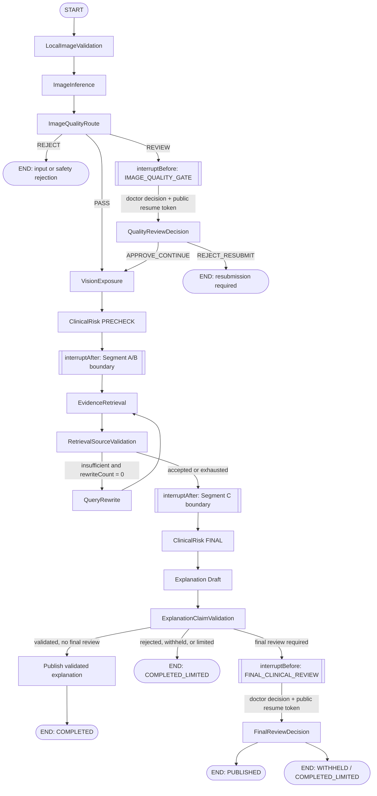
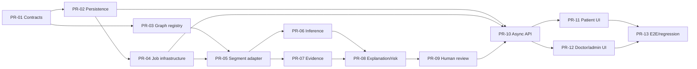

# PLAN-001：Graph-native Segment Runtime 正式实施计划

**状态：** 实施规划（Architecture Frozen V1.1.1 之后）
**基线：** `e7a80b4`（`fix(test): 隔离 COS 配置并恢复测试基线`）
**实施分支：** `codex/plan-001-graph-segment-runtime`
**范围：** 本文只定义后续实施的顺序、契约与验收门禁；不包含 Flyway、Worker、正式 Graph、API 或前端代码。

## 1. 目标、冻结边界与完成定义

本计划将异步诊断工作流拆成可独立评审、验证和回滚的 13 个 PR。实施完成后，运行时必须保持以下不变量：

- 一个数据库 Job 等于一次 Graph-native Segment 执行；不是单节点 tick。
- Graph 是节点拓扑和条件路由的唯一权威；Worker、数据库和 Controller 都不得解释业务条件来选择下一节点。
- MySQL 是 Workflow 的唯一业务真相；Graph checkpoint 只是运行时延续令牌。
- 每个 `inferenceEpoch` 至多发生一次逻辑 `Diagnose` RPC；质量判断和预测展示共享同一个不可变 `InferenceEnvelope`。
- 技术失败经受限重试后安全失败，绝不进入医生队列，也不伪装为安全拒识。
- `IMAGE_QUALITY_GATE` 与 `FINAL_CLINICAL_REVIEW` 是不同任务、不同动作和不同权限边界。

本文落实 ADR-001 至 ADR-009，尤其以 SPIKE-G03 已验证的公开 Graph 契约为唯一运行时前提：公开 `StateSnapshot.next()` 判定后继或 `END`，公开 `StateSnapshot.config().withResume()` 恢复。后续实现不得引入 Graph Core 升级、反射或非公开运行时耦合。

### 1.1 非目标

- 本计划不新建数据库表、迁移、实体、Mapper、GraphDefinition、Worker、Controller 或页面。
- 首次工作流发布不修改同步旧接口 `POST /api/diagnosis/diagnosis`，也不把它内部代理到新工作流。
- 不变更算法 gRPC 协议、生产依赖或生产配置；不增加 Web 搜索、症状分诊或可视化拖拽编排。
- 文中描述的是待实施的设计契约，不能被视为已经交付的生产能力或临床验证。

### 1.2 实施共同约定

所有后续 PR 必须：

1. 从其声明的依赖 PR 的绿色提交开始，使用明确文件清单提交；不得使用全量暂存。
2. 对持久化状态使用受控枚举、原因码、审计事件和版本/CAS，而非自由文本推断。
3. 将外部 I/O（gRPC、ChromaDB、LLM、COS、Graph 执行）置于数据库事务外；只在仍持有有效租约时提交结果。
4. 为每次可重试节点调用提供以 `workflowId + executionEpoch + nodeCode` 为基础的幂等键；供应商调用若不能原生幂等，持久化不可变结果后复用，避免逻辑重复副作用。
5. 不把患者 `question` 作为风险升级、结构化症状抽取或 Graph 路由输入。它仅可保存、展示给复核者和供普通聊天使用。

## 2. 正式 Segment 划分与 Graph 图

### 2.1 决策

正式工作流有五个 Segment。一个 Segment 是从一次 Job 通过公开 Graph API 开始或恢复，到公开中断边界或 Graph 选择 `END` 的连续执行；其中可以包含多个节点及受限内部循环。持久化的 `segmentCode` 是审计和调度标签，不是 Worker 的转移表。

| Segment | Job 类型 | 起点与终点 | 关键保证 |
| --- | --- | --- | --- |
| A：接入、推理和质量门 | `START_SEGMENT` | `START` 到质量复核前、风险预检后或 `END` | 在需要推理的 epoch 中只产生一个 envelope |
| B：质量复核恢复 | `RESUME_SEGMENT` | 质量医生决定到风险预检后或 `END` | 复用原 envelope，不再调用 Diagnose |
| C：证据检索与来源治理 | `RESUME_SEGMENT` | 检索到来源验证后的公开边界 | 最多一次改写，循环由 Graph 自身决定 |
| D：最终风险与解释 | `RESUME_SEGMENT` | 最终风险到最终复核前或 `END` | 解释只在可发布前提下推进 |
| E：最终临床复核恢复 | `RESUME_SEGMENT` | 医生最终决定到 `END` | 医生只决定授权动作，Graph 决定终态路径 |

### 2.2 运行时总图



图中的两个 `interruptBefore` 保留 Graph 已选择的人工节点；系统提交医生决定后创建通用恢复 Job，并以公开恢复令牌连同已持久化决定输入 Graph。任何 Worker 都不把 `APPROVE_CONTINUE`、`REJECT_RESUBMIT`、预测风险或说明校验结果映射成下一节点。

### 2.3 Segment A：图像接入、推理和质量判断

`START → LocalImageValidation → ImageInference → ImageQualityRoute` 是 Segment A 的前半段。合法本地校验失败以输入/安全终态结束，不创建人工任务；技术异常走 Job 重试并在耗尽后以技术失败终态结束。需要模型推理时，`ImageInference` 创建或加载当前 epoch 的不可变 `InferenceEnvelope`，并由质量判断消费。

- `REJECT`：Graph 选择 `END`，只提交拒识或重传原因，不暴露 Top1，也不创建后续 Job。
- `REVIEW`：在 `IMAGE_QUALITY_GATE` 前公开中断。提交业务快照和恢复令牌，不执行人工节点；医生动作后进入 Segment B。
- `PASS`：同一 Segment 继续 `VisionExposure → ClinicalRisk PRECHECK`，在风险预检后公开中断。这样既符合 G03 已证明的边界，又避免为纯展示/预检创建多余 Job。

### 2.4 Segment B：质量复核恢复

Segment B 从质量任务提交的通用 `RESUME_SEGMENT` 开始。恢复输入只包括已授权的医生决定、任务版本与既有公开恢复令牌；Graph 执行 `QualityReviewDecision` 并自行条件路由。

- `APPROVE_CONTINUE` 路由到既有 `VisionExposure → ClinicalRisk PRECHECK`，随后在 A/B 边界再次中断，供 Segment C 恢复。
- `REJECT_RESUBMIT` 路由到 `END`，工作流进入要求重传的受限终态，且没有后续 Job。
- 该 Segment 从不创建新 `InferenceEnvelope`、不调用 `Diagnose`，也不解释医生动作的后继节点。

### 2.5 Segment C：证据检索和来源治理

Segment C 包含 `EvidenceRetrieval → RetrievalSourceValidation`。第一次证据不足且 `rewriteCount = 0` 时，Graph 内部路由至 `QueryRewrite` 并回到 `EvidenceRetrieval`；改写计数是受控 Graph 状态并受最多一次约束。第二次验证后，无论结果为可用或证据不足，均在来源验证后中断，由 Segment D 处理最终风险和受限完成。

该循环是一个 Graph-native Segment 内部循环，不拆为 Worker 手写 retry，也不把检索结果转换为 Job 路由。检索过滤始终固定为 `CURATED_PUBLIC + APPROVED` 和受控 `diseaseCodes/topicCodes`；改写只能改变查询文本，不能改变元数据、可见性或启用外部 Web 搜索。

### 2.6 Segment D：最终风险、解释和发布决策

Segment D 自 Segment C 的公开令牌恢复：`ClinicalRisk FINAL → Explanation Draft → ExplanationClaimValidation`。Graph 基于受控输入而非解释自由文本做路由。

- 满足发布条件、且不需要最终复核：写入已验证快照，Graph 进入发布节点并选择 `END`，业务终态为 `COMPLETED`。
- 证据不足、解释被拒绝、需扣留或风险规则要求受限完成：Graph 选择受限 `END`，终态为 `COMPLETED_LIMITED`，不得保留草稿或仅验证未发布的患者可见解释。
- 需要最终临床复核：在 `FINAL_CLINICAL_REVIEW` 前公开中断。解释快照可为 `VALIDATED`，但尚未公开；医生决定由 Segment E 恢复。

### 2.7 Segment E：最终临床复核恢复

Segment E 以最终复核任务、审批人、任务/工作流版本和公开恢复令牌作为输入。Graph 根据已校验的合法医生动作选择发布、扣留或受限结束；它不是由 Controller 或 Worker 直接改写终态。

医生不能审核自己的病例，不能改写 AI 源字段或改变路由。纠正或“不确定”会扣留已验证 AI 解释并以 `COMPLETED_LIMITED` 结束；不会重新检索。`END` 是唯一结束标识，故不会创建恢复 Job。

## 3. 逻辑数据持久化模型（供 PR-02 实施）

以下是逻辑模型，不是 SQL 设计。字段名、数据类型、索引命名和 FK 物理策略留给 PR-02 在兼容 MySQL 的迁移中实现；所有时间由 MySQL `NOW(6)` 取得。

### 3.1 `t_diagnosis_workflow`

- **责任与主键：** 每个诊断工作流一行，`workflowId` 为主键，是唯一业务聚合根。
- **核心字段：** `ownerUserId`、`status`、`currentSegmentCode`、`graphDefinitionVersion`、`graphDefinitionHash`、`actionVersion`、`workflowVersion`、`inferenceEpoch`、`inferenceEnvelopeId`、`explanationPublicationStatus`、`predictionExposureStatus`、`stopReasonCode`、`limitationReasonCode`、`createdAt`、`updatedAt`。
- **唯一约束与关系：** 以创建端提供的 `ownerUserId + idempotencyKey` 防重复创建；一对多关联事件、Job、节点执行、引用、解释快照、人工任务；可选一对一关联当前 envelope。
- **状态和不可变性：** `WorkflowStatus` 的转换必须由领域契约校验。创建后图版本、定义哈希、所有权、创建幂等键和已接受的 envelope 引用不可改；`workflowVersion` 与状态、当前 Segment、公开状态、终态原因在同一 CAS 更新。
- **可见性与保留：** 患者可见本人的受控状态、已公开结果、限制说明和已发布引用；内部版本、令牌、错误、租约和审计仅管理员/系统，复核资料仅授权医生/管理员。终态数据按医疗演示数据保留策略归档；删除/脱敏必须保留不可伪造审计最小记录。

### 3.2 `t_diagnosis_workflow_event`

- **责任与主键：** 追加式审计事件，`eventId` 主键；记录创建、排队、租约、状态变更、公开状态变更、复核、取消和恢复。
- **核心字段：** `workflowId`、`eventSequence`、`eventType`、`actorType`、`actorId`、`workflowVersion`、`segmentCode`、`reasonCode`、`occurredAt`、受控 `payloadSnapshot`。
- **唯一约束与关系：** `workflowId + eventSequence` 唯一；关联一个 Workflow，必要时引用 Job、节点执行或任务。
- **状态和不可变性：** 无状态迁移；事件一经写入不可更新或删除，序号由同一 workflow CAS/锁控制。
- **可见性与保留：** 患者仅看经投影后的事件；完整审计供医生/管理员按权限查阅。至少与 Workflow 保留期一致，归档后只读。

### 3.3 `t_workflow_job`

- **责任与主键：** 可靠调度单位，`jobId` 主键；每行只调度一个已定义的 Segment。
- **核心字段：** `workflowId`、`jobType`（`START_SEGMENT`/`RESUME_SEGMENT`）、`segmentCode`、`executionEpoch`、`status`、`attempt`、`maxAttempts`、`availableAt`、`leaseOwner`、`leaseToken`、`leaseVersion`、`leaseUntil`、`graphThreadId`、`graphCheckpointId`、`lastErrorCode`。
- **唯一约束与关系：** 对同一 `workflowId + executionEpoch + segmentCode + jobType` 建业务幂等唯一约束；关联 Workflow 和接受的恢复令牌。`graphThreadId/checkpointId` 只指向运行时续接，不表达业务路由。
- **状态和不可变性：** `WorkflowJobStatus` 受状态机控制；Job 身份、执行 epoch 和 Segment 不可改。认领、续租、重试与提交均以 `leaseToken + leaseVersion + status` CAS；已成功/取消 Job 不能重新变为可执行。
- **可见性与保留：** 不对患者暴露；医生只可见必要的受限处理状态，管理员可见诊断信息。终态 Job 和错误依据运营保留期归档，不能早于关联 Workflow 的审计最小期。

### 3.4 `t_workflow_node_execution`

- **责任与主键：** 记录节点的幂等执行与不可变输出快照，`nodeExecutionId` 主键。
- **核心字段：** `workflowId`、`executionEpoch`、`segmentCode`、`nodeCode`、`idempotencyKey`、`status`、`inputDigest`、`outputDigest`、`resultReference`、`startedAt`、`completedAt`、`errorCode`。
- **唯一约束与关系：** `workflowId + executionEpoch + nodeCode + idempotencyKey` 唯一；引用 Workflow、Envelope、Citation 或 Explanation 的不可变结果。
- **状态和不可变性：** 节点执行状态仅可受控推进；完成输出、摘要和幂等键不可改。写入完成结果与工作流推进必须在 segment 成功事务中验证版本；不得让该表成为第二个路由表。
- **可见性与保留：** 默认系统/管理员；受控的患者结果通过专用投影展示。保留以可复现、审计和数据最小化之间的政策决定；可清除大 payload，保留摘要与引用。

### 3.5 `t_inference_envelope`

- **责任与主键：** 单一逻辑推理结果，`inferenceEnvelopeId` 主键；保存质量、预测、拒识/OOD、模型和输入摘要。
- **核心字段：** `workflowId`、`inferenceEpoch`、`imageObjectReference`、`inputDigest`、`modelVersion`、`qualityOutcome`、`diagnosisOutcomeType`、`predictionSnapshot`、`confidenceSnapshot`、`oodSnapshot`、`createdAt`。
- **唯一约束与关系：** `workflowId + inferenceEpoch` 唯一；被 Workflow 当前引用并被质量/展示节点复用。
- **状态和不可变性：** 创建后全行不可变，绝不更新或覆盖 AI 源字段；重新上传才开启新 epoch。该唯一约束与节点幂等键共同保证每个 epoch 的一次逻辑 RPC。
- **可见性与保留：** 原始概率/模型调试信息仅系统/管理员；患者可见性由 `predictionExposureStatus` 控制，拒识时绝不展示 Top1。图像引用与预测保留/删除遵循患者数据策略。

### 3.6 `t_diagnosis_citation`

- **责任与主键：** 检索时冻结的引用快照，`citationId` 主键，不依赖资料之后的可见性变化而重写历史。
- **核心字段：** `workflowId`、`retrievalEpoch`、`sourceDocumentId`、`sourceRevision`、`visibilitySnapshot`、`reviewStatusSnapshot`、`diseaseCodesSnapshot`、`topicCodesSnapshot`、`quotedSpan`、`quotedSpanDigest`、`retrievedAt`、`withdrawnAt`。
- **唯一约束与关系：** `workflowId + retrievalEpoch + sourceDocumentId + sourceRevision + quotedSpanDigest` 唯一；可被解释快照引用。
- **状态和不可变性：** 内容、来源版本、范围和引用段落在创建后不可变；撤回作为单独的受控标记/事件，不篡改原检索事实。生成前必须验证引用段落归属及范围。
- **可见性与保留：** 患者仅见已发布解释中允许展示的引用；医生/管理员可见审计元数据。引用快照随解释保留，资料撤回后按展示策略隐藏但保留审计。

### 3.7 `t_explanation_snapshot`

- **责任与主键：** 解释草稿、验证、扣留和发布的不可变版本，`explanationSnapshotId` 主键。
- **核心字段：** `workflowId`、`revision`、`publicationStatus`、`contentSnapshot`、`claimValidationResult`、`citationSetDigest`、`limitationTextCode`、`createdAt`、`validatedAt`、`publishedAt`、`withheldReasonCode`。
- **唯一约束与关系：** `workflowId + revision` 唯一；引用一个冻结 citation 集合，Workflow 只可指向一个当前接受的版本。
- **状态和不可变性：** 状态使用 `NONE/DRAFT/VALIDATED/REJECTED/WITHHELD/PUBLISHED` 及其合法转换；内容、校验结果和引用集在创建后不可改，状态推进与 Workflow 公共状态 CAS。`REJECTED`、`WITHHELD` 永不发布。
- **可见性与保留：** 患者仅见 `PUBLISHED`；草稿、校验材料和扣留原因仅医生/管理员。`COMPLETED_LIMITED` 不保留患者可见草稿或仅验证版本；保留历史用于审计并按数据政策脱敏。

### 3.8 `t_human_review_task`

- **责任与主键：** 人工复核工作项，`reviewTaskId` 主键。
- **核心字段：** `workflowId`、`reviewType`、`status`、`assignedDoctorId`、`submittedDoctorId`、`decision`、`decisionReasonCode`、`taskVersion`、`createdAt`、`claimedAt`、`submittedAt`、`graphThreadId`、`graphCheckpointId`。
- **唯一约束与关系：** 对活动任务使用 `workflowId + reviewType + activeMarker` 唯一，确保同型待办不重复；关联 Workflow、审核人和接受的恢复令牌。
- **状态和不可变性：** 类型、工作流与创建令牌不可改；认领、提交、撤销采用 `taskVersion` CAS。服务层在持久化前校验医生权限、非本人病例及动作与任务类型/预测状态兼容性。
- **可见性与保留：** 患者只见经授权的处理状态，不见内部任务细节；任务详情仅被指派医生和管理员可见。复核决定、审批人与时间按审计期保存。

## 4. 事务、租约与提交边界

### 4.1 Workflow 创建事务

在一个本地 MySQL 事务内，按创建幂等键：创建 Workflow（`CREATED` 后转 `QUEUED`）、插入 `CREATED`/`QUEUED` 事件、创建唯一的 `START_SEGMENT` Job。冲突时返回已存在的同一工作流，不创建第二个 Job。Graph 和外部服务均不得在此事务中调用。

### 4.2 Job 认领事务

Worker 在短事务内以 MySQL 时间选择到期且可用的 Job（`SELECT ... FOR UPDATE SKIP LOCKED`）：确认未取消/终态、更新为 `LEASED`、生成新的高熵 `leaseToken`、`leaseVersion + 1`、设置 `leaseUntil`，并追加租约事件。所有可用性、过期判断和续租均使用 MySQL `NOW(6)`，不使用应用机时钟。

### 4.3 Segment 成功提交事务

Graph 执行、外部 I/O 和 checkpoint 写入均在事务外完成。随后在一个事务中：验证 Job 的 `LEASED + leaseToken + leaseVersion`、验证 Workflow `workflowVersion` 和未取消状态、持久化不可变节点/业务快照、接受公开 `graphThreadId/checkpointId`、CAS 更新 Workflow、插入事件、将当前 Job 标为 `SUCCEEDED`，并且仅当 `StateSnapshot.next()` 不是 `END` 时创建一条唯一的通用 `RESUME_SEGMENT` Job。

Job 成功与后续 Job 创建在同一事务内；因此业务提交成功而下一个 Job 遗失不能发生。Graph 选择 `END` 时，事务只提交终态与成功 Job，明确不创建 Resume Job。

### 4.4 人工复核提交事务

在一个事务内读取并验证活动任务、医生权限、非本人病例、`taskVersion`、Workflow 版本和合法动作：保存医生决定与审计信息、CAS 更新任务和 Workflow、创建与接受 checkpoint 对应的唯一通用 `RESUME_SEGMENT` Job、插入审计事件。提交后才允许 Worker 认领恢复 Job；Controller 不运行 Graph，不解释下一节点。

### 4.5 取消、失败和过期租约

取消与成功提交竞争同一 Workflow 版本：先成功的 CAS 胜出；终态不可取消。过期 Worker 可继续在事务外完成计算，但它的 `leaseToken/leaseVersion` 已失效，故不能提交。恢复扫描只把过期 `LEASED` Job 安全地重新排队或在上限后标为失败；不会根据节点输出补造路由。

## 5. Checkpoint 与业务状态一致性

| 场景 | 接受规则与恢复方式 |
| --- | --- |
| A. checkpoint 已写入，业务事务失败 | checkpoint 尚未被 Workflow/Job 的接受记录引用，不能视为业务已推进。重试从最后已接受的业务恢复令牌执行；节点幂等键和不可变快照避免外部副作用重复。未引用 checkpoint 标为运行时孤儿，按 Saver 的可审计 TTL/清理任务回收，且绝不反向覆盖业务状态。 |
| B. 业务事务成功，Worker 响应前崩溃 | 同一事务已把当前 Job 标为 `SUCCEEDED`，并在非 `END` 情况创建唯一 Resume Job；扫描器会继续调度。重复提交会因旧 `leaseToken/leaseVersion` 或旧 `workflowVersion` 被拒绝。客户端响应丢失不影响业务完成，可按幂等键查询。 |
| C. 医生决定已提交，恢复 Job 未执行，服务重启 | Workflow、`HumanReviewTask`、已接受的公开恢复令牌和 `READY` Resume Job 均已原子保存。启动恢复扫描根据 Job 重新认领，载入持久化的决定并用公开恢复契约执行；不得要求医生重复提交。 |
| D. graphDefinitionVersion 缺失 | Registry/Worker readiness 在启动和执行前显式校验版本与哈希。缺失时不得回退到“最新”定义；阻止 Worker 就绪，或将受影响 Workflow 安全终止为 `UNSUPPORTED_GRAPH_VERSION` 并保留可审计原因。 |

## 6. PR 依赖图与统一交付格式



每个 PR 必须以以下完成汇报格式关闭（下面各 PR 的“完成汇报”均指此格式，另附其专属验收结果）：

```text
PR-XX 完成汇报
基线/依赖提交：<SHA>
实现范围与实际文件：<explicit list>
禁止范围核查：<0 deviations or approved exception>
测试：<command and totals>
验收：<each listed criterion PASS/FAIL>
回滚：<feature flag / revert commit / forward-only data note>
风险与未验证项：<explicit list>
工作树：<clean status>
```

## 7. 正式 PR 拆分

### PR-01：领域枚举与强类型契约

- **目标/依赖：** 建立 Workflow、Job、解释、暴露、推理、复核、原因码及强类型节点输入输出；依赖基线，无其他 PR。
- **允许目录：** `src/main/java/**/workflow/**`、`src/test/java/**/workflow/**`、必要的架构文档。
- **禁止范围：** Flyway、实体/Mapper、Worker、GraphDefinition、Controller、旧接口、前端和依赖升级。
- **接口或 Schema：** `WorkflowStatus`、`WorkflowJobStatus`、`ExplanationPublicationStatus`、`PredictionExposureStatus`、`InferenceOutcomeType`、`ReviewType`、`ReviewDecision`、`ReasonCode`，以及不可变节点 DTO 与状态不变量 API；不产生表结构。
- **核心任务：** 定义合法转换、终态规则、动作兼容性、患者暴露约束和 `COMPLETED`/`COMPLETED_LIMITED` 不变量。
- **测试/验收：** 枚举语义、非法迁移、医生动作兼容性和序列化兼容性；`mvn test` 全绿。
- **回滚/风险/汇报：** 常规代码 revert；风险是枚举过早固化，需在 PR-02 前复核持久化映射；按第 6 节模板报告。

### PR-02：数据库模型与 Flyway

- **目标/依赖：** 实现第 3 节的表、索引、唯一约束、外键策略与 Repository/Mapper；依赖 PR-01。
- **允许目录：** `src/main/resources/db/migration/**`、对应实体/Mapper/Repository、repository 集成测试、数据库架构文档。
- **禁止范围：** Worker、正式 Graph 节点、Controller、前端、旧接口和算法协议。
- **接口或 Schema：** 八张规划表及所需枚举持久化；公开恢复令牌仅作为字段，不实现恢复逻辑。
- **核心任务：** 采用向前 Flyway、兼容当前数据策略的索引/FK、CAS 列和业务唯一键；明确 H2/MySQL 差异的测试策略。
- **测试/验收：** 空库迁移、重复迁移、H2/MySQL 兼容策略、唯一约束、状态字段及审计不可变性；`mvn test` 全绿。
- **回滚/风险/汇报：** 不自动删业务数据；关闭功能并以向前修复迁移处理问题。风险是迁移锁和历史表冲突；报告迁移版本、升级/降级演练边界。

### PR-03：GraphDefinitionRegistry 与版本保护

- **目标/依赖：** 注册 v1 图定义元数据并实现显式版本/哈希保护；依赖 PR-01。
- **允许目录：** `src/main/java/**/workflow/graph/**`、对应测试、`docs/architecture/**`。
- **禁止范围：** 正式业务节点、Job 租约、Flyway 变更、Controller 和 Graph Core 升级。
- **接口或 Schema：** `DiagnosisGraphDefinition`、`GraphDefinitionRegistry`、`definitionHash`、`actionVersion` 与 Worker readiness 契约。
- **核心任务：** 指定版本加载、版本/哈希匹配、启动和执行前校验；定义缺失版本的安全错误。
- **测试/验收：** 指定版本加载、缺失版本失败、禁止 latest fallback、旧 Workflow 版本保护；不得依赖非公开运行时接口。
- **回滚/风险/汇报：** 使用 Feature Flag 停止执行或 revert registry 代码；风险是残留旧版本，报告注册清单和 readiness 输出。

### PR-04：可靠 Segment Job 基础设施

- **目标/依赖：** 实现 Job claim、MySQL 租约、fencing token、续租、CAS、重试与过期恢复；依赖 PR-01、PR-02。
- **允许目录：** `src/main/java/**/workflow/job/**`、Repository/Mapper 的 Job 部分、集成测试、运行文档。
- **禁止范围：** 正式诊断 Graph、业务节点、人工复核 API、前端和业务路由表。
- **接口或 Schema：** Job claim/renew/commit/retry 端口与 `START_SEGMENT`/`RESUME_SEGMENT` 调度语义。
- **核心任务：** 使用 MySQL `NOW(6)` 和短事务；实现唯一 Job 创建、租约 CAS、崩溃扫描和取消竞态边界。
- **测试/验收：** 多 Worker 抢占、过期 Worker 提交失败、重试上限、MySQL 时间、服务重启恢复和终态不可再执行。
- **回滚/风险/汇报：** `workflow.execution.enabled=false` 停止抢占，代码可 revert；风险是租约续租失败和 DB 压力，报告竞争测试证据。

### PR-05：Graph Segment Runtime Adapter

- **目标/依赖：** 以 G03 的公开契约桥接 `START_SEGMENT`/`RESUME_SEGMENT`、恢复令牌、`END` 和通用 Resume Job；依赖 PR-03、PR-04。
- **允许目录：** `src/main/java/**/workflow/runtime/**`、Graph adapter 测试、运行时架构文档。
- **禁止范围：** 业务诊断节点、数据库新表、Controller、前端、第二套路由和非公开 API。
- **接口或 Schema：** 公共 `StateSnapshot` 投影、`threadId/checkpointId`、`withResume()` 适配器、Segment 结果对象。
- **核心任务：** 从已接受令牌恢复、读取公开 next/END、将事务性后继 Job 创建委托给 PR-04；不把条件值翻译为节点。
- **测试/验收：** PASS/REVIEW/REJECT、跨 Saver 恢复、`END` 无 Resume Job、无第二套路由、仅公开 Graph API。
- **回滚/风险/汇报：** Feature Flag 暂停执行；风险是 checkpoint 与业务提交不原子，报告场景 A/B/C/D 演练结果。

### PR-06：InferenceEnvelope 与单次 Diagnose

- **目标/依赖：** 实现本地图片检查、单次 RPC、不可变 envelope、质量/展示节点和预测暴露；依赖 PR-05。
- **允许目录：** `src/main/java/**/workflow/inference/**`、必要的 gRPC client 适配层、测试与安全文档。
- **禁止范围：** gRPC proto 变更、证据/解释实现、人工复核 UI、旧接口和生产算法配置。
- **接口或 Schema：** `InferenceEnvelope`、本地校验结果、受控质量与暴露 DTO；复用 PR-02 表而非新增业务表。
- **核心任务：** 以 epoch 幂等键调用/复用 Diagnose，质量门恢复读取同一 envelope，技术失败与安全拒识严格分开。
- **测试/验收：** 每个 epoch 一次 RPC、质量复核后不重复推理、技术失败不转人工、拒识不泄露 Top1、输入无效不调用 RPC。
- **回滚/风险/汇报：** 停止 Worker 或关闭新流程；风险是缓存错配与泄露，报告 RPC 计数和展示断言。

### PR-07：证据检索和来源治理

- **目标/依赖：** 实现受控检索、最多一次改写、来源验证和 Citation Snapshot；依赖 PR-05，使用 PR-02 持久化。
- **允许目录：** `src/main/java/**/workflow/evidence/**`、受限知识库适配层、测试、知识治理文档。
- **禁止范围：** Web 搜索、私人资料检索、解释发布、人工任务、Controller/前端和无控制元数据改写。
- **接口或 Schema：** 受控 `diseaseCodes/topicCodes` 输入、来源验证结果、Citation Snapshot、rewrite count。
- **核心任务：** Graph 内部一次回路、段落归属/摘要校验、撤回来源的历史语义和不可变引用。
- **测试/验收：** 不检索 `PRIVATE_USER`、`QUARANTINED` 或未批准资料；不使用 Web Search；`quotedSpan` 校验、改写上限、来源撤回语义。
- **回滚/风险/汇报：** 关闭新流程且保留快照；风险为 ChromaDB 超时/引用膨胀，报告过滤证据和快照大小指标。

### PR-08：解释与风险控制

- **目标/依赖：** 实现 `ClinicalRisk PRECHECK/FINAL`、解释草稿、声明校验、公开状态和受限完成；依赖 PR-06、PR-07。
- **允许目录：** `src/main/java/**/workflow/explanation/**`、`**/workflow/risk/**`、测试与患者安全文档。
- **禁止范围：** 自由文本风险分流、新医生 API、前端、旧接口和重新检索机制。
- **接口或 Schema：** 解释状态转换、风险规则输入/输出、快照接受/扣留契约。
- **核心任务：** 保证风险路由只用受控字段；把引用验证置于草稿前、声明验证置于草稿后；使 `COMPLETED` 和 `COMPLETED_LIMITED` 满足 ADR-003。
- **测试/验收：** `REJECTED` 永不发布、`VALIDATED` 可扣留、`COMPLETED` 必有已发布解释、自由文本不参与风险路由、证据不足受限完成。
- **回滚/风险/汇报：** Feature Flag 停止公开新解释；风险是 LLM 不稳定，报告确定性规则与 mock 契约覆盖。

### PR-09：人工复核

- **目标/依赖：** 实现任务创建/认领/提交、两种 ReviewType、动作校验与通用恢复 Job；依赖 PR-08、PR-04、PR-05。
- **允许目录：** `src/main/java/**/workflow/review/**`、授权服务扩展、任务 Repository/Mapper、测试与审计文档。
- **禁止范围：** 新 REST Controller、医生/患者页面、业务路由 switch、重检索和 AI 源字段覆盖。
- **接口或 Schema：** 任务服务命令 DTO、合法动作矩阵、任务版本 CAS 与审计事件；使用既有任务表。
- **核心任务：** 区分质量门和最终复核；强制非本人审核；提交时原子创建 Resume Job；纠正/不确定只扣留且不检索。
- **测试/验收：** 医生不可审自己病例、质量门不可确认疾病、拒识与有效预测动作分离、纠正后不重新检索、决定提交后重启可恢复。
- **回滚/风险/汇报：** 暂停执行而不丢待办；风险为取消和提交竞态，报告冲突结果与审计链。

### PR-10：新异步 API

- **目标/依赖：** 暴露新工作流创建、读取、事件和取消 API；依赖 PR-02、PR-04、PR-09。
- **允许目录：** `src/main/java/**/controller/**` 中新增工作流端点、相应 service/DTO/测试、OpenAPI 文档。
- **禁止范围：** 修改同步旧接口、自动迁移旧接口调用、前端页面和 Graph/Worker 路由。
- **接口或 Schema：** `POST /api/diagnosis/workflows`（`202 Accepted`）、`GET /api/diagnosis/workflows/{id}`、`GET /api/diagnosis/workflows/{id}/events`、`POST /api/diagnosis/workflows/{id}/cancel`。
- **核心任务：** 所有权/角色隔离、创建幂等键、最小患者安全投影、取消 CAS 和终态拒绝；Controller 只调用服务，不运行 Graph。
- **测试/验收：** 权限隔离、202 响应、幂等创建、取消竞态、终态不可取消、旧同步接口回归。
- **回滚/风险/汇报：** Feature Flag 或路由下线新接口，保留已有数据；风险是 API 泄露内部字段，报告响应字段审查。

### PR-11：患者前端

- **目标/依赖：** 提供上传、轮询/SSE、状态 Stepper、结果分区、引用、风险、医生状态与受限 Trace；依赖 PR-10。
- **允许目录：** `frontend/src/**` 中新工作流路由/组件/API client、前端测试和用户文档。
- **禁止范围：** 修改旧诊断页面行为、后台/Graph/数据库、医生管理功能和症状分诊。
- **接口或 Schema：** 仅消费 PR-10 的最小公开 DTO；Feature Flag/独立路由保护新流。
- **核心任务：** 将 AI、医生状态和参考解释分区；严格按公开状态隐藏预测、扣留解释和内部 Trace。
- **测试/验收：** 拒识不显示 Top1、`WITHHELD` 不显示内容、AI/医生结果分区、旧页面未破坏、深浅主题基本可用。
- **回滚/风险/汇报：** 关闭新路由/Feature Flag 即可；风险是状态时序和展示混淆，报告视觉与权限测试证据。

### PR-12：医生与管理端

- **目标/依赖：** 提供医生任务列表、复核详情、知识资料审核和运行 Trace 管理视图；依赖 PR-10、PR-09、PR-07。
- **允许目录：** `frontend/src/**` 医生/管理路由组件、必要的受限管理 API、前端与权限测试、管理文档。
- **禁止范围：** Web 拖拽编排、患者旧流程重写、Graph/算法协议变更及未授权数据批量导出。
- **接口或 Schema：** 最小化任务认领/提交和受限 Trace DTO；知识审核只落实 ADR-008 已批准语义。
- **核心任务：** 明确任务类型和合法动作，展示不可变 AI 源记录/引用快照，按角色限制 Trace。
- **测试/验收：** 非医生无权、自己病例不可提交、类型动作限制、撤回资料展示受控、管理 Trace 不向患者泄露。
- **回滚/风险/汇报：** 关闭管理路由/Feature Flag；风险是权限绕过，报告角色矩阵与 UI/API 双层测试。

### PR-13：端到端验收与旧接口回归

- **目标/依赖：** 只验证集成闭环、失败恢复、并发与兼容性；依赖 PR-11、PR-12 及全部前序 PR。
- **允许目录：** `src/test/**`、`frontend/**` 测试、隔离测试配置、验收文档与发布 runbook。
- **禁止范围：** 新主要功能、领域模型重构、生产依赖升级、协议/API 扩张。
- **接口或 Schema：** 不新增生产接口/Schema；补齐测试 fixture 与隔离服务契约。
- **核心任务：** 以 mock 或隔离环境组合验证所有段、跨 Saver 恢复、租约竞争、权限、审计、旧接口回归和发布/停止路径。
- **测试/验收：** 第 9 节全部 E2E 场景通过；后端与前端全量回归绿；报告已验证工程行为与仍未做的临床验证。
- **回滚/风险/汇报：** 不含数据回滚；发布失败时关闭执行和新路由、按向前迁移策略处理。风险是环境漂移，报告版本、配置指纹和测试隔离证明。

## 8. ADR 需求追踪矩阵

| 冻结要求 | ADR | 实施 PR | 验收测试 |
| --- | --- | --- | --- |
| 系统仅为辅助诊断演示，患者文案分层 | ADR-001 | PR-08、PR-10、PR-11、PR-13 | Patient wording boundary、工程验证不等于临床验证 |
| MySQL 唯一业务真相，checkpoint 非状态机 | ADR-002 | PR-02、PR-04、PR-05、PR-13 | Restart Recovery、checkpoint 事务场景 A/B/C |
| 证据—解释顺序与扣留/发布不变量 | ADR-003 | PR-07、PR-08、PR-09 | Publication state machine、WITHHELD/REJECTED never publish |
| 两类人工复核和动作边界 | ADR-004 | PR-01、PR-09、PR-12 | Review action matrix、self-review denied、no re-retrieval |
| 租约、fencing、CAS 与技术失败边界 | ADR-005 | PR-02、PR-04、PR-06、PR-13 | Lease expiry、retry limit、technical failure routing |
| 旧同步接口保持不变，新接口独立 202 | ADR-006 | PR-10、PR-11、PR-13 | Legacy synchronous regression、new async contract |
| Graph 唯一路由、公开恢复、单次推理 | ADR-007 | PR-03、PR-05、PR-06 | Public checkpoint resume、no duplicate routing、one RPC per epoch |
| 受控知识范围与无 Web 搜索 | ADR-008 | PR-07、PR-12、PR-13 | Visibility filter、rewrite invariant、withdrawal semantics |
| 自由文本不触发风险或路由 | ADR-009 | PR-01、PR-08、PR-10、PR-13 | Question isolation、risk input allow-list |

## 9. 测试矩阵与分层门禁

| 层级 | 最小覆盖 | 主要 PR | 隔离要求 |
| --- | --- | --- | --- |
| 单元测试 | 状态迁移、路由输入、枚举兼容、Citation 校验、风险规则、医生动作 | PR-01、06、07、08、09 | 无真实外部凭据 |
| Repository 集成 | Flyway、CAS、唯一约束、Job claim、lease、fencing token | PR-02、04 | H2/MySQL 明确分层；MySQL 使用专用测试库 |
| Graph Runtime | Segment PASS/REVIEW/REJECT、checkpoint resume、END、图版本 | PR-03、05、06 | 公开 API 与隔离 Saver；不得触碰生产 checkpoint |
| 外部服务契约 | gRPC、ChromaDB、LLM、COS 的请求/超时/错误映射 | PR-06、07、08 | Mock 或隔离环境，不使用生产凭据 |
| API/前端 | 授权、最小投影、轮询/SSE、隐藏规则、旧页面 | PR-10、11、12 | 测试账号和模拟数据 |
| E2E | 全路径、崩溃、竞争、审计和旧接口回归 | PR-13 | 独立数据库/服务 fixture |

PR-13 的 E2E 清单必须至少包含：普通有效病例直接完成；高风险有效病例等待医生；质量复核后继续；质量复核拒绝重传；低置信度拒识；OOD；证据不足；解释校验失败；医生确认；医生纠正；医生无法确认；取消竞态；Worker 崩溃恢复；过期 Lease 竞争。

每一 PR 的最小门禁为：格式/静态检查通过、目标层测试通过、全量 `mvn test` 绿色、变更范围审查通过。前端 PR 另需其构建与目标 UI 测试。工程测试只能证明实现符合契约，不能证明临床效果、安全性或医生资质。

## 10. 发布、停止和回滚策略

### 10.1 数据库与后端

- Flyway 只向前；自动回滚绝不删除业务数据。错误通过向前修复迁移、代码回退和 Feature Flag 组合处理。
- 每次表结构变更必须至少跨一个发布周期保持向后兼容；移除旧列/索引需单独 ADR/计划。
- `workflow.execution.enabled=false` 必须让 Worker 停止认领新 Job，用于迁移、版本不兼容和紧急停止；它不删除 Job、checkpoint 或审计记录。
- 发现缺失图版本、不可恢复租约故障或关键外部依赖异常时，优先暂停执行、保留证据、按受控原因安全失败，不静默切换新图。

### 10.2 API 与前端

- 新异步接口独立发布；同步旧接口保持原行为，V1 不删除、不重命名、不自动委派。
- 患者和医生新页面使用独立路由或 Feature Flag 灰度；禁用时回到稳定旧路径，而不是覆盖旧诊断流程。
- 发布应先部署兼容 schema，再部署 registry/job/runtime，最后逐步启用 API 与界面；回退顺序反向，但 schema 保留并采取向前修复。

## 11. 风险登记

| 风险 | 触发条件 | 影响 | 检测方式 | 缓解措施 | 对应 PR |
| --- | --- | --- | --- | --- | --- |
| checkpoint 与业务事务不原子 | checkpoint 写入后提交失败 | 重复计算或孤儿令牌 | 场景 A 演练、孤儿计数 | 仅接受事务中引用的令牌、节点幂等键、TTL 清理 | PR-04、05 |
| checkpoint 垃圾增长 | 重试/崩溃频繁 | 存储膨胀 | orphan age/size 指标 | 接受引用审计、延迟清理、容量告警 | PR-05、13 |
| Graph 版本残留 | 升级时旧 workflow 未完成 | 无法恢复或错图恢复 | registry readiness、版本计数 | 版本/哈希强校验，保留旧定义直至无引用 | PR-03、05 |
| 长人工复核阻塞旧版移除 | 任务长期未提交 | 版本保留成本 | 活动任务年龄报表 | 到期策略与管理提醒，禁止 latest fallback | PR-03、09、12 |
| 重复 gRPC 副作用 | 租约失效/重试 | 结果不一致或成本增加 | epoch RPC 计数、幂等冲突 | 不可变 envelope、节点幂等键、结果复用 | PR-06、13 |
| ChromaDB 超时 | 依赖慢/不可用 | 证据缺失或任务拖延 | 超时/重试指标、契约测试 | 限时重试、受限完成、绝不使用 Web 搜索替代 | PR-07、13 |
| LLM 输出不稳定 | 草稿/校验波动 | 不当解释 | 固定 fixture、拒绝率监控 | 确定性校验、状态扣留、mock 契约 | PR-08、13 |
| Citation Snapshot 膨胀 | 长文/重复检索 | DB 存储增长 | 每 workflow 引用大小指标 | 段落限额、digest 去重、归档策略 | PR-02、07 |
| 医生纠正展示混淆 | AI 与医生结论同时显示 | 患者误解 | UI 场景测试、人工评审 | 分区展示、扣留 AI 解释、受控文案 | PR-08、09、11 |
| 取消与医生提交竞态 | 并发请求 | 错误恢复或双 Job | CAS 冲突测试、审计序列 | 同一 workflowVersion 决胜、终态不可取消 | PR-04、09、10 |
| Job Lease 续租失败 | DB 抖动/长调用 | 重复执行 | 续租失败告警、fencing 测试 | MySQL 时钟、token/version CAS、可重试幂等 | PR-04、13 |
| 数据库与应用时钟混用 | 应用节点时钟偏移 | 错误 claim/过期判断 | 时钟来源代码审查、集成测试 | 所有 lease 时间用 `NOW(6)` | PR-04 |

## 12. PLAN-001 自检与下一步

本计划满足：基于 `e7a80b4`；只产生规划文档；定义五段 Graph-native Segment；给出八张逻辑表和四类事务；覆盖 checkpoint 异常；拆分 13 个 PR；映射 ADR-001 至 ADR-009；包含测试、发布/回滚和风险登记；不创建任何生产业务代码。

PLAN-001 通过后，下一张业务工作卡为 **PR-01：Workflow Domain Contracts**，且只能实现状态枚举、原因码、复核类型/动作、强类型节点输入输出、状态不变量校验和单元测试；不得提前创建数据库或 Worker。
