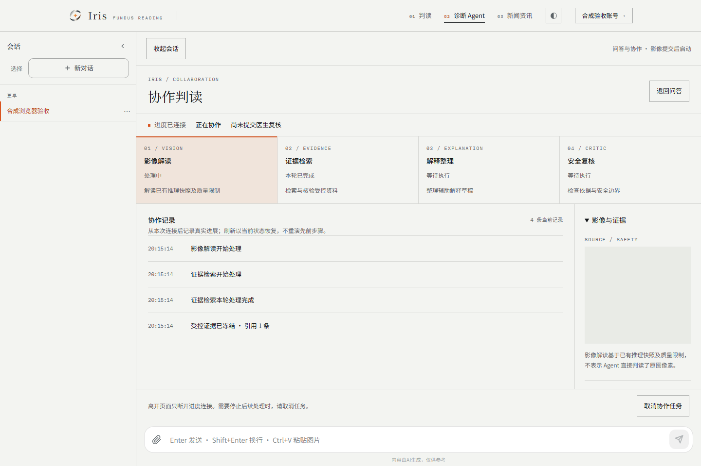
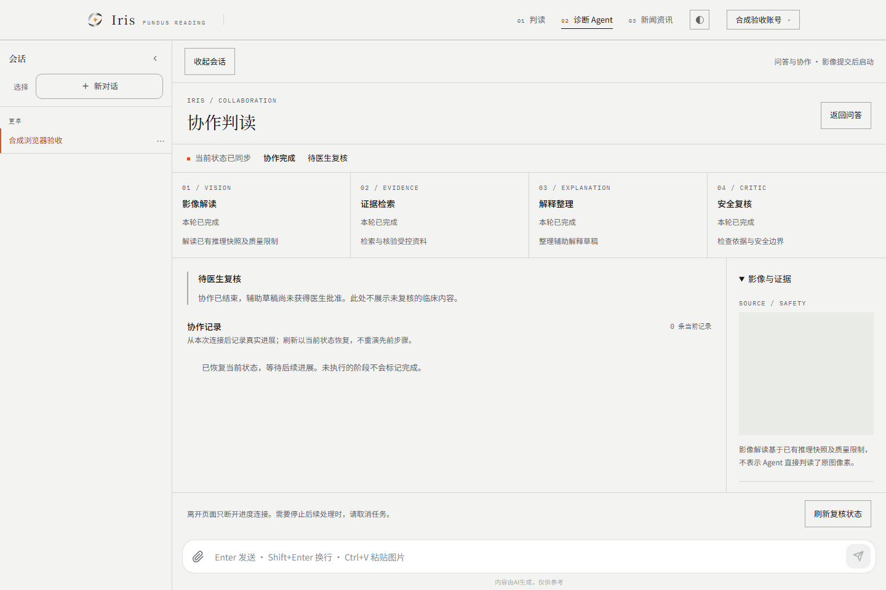

# TASK-05：Iris React 协作工作台验收

2026-11-11。**当前 v1 元数据契约内的 UI 工程验收 PASS；完整 TASK-05 产品范围与实时多 Agent 整体验收仍为 PARTIAL。** 本次通过真实浏览器到 Java HTTP/SSE、Coordinator 和临时 MySQL 的工程联调；存储、推理、模型及会话引导是确定性合成夹具。真实提供方、真实 Redis、正常医学输入、完整引用/影像授权读取及医生发布均未因此放行。

## 输入与隔离

- 独立工作树：`D:/Work/code/eye-diagnosis/.claude/worktrees/realtime-collaboration-ui`，分支 `codex/realtime-collaboration-ui`。
- Java 基线为 `6572743169027bb1e7c27d7d969a26ed89d99cd1`；继承 TASK-04 的 React 固定来源 `a0efaf46d6f8b53bea4a35d613fc806e2f6e9d47`。没有整分支合并 master，没有提交、暂存、推送或部署。
- 引入 TASK-03 与 TASK-04 的未提交候选，仅在本工作树整合。两份 CI 的 backend/web job 均保留；AGENTS/CLAUDE 合并正式 React、V18 和实际 `/api/agent/collaboration-runs` 索引。原工作区仅复制 v1.1 计划与实施准备两份必要输入文档，未复制 OOD/V15 或其他脏文件。
- 开工输入逐文件 SHA-256 见 [inputs.json](realtime-collaboration-ui-20261111/inputs.json)。结束时检查：原工作区 34 个文件、TASK-03 的 18 个文件、TASK-04 的 186 个文件及路径集合全部未变，三者暂存区保持为空。
- 实际验收对象是基线加未提交文件；最终候选路径/哈希、逐用例结果、XML/JSON 原始报告哈希见 [results.json](realtime-collaboration-ui-20261111/results.json)。未刷新远端状态。

## 实现

原 `/agent` 增加默认关闭的“影像协作”，保留普通问答、附件、历史、会话、资源和原 MCP/RAG 数据路径。`CollaborationTaskForm` 调用已有图像任务 API；只在显式提交时上传，经安全状态确认后受理协作。等待最多 60 次、间隔 2 秒；超时重试沿用已创建任务及稳定幂等键。离开作用域中止等待和订阅，不发送任务取消。

`CollaborationWorkspace` 展示四角色、执行/审核独立状态和安全边界；`CollaborationTimeline` 仅显示实际快照之后收到的事实，患者只见安全进度，授权医生/管理员可以展开服务端已投影的交接/修订元数据。未知原因不直接输出。终止时未执行的角色不标记完成，执行成功不等于医生批准或内容已发布。

影像/证据侧栏只使用身份/runId 绑定的本次上传 Blob 预览；返回问答、授权撤回、身份变化或卸载会回收已持有的 URL。刷新和已有任务选择不使用其他聊天图片补位。不直接渲染模型 HTML、原始异常、隐藏推理、草稿正文或不可信链接。

时间线默认最近 30 条、可展开至 reducer 的 200 条窗口；读者上滑后停止自动跟随。手机保留主舞台和角色状态，会话可收起，影像/证据可折叠；明暗主题使用同一 tokens.css，状态有文字和 live region，reduced-motion 下关闭非必要过渡。操作说明见 [客户端契约](../collaboration-client.md) 和 [浏览器运行说明](../../web/e2e/README.md)。

## 命令与实际结果

环境：PowerShell 7.6.9、Corretto JDK 21.0.7、Maven 3.9.9、Node 22.21.0、npm 10.9.4、Playwright 1.65.0、实际 Chromium 151.0.7922.34。复用本机已有 Chromium，通过 `E2E_CHROMIUM_EXECUTABLE_PATH` 显式指定；没有下载 Playwright 默认的 revision 1254。MySQL 为本卡在 target 下新建并独立启动的临时实例；未修改原有实例、运行中的 8081 服务或生产库。

| 检查 | 最终结果 |
| --- | --- |
| `npm ci --offline --no-audit --no-fund --cache <已有用户缓存>` | PASS；没有新增或升级依赖，锁文件保持 TASK-04 内容 |
| `npm run typecheck` / `npm run lint` / `npm run build` | 全部 PASS；既有大 chunk 警告保留 |
| `npm test -- --reporter=json --outputFile=../target/task05-vitest.json` | **332/332 PASS，0 failures，0 skipped**；TASK-04 的 298 项加本卡 34 项 |
| `mvn -o -B -Dtest=CollaborationRunTest,PatientDraftTest,CoordinationPocTest test` | **67/67 PASS，0 failures/errors/skipped**：22 + 41 + 4；两个专项均设置各自隔离库变量 |
| `npx --offline playwright test e2e/collaboration.spec.ts --output=../target/task05-fixture-browser --reporter=json` | **12/12 PASS，0 skipped/flaky**；最终运行未使用 update-snapshots，四组已生成基线比对通过 |
| `npx --offline playwright test e2e/collaboration-backend.spec.ts --output=../target/task05-real-browser --reporter=json` | **1/1 PASS，0 skipped**；真实浏览器/Java/MySQL，三种运行：正常、在途取消、活动撤权 |
| `npx --offline playwright test e2e/collaboration-default-off.spec.ts --output=../target/task05-default-off-browser --reporter=json` | **1/1 PASS，0 skipped**；默认关闭的生产构建预览，普通聊天合成 SSE 回归，协作请求为 0 |
| `python -m unittest discover -s scripts/tests -p test_check_surefire_skips.py` | **19/19 PASS** |
| `check_surefire_skips.py ... collaboration` / `... issue19` | PASS；22/41 项均未跳过或丢失 |
| `check_collaboration_fixture.py --backend-root .` | PASS，14 种事件、12 个快照字段；[源码契约](realtime-collaboration-ui-20261111/source-contract.json) |
| `check_steering_docs.py` / `check_design_doc.py` / `check_probability_scale.py` / `git diff --check` | 全部 PASS |
| `python scripts/check_task05_inputs.py` | PASS，原工作区及两张输入卡内容/路径集合未变 |

前端命令在 `web/` 执行，Python/Maven 在根目录执行；完整启动方式见浏览器说明。两类 Playwright 报告及 Vitest 原始报告位于本地 target，结果清单保留其 SHA-256 与逐用例结果。截图基线位于 `web/e2e/collaboration.spec.ts-snapshots/`，为本次检查后的 Windows Chromium 初始基线，不代表跨平台或人工签署的临床批准。

### 真实后端浏览器证据

`CollaborationBrowserServer` 只在测试 classpath 中，以 loopback HTTP 启动实际 CollaborationRunController、DiagnosisTaskController、Coordinator、事务事件和 JsonConfig；任务表及事件来自临时 MySQL。图像校验/上传幂等使用实际 DiagnosisTaskService，存储替换为内存对象，可信推理替换为明确的合成 protobuf；UserService 会话引导为测试替身，协作读取/订阅使用实际 Spring Session 过滤器和 MapSessionRepository。未启动正式全应用、真实 Redis、COS、Python gRPC 或模型提供方。

浏览器用一张 canvas 生成的 1px PNG 发起任务。先让 Vision/Evidence 均阻塞，确认运行中，再单独放开 Evidence：浏览器通过 SSE 时间线观察到 Evidence 完成时 Vision 仍为 RUNNING。不是把终态记录拆成动画。随后放开 Vision，实际 Coordinator 完成四角色，患者看到 SUCCEEDED + PENDING，未出现内部草稿或医生交接；刷新前后的模型调用/运行计数完全相同。

第二张合成图在模型在途时取消；即使放开模型并刷新状态，仍为 CANCELLED、未提交复核。第三张合成图在订阅活动时使 Session 失效：客户端清除角色/证据面板，并实际调用 revokeObjectURL 回收本地影像；放开合成模型后后端独立完成，证明撤权/断流没有被当成取消。测试中没有 `route.fulfill` 或替换协作 SSE。

### 可访问性与视觉边界

已检查 1440×960 和 390×844 的明暗主题截图；浏览器验证无横向溢出，患者/医生可见性、受限/失败/取消态、长列表折叠与回到最新、焦点可见、输入可访问名、工作台可见文字对比度至少 4.5:1、reduced-motion 均通过。新增组件语义与键盘行为另有组件测试。

本次不是完整 WCAG 合规认证，也没有运行 axe 全站扫描、屏幕阅读器实机、Safari/Firefox 或跨平台截图。新增组件未覆盖到的其他产品页面继续保留原验收边界。

## 验证中的失败与修正

1. PowerShell 多层引号使最初的版本/一次性脚本命令解析失败；改为脚本文件和直接结构化读取。临时库初始 SQL 语法、带 query 参数的专项 URL 不符合已有严格隔离规则；修正环境，没有放宽隔离守卫。早期 41 项环境跳过不计入最终 67 项。
2. 旧 context 探针在新工作台展开后被隐藏；保留其作用域负例，并将取消断言改为真实工作台按钮。重复提交测试改为捕获真实按钮后连点，而非查找已经变化的按钮文案。最终 332 项全绿。
3. Playwright 首次发现 JSON 模块缺少 import attribute，以及默认 Chromium revision 未安装；补精确导入并使用已安装的显式浏览器。没有把“未发现测试”算作通过。
4. 两个并行 Playwright 进程曾清理同一个 trace 目录；后续始终使用独立 output。全局 reduced-motion 实现将过渡压到 0.01ms，断言验证其实际可忽略时长，没有要求字符串必须是 0s。
5. 撤权夹具最初直接删除 repository 记录，当前请求的 Session 过滤器又将其保存；改用标准 invalidate()，再补活动订阅和 Blob 回收断言。生产会话实现未因此被修改。
6. 视觉检查去掉重复返回按钮，补齐截图夹具真实声明的四角色状态；这些截图仍明确是合成契约场景。真实增量和撤权以单独 Java 联调证据记录。

## PARTIAL 与下一步

| 项目 | 当前边界 |
| --- | --- |
| 当前 v1 元数据协作 UI、取消、恢复、主题/手机、工程浏览器联调 | PASS，上述明确环境范围 |
| 首张图直接从全新空会话启动 | 未支持；已有后端只接受服务端已存在的聊天会话，UI 明示先进行一次文字问答；没有为创建会话暗中触发模型 |
| 完整授权影像读取/下载、引用正文与具体 claim 级因果链 | 当前 DTO 没有这些内容；侧栏如实显示缺失，只展示现有交接/版本元数据。仍须补授权资源契约及后续 UI/安全验收，不能称完整 TASK-05 产品范围已通过 |
| 医生批准/拒绝与患者最终发布/保存 | 只展示快照中的审核状态；操作和内容许可继续交 TASK-07 |
| 真实 Redis 会话/COS/算法/OOD/正常医学输入与真实模型反馈质量 | NOT_RUN；真实提供方调用 **0**，继续 TASK-06/07 |
| Graph 等价性、fencing、节点恢复 | NOT_RUN，TASK-02 可独立推进 |
| 生产 Flyway 历史、Java/master V15–17 分歧、生产参数/SLO/回滚 | 未解决，保持原专项边界；不升级为生产验收 |
| 全量后端、hosted CI、原四项真账号 smoke | NOT_RUN；本次仅列出的后端专项与合成聊天回归有效 |

后续可独立推进 TASK-02；TASK-06 的真实质量样本与 TASK-07 的授权/复核发布仍需分别验收。完整 UI 的授权影像、引用正文和空会话受理契约需明确后再补，不通过前端猜测填充。整体验收保持 PARTIAL，开关保持默认关闭。

回退：不设置前端开关并重新构建，返回普通问答；卸载客户端只断开订阅。后端若需回退，先排空/显式持久取消活动运行，再关闭受理与 worker，保留事实/迁移和审核历史。本卡没有发布或生产回滚操作。
