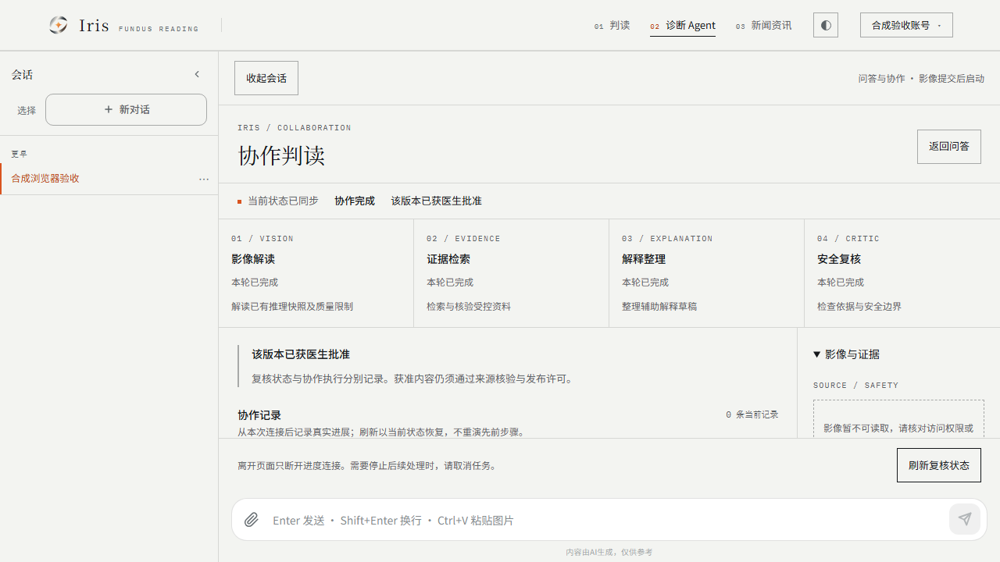
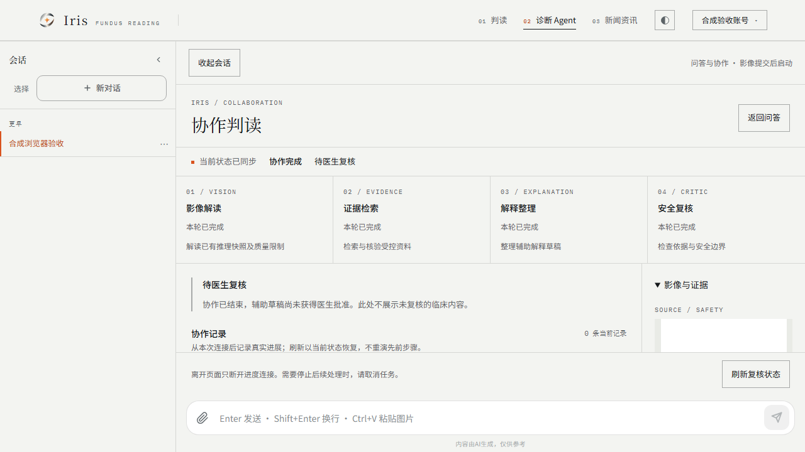

# TASK-07：权限、医疗审核与生产开关工程验收

2026-11-11。**本地权限/审核/开关工程专项 PASS；完整 TASK-07 生产放行与实时多 Agent 整体验收保持 PARTIAL。** 使用真实 Graph `1.1.2.2`、Coordinator、HTTP/SSE、Spring Session过滤器及隔离MySQL。模型、推理、对象存储和会话身份引导为确定性合成夹具。真实提供方请求 **0**，未追加或重用 TASK-06 的请求预算。

## 候选与输入

- 独立工作树 `D:/Work/code/eye-diagnosis/.claude/worktrees/realtime-safety-release`；分支 `codex/realtime-safety-release`。
- HEAD `6572743169027bb1e7c27d7d969a26ed89d99cd1` 加未提交内容；未暂存、提交、推送、合并、部署或修改远端工单。未刷新远端引用。
- 原样引入TASK-05的React/浏览器候选，再组合TASK-02的Graph/V19/领域守卫；审核重叠文件并保留两侧CI的Graph及web job、V19测试DDL与浏览器启动入口。未复制原Java树的OOD/V15变更，未合并master或Python后端分支。
- [开工输入清单](realtime-safety-release-20261111/inputs.json)冻结七个输入树的HEAD、暂存区和全部未提交文件路径/哈希：原Java树34、SPIKE 7、Coordinator事件18、React事件186、UI 229、Graph运行时34、TASK-06 53。结束核验全部未变。
- [结果清单](realtime-safety-release-20261111/results.json)绑定当前候选、TASK-07新增/整合差异、逐用例结果和原始报告SHA-256。实际验收对象包含未提交文件，不能仅用HEAD代表。

## 本卡实现

新增默认关闭的 `admission-enabled`、`patient-progress-enabled`、`clinician-detail-enabled`；总开关和Graph开关也显式在默认配置中关闭。停止新受理后，原幂等键仍可回放，已有run由原runtime继续执行。关闭展示终止对应投影读取与订阅，不取消后台任务；owner/admin仍可显式取消，医生/其他患者不能取消。

本人任务始终使用患者投影，即使账号是医生或管理员。完整冻结材料仅分配医生可读/决定；管理员能分配和读协作元数据，不能代替医生批准。协作成功仍是PENDING；批准后的患者解释、引用和首次保存继续复用既有来源/材料/版本门禁，保存需患者显式批准。

新增管理员只读 `GET /api/agent/collaboration-runs/operations`：开关、本地队列和全库按runtime/status/stopReason聚合计数，无患者标识、taskId/runId、正文或影像地址，不派发模型工作。权限矩阵、参数、监控接入边界和回退操作见[手册](../collaboration-release-runbook.md)。没有新增生产在线改开关接口；配置在实例启动时注入。

修复浏览器验证发现的SSE空闲连接问题：鉴权后的首批立即发送带扫描游标的真实heartbeat，随后恢复15秒节奏；水位/领域事实不变。避免快照之后没有新事件时，响应等15秒才发出、工作台持续停在“正在连接”。回归测试先实际失败，再修复通过。

## 本轮验证

环境：PowerShell7.6.9、Corretto21.0.7、Maven3.9.9、Node22.21.0、npm10.9.4、Playwright1.65.0、Chromium151.0.7922.34、临时MySQL8.0.26。MySQL在本卡target下独立初始化，仅监听loopback，六份测试schema各自使用测试专用账号；未修改现有业务实例或8081服务。

后端命令使用指定JDK21，设置各专项严格限定的测试库环境变量后运行：

```text
mvn -o -B -Dtest=CollaborationRunTest,GraphExecutionTest,PatientDraftTest,DoctorReviewApiTest,PatientExplanationApiTest,PatientAuthorizationApiTest,RealtimeGraphSpikeTest,CoordinationPocTest test
```

| 本轮检查 | 最终结果 |
| --- | --- |
| 协作事件/权限/开关/空闲首帧 | CollaborationRunTest 31项，含本卡9项 |
| Graph等价性/取消/fencing/跨JVM恢复 | GraphExecutionTest 32项 |
| 医生复核、患者发布、患者授权保存 | DoctorReviewApiTest 36、PatientExplanationApiTest 37、PatientAuthorizationApiTest 37项 |
| 原草稿、Graph SPIKE、基础PoC | PatientDraftTest 41、RealtimeGraphSpikeTest 12、CoordinationPocTest 4项 |
| 后端合计 | **230/230 PASS，0失败/错误/跳过** |
| React Vitest | **332/332 PASS，0失败/跳过** |
| typecheck / lint / 默认关闭生产构建 | PASS；已有大chunk提示保留，未升级依赖 |
| 浏览器真实HTTP/SSE/MySQL权限审核链 | **4/4 PASS，0跳过/flaky**，没有route.fulfill或替换协作/审核响应 |
| 默认关闭生产构建浏览器回归 | **1/1 PASS，0跳过**；普通聊天响应为合成SSE，协作请求0 |
| Surefire缺报/跳过/丢用例门禁单测 | **20/20 PASS**；专项预期协作例数更新为31，负例断言保留 |
| 事件源码契约 | PASS，14种事件、12个快照字段；协议v1未增加临床正文 |
| steering/design/probability、diff、七树输入核验 | PASS |

前端命令在 `web/`：`npm ci --offline --no-audit --no-fund --cache <已有缓存>`，`npm run typecheck`、`npm run lint`、`npm test -- --reporter=json --outputFile=../target/task07-vitest.json`、`npm run build`。锁文件未改变依赖。后端XML及日志在target；结果清单保留逐用例及哈希。

浏览器先显式运行test classpath的 `CollaborationBrowserServer` 和开启协作的Vite，执行 `npx --offline playwright test e2e/collaboration-safety.spec.ts --output=../target/task07-safety-browser --reporter=json`。默认关闭检查单独连接未设置开关的生产构建preview。起法与夹具边界见[浏览器说明](../../web/e2e/README.md)。

### 四项真实HTTP/SSE验收

1. **Graph与完整审核链**：真实上传合成1px PNG → Graph四角色 → SUCCEEDED/PENDING。患者解释无result，拟保存409；其他账号查询/SSE/取消403，未分配医生403。管理员分配后医生可读冻结材料及医生投影；患者/管理员/其他账号仍不能读完整复核材料，医生不能取消。批准后患者解释AVAILABLE，显式授权后保存；相同批准回放同一回执。来源撤回后解释重新受限、历史保存回执保持原样，无新增模型调用。
2. **展示撤回与排空**：Graph角色在途时关闭新受理、Graph选择与两种展示。浏览器主动订阅被拒绝并清除角色；管理员仍能查聚合。释放合成模型、恢复展示后，原run仍是Graph并完成为PENDING；原幂等键回放同run。
3. **Coordinator医生拒绝**：新运行按关闭Graph开关选择Coordinator；真实医生REJECTED，患者解释无正文、保存409；React同步“医生复核未通过”，无内部草稿。
4. **决定前来源撤回**：Graph草稿分配后撤回来源；医生批准409，复核INVALIDATED，患者无解释、不能保存。执行历史仍SUCCEEDED，审核许可独立变化，不因刷新/读取新增调用。

React在这些测试中展示执行/审核状态；医生决定及患者保存由真实HTTP API驱动，**没有宣称已经交付React完整复核和保存页面**。身份引导与用户查询服务为受控夹具，协作鉴权使用实际Session过滤器、会话仓库与数据库授权。完整生产登录/Redis未在此运行。





两张当前Chromium截图已实际检查。没有修改产品样式，也没有将本卡截图等同完整可访问性或跨浏览器认证。

## 失败、修正与复算

- 初次启动因PowerShell嵌套命令提前展开环境变量失败，改用独立ps1。未放宽测试库隔离。
- 首次浏览器组1通过、1失败、2未执行；故障截图显示空闲SSE一直“正在连接”。新增 `idleSubscriptionImmediatelyEmitsAuthenticatedHeartbeatAtSnapshotWatermark` 在原实现上实际失败；首批真实心跳修复后，该测试及4项浏览器全部通过。失败没有改为跳过或延长等待来掩盖。
- 一次扩大回归并行运行浏览器启动脚本的Maven编译，重写target/classes，4个Graph恢复子进程报NoClassDefFoundError。停止并发Maven后，串行重跑完整230项；失败日志保留 `target/task07-concurrent-compile-failure.log`，不计入最终通过。
- 原TASK-05/02报告是输入历史记录；本报告只使用当前实际重跑结果。TASK-06未重跑，仍保留31/48与两次超时及PARTIAL，不因本卡升级模型质量结论。

不触发网络的复算：

```text
python -m unittest discover -s scripts/tests -p test_check_surefire_skips.py
python scripts/check_surefire_skips.py target/surefire-reports collaboration
python scripts/check_surefire_skips.py target/surefire-reports graph-execution
python scripts/check_surefire_skips.py target/surefire-reports issue19
python scripts/check_surefire_skips.py target/surefire-reports issue20
python scripts/check_surefire_skips.py target/surefire-reports issue21
python scripts/check_surefire_skips.py target/surefire-reports issue22
python scripts/task07_inputs.py
python scripts/collect_task07_evidence.py
```

## 未放行项及回退

正常医学图像/Python/OOD、真实模型扩大重复评估和自然补证均未在本卡验证。医生完整React复核/患者保存UI、完整授权影像/引用工作台、全新空会话提交仍有原范围缺口。无真实医生资格/医学语义金标准，不宣称临床有效。

未运行全后端/hosted CI、目标环境Flyway历史兼容、真实多实例配置切换、旧二进制回退、生产SLO/容量与告警投递。患者授权专项在临时空库应用Java迁移集合，不能证明Java/master V15–17历史分歧已解决，也未复制缺失的V15。

已验证的回退是停止新受理/切换新运行时/关闭展示、让原Graph完成或显式持久取消；保留审核、授权、事件及checkpoint历史。生产总开关/旧二进制回退必须先排空并证明兼容，不能删除表或修改Flyway历史。

结束时本卡临时数据库、浏览器后端和前端服务均已关闭，所有默认产品开关保持关闭；源码及七个输入树核验通过。整体仍为PARTIAL，后续需要补齐上述独立产品/医学/生产门禁，不能直接生产放行。
