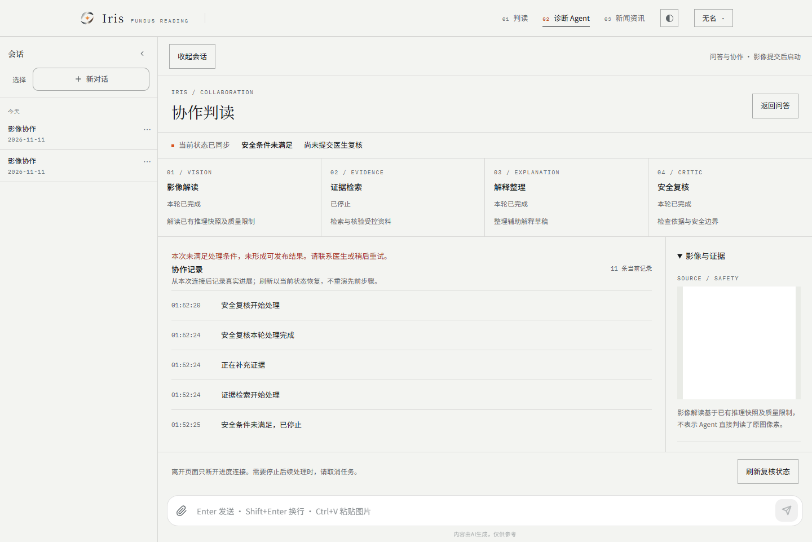

# 实时多 Agent 完整产品验收

2026-11-12，验收基线为实时多 Agent v1.1 方案及 E2E-01～20。**整体 PARTIAL，不放行生产。** 本轮补齐并验证了 React 工程产品闭环；真实提供方的两次正常尝试均未达到可复核状态，医学正常链路和生产门禁仍未完成。另外发现继承的 CI 用例数量契约与当前源码不一致，完整跳过门禁实际失败。

## 候选与范围

- 工作树 `D:/Work/code/eye-diagnosis/.claude/worktrees/realtime-product-acceptance`，分支 `codex/realtime-product-acceptance`；HEAD `6572743169027bb1e7c27d7d969a26ed89d99cd1` 加未提交内容。未暂存、提交、推送、合并、部署或修改远端工单。
- [输入冻结](product-acceptance-20261112/inputs.json)记录八个输入工作树的 HEAD、暂存区和变更文件哈希；全部核验未变。原样引入 TASK-07 候选，并明确加入原 Java 树已有的 V15 空库用户表依赖；没有搬入其他 OOD 或历史 Vue 改动。
- [结果清单](product-acceptance-20261112/results.json)绑定实际候选文件、逐后端用例、浏览器用例和证据哈希。真实实验另在首个请求前冻结 [792 个源文件及编译类](product-acceptance-20261112/live-preregistration.json)，运行后验证一致。
- 正式产品为 React `web/`。浏览器链使用真实注册、BCrypt 登录、MyBatis 用户/会话映射、Spring Session + 独立 Redis、MySQL、HTTP/SSE、实际 Graph/Coordinator、审核/发布/授权领域服务。推理、对象存储和来源库是明确的合成工程替身；普通回归的角色模型也为确定性替身。测试服务不等同完整生产 Boot 部署。

## 本轮完成的产品补齐

1. 空会话可直接上传：真实身份创建/确认所属会话，不需先发送文本、不调用模型；冲突归属、过期与非活动会话拒绝受理。
2. 新增 V20 前向迁移补齐实际聊天会话/消息表；保留小驼峰字段和原迁移。空库注册登录、会话创建及 V14→V20 迁移测试通过。没有宣称解决 Java/master 历史迁移分歧。
3. `/doctor-reviews` 提供管理员明确分配、医生读取冻结版本/来源/条目标识/结构化交接与异议、非空意见批准/驳回。完整模型上下文和隐藏推理不渲染。
4. 新增授权原图接口：仅本人或明确分配医生可读取绑定对象版本；核对摘要、大小与格式，并在存储读取后重新鉴权。元数据管理员不能读其他患者原图；前端清理 Blob URL。
5. 患者获批后可查看逐条依据、完整拟存内容、显式勾选授权和唯一保存回执；刷新回放相同回执。来源失效/请求冲突清除旧正文及勾选状态，保存不自动重试。
6. 修复实际 Java 数字时间戳导致会话列表刷新崩溃的问题，并统一历史消息时间；保留实际红/绿证据。未更改事件 v1 临床正文白名单或安全门禁。

## 本轮实际验证

环境：PowerShell 7.6.9、Corretto 21.0.7、Maven 3.9.9、Node 22.21.0、Playwright 1.65.0、Chromium 151、隔离 MySQL 8.0.26、Redis 7.2.4。所有数据库测试限定一次性测试 schema；未改变本机业务数据库、已有应用或原容器。

| 检查 | 本轮结果与边界 |
| --- | --- |
| 全后端 Maven | **417 项：414 通过、3 跳过、0 失败/错误**；最终运行 5:11，结束 01:48:07 +08:00 |
| 三项跳过 | VectorStoreConfigTest 1、RAGEvaluationTest 2；外部 embedding/医学来源评估未启用，不能计为通过 |
| 本轮新增后端专项 | **20/20**：空会话 8、原图授权 7、新库依赖 1、真实调用计量器 4；专项缺报/跳过门禁通过 |
| React Vitest | **339/339**，0 失败/跳过 |
| typecheck / lint / 默认关闭构建 | 通过；构建保留已有大 chunk 提示 |
| 真实认证、Redis、HTTP/SSE 产品浏览器 | **16/16**，0 跳过/flaky；包含医生页面决定、患者页面明确授权与唯一保存 |
| 浏览器契约/四张截图 | **12/12**，0 跳过/flaky；合成 API 夹具，与真实后端结果分开 |
| 默认关闭生产构建浏览器 | **1/1**；普通聊天为合成 SSE，协作请求 0 |
| 真实提供方实验驱动 | **1/1 驱动检查通过**；实际可复核候选为 **0/2**，不能把驱动通过计作模型成功 |
| Surefire 门禁脚本单测 | **21/21**；本轮 product 专项 20 项无缺报/跳过 |
| 完整 backend-unit 跳过门禁 | **FAIL**：继承契约要求 DiagnosisTaskApiTest 15 项，源码/报告实际 7 项；源码与 HEAD 相同、该文件无本轮改动，未下调契约 |
| wire / steering / design / probability / diff | 通过；14 种事件、12 个快照字段；八个输入工作树保持不变 |
| hosted CI / 部署环境 | NOT_RUN，没有远端绿色或生产验证证据 |

16 项产品浏览器涵盖：空会话上传、双角色增量并行、刷新不重复执行、完整审核保存；患者/其他患者/未分配医生/管理员的查询/SSE/取消/原图/冻结材料负例；真实 Graph 确定性重写与补证；401/429/503/非法 JSON/非法引用/质量/OOD 故障夹具；取消与退出；批准前来源撤回；移动亮暗主题/键盘/减弱动效；Coordinator 驳回；拟存内容展示后来源撤回阻止保存。提供方故障夹具不等于实际提供方发生过这些错误。

## 独立真实提供方实验

用户明确授权新预算 **最多 32 次，含失败和超时，不自动重试**。TASK-06 的 31/48 历史预算没有沿用。[预先固定方案](../plans/2026-11-12-product-acceptance-live-protocol.md)规定 Graph、Coordinator 各一次，不替换失败样本；两项安全负例必须零调用。

锁定 `qwen3.5-plus`、temperature 0.2、thinking=false、max_tokens 4000、stream=false；JDK HTTP 连接/方法重试关闭，重定向关闭。先持久化 reservation/请求摘要，再发送；唯一启动标记阻止重开计量器。密钥只注入子进程，不公开提示词和完整原始响应。

| 固定样本 | 真实请求 | 结果 | 自然反馈与后续 |
| --- | --- | --- | --- |
| OOD 未评估 | 0 | RESTRICTED | 未启动角色模型 |
| 质量拒识 | 0 | RESTRICTED | 未启动角色模型 |
| Graph | 5 | RESTRICTED / INSUFFICIENT_EVIDENCE；23.388s 至观测终态 | Critic 自然 SUPPLEMENT，有 claim:c1/c2/c4 定位；Evidence 实际再调用，未形成新的合格证据或修订草稿 |
| Coordinator | 6 | RESTRICTED / FEEDBACK_LIMIT；36.443s 至观测终态 | Critic 自然 REWRITE，生成第 2 版草稿；再次 Critic 自然 SUPPLEMENT，被反馈上限停止 |

**合计 11/32 次，11 次 HTTP 200，0 失败、0 超时、0 自动重试。** 实际已返回 usage：输入 6,951、输出 2,467、总 9,418 tokens；货币成本 NOT_AVAILABLE。剩余 21 次未使用，实验已封存，不补跑。本轮正常就绪 **0/2**，真实模型后续医生批准/患者保存均 **NOT_RUN_NOT_READY**；数据库核验审核、授权和诊断记录数均为 0。

证据：[请求台账](product-acceptance-20261112/real-provider-requests.json)、[实际终态](product-acceptance-20261112/real-provider-observations.json)、[结构化异议](product-acceptance-20261112/real-provider-structure.json)、[领域计数/版本/事件](product-acceptance-20261112/real-provider-domain-audit.json)、[封存](product-acceptance-20261112/live-seal.json)。私有原始传输留在忽略目录，逐份哈希已核对。

本轮使用合成 1px PNG、合成推理和一条合成工程来源；正常工程夹具的上下文包含 qualityScore=0，不能推断正常医学图像表现。补证没有新来源，Critic 的医学语义也未由临床金标准评分。自然重写/补证请求首次在本轮两条固定路径实际观察到，但没有成功的真实模型发布闭环，也不足以证明多 Agent 收益、稳定成功率或临床有效性。延迟含浏览器操作与轮询，仅 n=1/运行时，不计算 p95/SLO 或运行时优劣。



## E2E-01～20 覆盖结论

下表中的“工程通过”指本候选当前重跑的工程证据，不代表真实医学/生产端到端通过。逐用例名称和报告哈希在结果清单中。

| 基线项 | 当前证据 | 结论 |
| --- | --- | --- |
| 01 合法眼底图受理 | P01 真实上传/事件，但图像、推理为合成替身 | 工程通过；正常医学链路未验收 |
| 02 Vision/Evidence 并行 | P01、GraphExecutionTest 并行阻塞/汇合 | 工程通过 |
| 03 具体异议/收件人/修订 | P03 两种路由，真实实验自然反馈及领域审计 | 工程通过；医学语义未评估 |
| 04 刷新/断流补偿 | P01、12项浏览器、事件/Hook用例、跨JVM重放 | 工程通过 |
| 05 跨账号访问 | P02、CollaborationRunTest 权限负例 | 工程通过 |
| 06 提供方错误分类 | P04 四类故障、后端分类测试 | 故障夹具通过；真实错误未发生 |
| 07 引用/来源失效 | P04、P06、P09、发布/授权领域测试 | 工程通过 |
| 08 审核前后隔离 | P01 完整页面批准/保存、P08 驳回 | 工程通过；真实模型正常候选未就绪 |
| 09 切换会话/明确取消 | P05、浏览器/Hook作用域和迟到结果测试 | 工程通过 |
| 10 主题/手机/键盘/减弱动效 | P07、12项浏览器、实际检查截图 | Chromium工程通过；无跨浏览器/完整读屏认证 |
| 11 授权过滤跳号 | 协作后端投影、reducer/Hook契约、P02/P03 | 工程通过 |
| 12 快照/提交竞态 | concurrentSnapshot、事务回滚/水位测试、重放 | 后端/前端分层通过；非生产故障演练 |
| 13 游标恢复 | opaqueCursors、P02跨投影、Hook恢复/不重建 | 工程通过 |
| 14 取消竞态 | Graph/Coordinator末次Critic、排队/迟到结果、P05 | 工程通过 |
| 15 崩溃恢复/fencing | GraphExecutionTest 跨JVM进程死亡/已提交复用 | 隔离MySQL工程通过；非生产多实例演练 |
| 16 开关与运行时固定 | 停止受理、Graph选择、在途排空和回放专项 | 工程通过；生产配置同步未演练 |
| 17 订阅授权撤回 | 后端医生撤权/会话失效、P05实际Redis退出清理 | 工程通过 |
| 18 医学受限输入 | P04、真实实验两个零调用负例 | 受限安全路径通过；合格正常OOD输入缺失 |
| 19 执行/审核分离 | P01/P06/P08/P09、审核/发布/授权领域测试 | 工程通过 |
| 20 慢消费者/乱序 | slowSubscriber 有界缓冲/重放、reducer/Hook消重恢复 | 分层工程通过；生产容量/SLO未验证 |

## 失败记录与剩余放行项

- 初次全后端运行的 contextLoads 因缺少 COS 配置报错：417项中 413通过、1错误、3跳过。保留原日志/XML；使用已存在本机配置中仅 COS 部分生成忽略的临时测试配置，配合独立 Redis/Chroma 测试 collection、假模型凭证和关闭的 loopback HTTPS 代理后，最终全套 414通过/3跳过。该环境修正没有授权未计量模型调用，临时凭证文件已清理。
- 实际页面暴露数字时间戳错误、测试 MVC 未应用生产 JsonConfig 导致 Long ID 舍入；分别修复真实时间适配和测试容器配置后回归。测试服务使用真实生产 JsonConfig，没有放宽医生分配鉴权。
- 四张历史工作台基线因授权原图和引用提示发生预期变化；保留原失败报告，检查实际桌面/手机亮暗截图后更新，再以不更新基线方式 **12/12** 通过。医生批准截图可能捕获重新装载影像时的占位，批准前实际影像可见性及两类接口权限均已断言。
- [独立放行门禁记录](product-acceptance-20261112/release-gates.json)明确保留 DiagnosisTaskApiTest 的 **15 vs 7** 基线契约失败。不能以 Maven BUILD SUCCESS 或 product 专项通过覆盖该失败；恢复缺失覆盖或确认契约历史需独立处理，不能直接降低门禁。
- 医学正常输入、可证明独立的数据分组/标签/模型来源、合格 OOD 工件和真实 Python 正常链路仍为 **BLOCKED_INPUTS / NOT_EVALUATED**。没有新医学材料，不制造工件或门槛。
- TASK-06 扩大医学评估、临床金标准/真实医生审核、稳定反馈改善与真实正常发布闭环未完成；本轮真实安全受限结果不替代这些门禁。
- 目标环境 Flyway 历史兼容、生产多实例开关/排空、旧二进制回退、容量/SLO、监控告警实际投递、完整 Boot→COS→Python→模型正常链路和 hosted CI 为 **NOT_RUN**。不执行生产启用/迁移或清除审计表。

任务状态：TASK-01～05 的当前工程回归具备证据；TASK-06 仍为 PARTIAL；TASK-07 的本地权限/审核/关闭开关工程通过，完整生产放行仍 PARTIAL。本轮产品验收工作已执行并落档，不能回答“全部任务已完成”。

## 复算与收尾

离线复算，不会发送模型请求：

```text
python scripts/product_acceptance_inputs.py
python scripts/freeze_product_acceptance_live.py
python -m unittest discover -s scripts/tests -p test_check_surefire_skips.py
python scripts/check_surefire_skips.py target/surefire-reports product
python scripts/collect_product_acceptance.py
```

全后端命令为指定 JDK21 下 `mvn -o -B ... test`，为每项显式设置独立测试库，使用临时 Boot 配置、独立 Redis 和禁用外部 HTTPS 的代理；最终日志 `target/product-backend-all.log`，XML `target/surefire-reports/`。前端运行 `npm run lint`、`npm run build`、`npm test -- --reporter=json --outputFile=../target/product-vitest.json`。浏览器逐文件运行 product-acceptance、collaboration、collaboration-default-off 和唯一一次 product-real-provider，retries=0；报告在 target，摘要与哈希已归档。重新执行真实实验不属于离线复算，不能删除启动标记后重跑。

结束核验见[清理记录](product-acceptance-20261112/cleanup.json)：本轮 MySQL/Redis/Java/Vite/preview 已关闭，只移除本轮创建的 Chroma collection，原有三个容器保持运行；临时凭证配置已删除。默认产品开关全部保持关闭，输入八树未变，暂存区为空。没有提交或发布。
